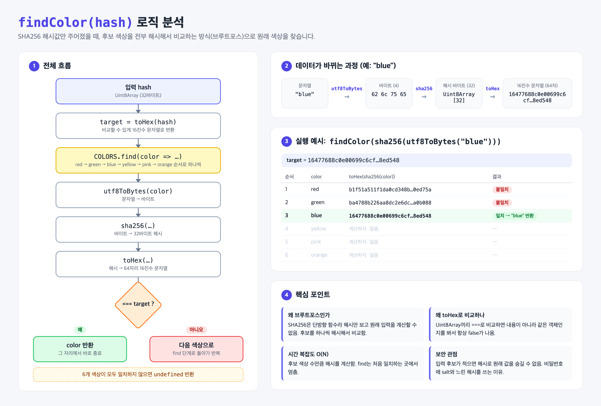

# 01. Find Favorite Color

## 문제

SHA256 해시값이 주어졌을 때, 어떤 색깔 문자열(`red`, `green`, `blue`, `yellow`, `pink`, `orange`)로 만든 해시인지 찾기.

## 풀이 아이디어

- SHA256은 **단방향 함수**라서 해시만 보고 원래 값을 계산할 수 없다.
- 대신 후보가 6개뿐이니, 후보를 전부 해시해서 주어진 해시와 같은 걸 찾는다 (브루트포스).

## 코드

```js
function findColor(hash) {
    const target = toHex(hash);
    return COLORS.find((color) => toHex(sha256(utf8ToBytes(color))) === target);
}
```



## 데이터가 바뀌는 과정

`"blue"` → `utf8ToBytes` → 바이트 `62 6c 75 65` → `sha256` → 32바이트 `Uint8Array` → `toHex` → 64자리 16진수 문자열

## 새로 배운 것

- **`Array.find()`**: 조건에 맞는 첫 번째 요소를 반환하고, 없으면 `undefined`.
  Python으로 치면 `next((c for c in COLORS if ...), None)`.
- **바이트 배열 비교**: `Uint8Array`끼리 `===`로 비교하면 내용이 아니라 "같은 객체인지"를 봐서 항상 `false`.
  그래서 `toHex`로 문자열로 바꾼 뒤 비교했다. (Python의 `bytes`는 `==`로 내용 비교가 되는 것과 다름)
- **시간 복잡도 O(N)**: 후보 수만큼 해시를 계산. `find`는 일치하는 순간 멈춘다.

## 보안 관점

후보가 적으면 해시로 원래 값을 숨길 수 없다. 그래서 비밀번호 저장에는 salt와 느린 해시(bcrypt 등)를 쓴다.

## 헷갈렸던 점 / 질문

- 
