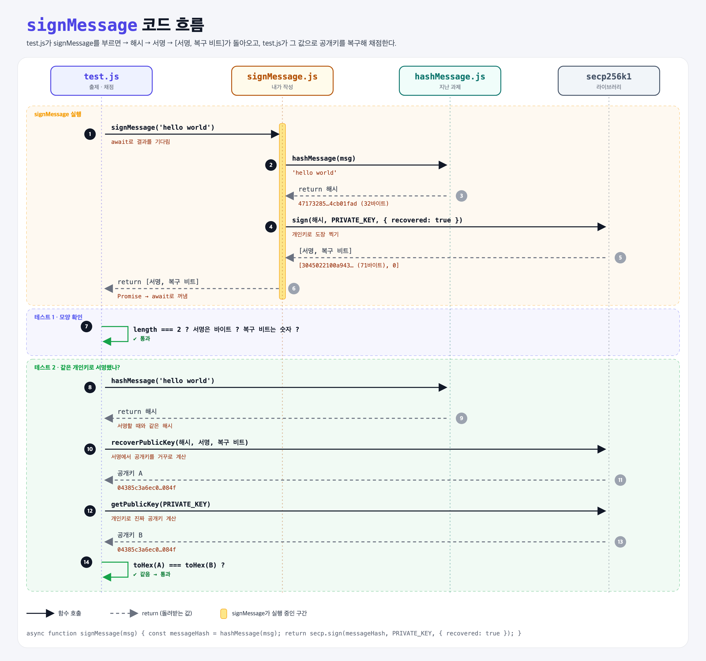

# 02. Sign Message

## 문제

메시지를 받아서 **개인키로 서명**하고, **서명과 복구 비트(recovery bit)를 함께** 돌려주는 `signMessage` 함수를 완성하기.

## 한 줄 요약

메시지를 **해시하고 → 개인키로 서명**해서 `[서명, 복구 비트]`를 돌려준다. 받은 사람은 이 값으로 공개키를 복구해서 "누가 서명했는지" 확인할 수 있다.



### 다이어그램 읽는 법

- 위쪽 상자 4개는 등장하는 파일과 라이브러리다. 아래로 갈수록 시간이 흐른다.
- 실선 화살표는 **함수 호출**, 점선 화살표는 **return(돌려받는 값)**이다. 화살표 아래 주황 글씨는 실제로 오가는 값이다.
- 번호 순서대로 따라가면 된다.

| 구간 | 번호 | 일어나는 일 |
|------|------|-------------|
| signMessage 실행 | ①~⑥ | test.js가 부름 → 해시 → 개인키로 서명 → `[서명, 복구 비트]`가 test.js로 돌아옴 |
| 테스트 1 | ⑦ | 돌아온 값이 2개이고, 서명은 바이트, 복구 비트는 숫자인지 확인 |
| 테스트 2 | ⑧~⑭ | 같은 해시로 공개키를 복구(A)하고, 개인키로 진짜 공개키(B)를 계산해서 A와 B가 같은지 비교 |

내가 작성한 코드는 노란 막대 구간(②~⑤)뿐이다. 나머지는 test.js와 라이브러리가 한다.

---

## 0. 이 과제가 말하려는 것

> **개인키로 해시에 도장을 찍으면, 서명만 보고도 누가 찍었는지(공개키를) 알아낼 수 있다.**

```
해시하기 ──→ [서명하기] ──→ 공개키 복구 ──→ 주소 만들기
지난 과제    ★ 이 과제       서명+해시+복구 비트   공개키 → 이더리움 주소
                            → 공개키             "이 주소가 보냈다"
```

- 지난 과제에서 만든 **32바이트 지문(해시)**에 **개인키로 도장**을 찍는 단계다.
- 서명할 때 **복구 비트**도 같이 만든다. 이걸로 서명에서 공개키를 거꾸로 알아낼 수 있다.
- 이더리움 거래에는 보낸 사람의 공개키가 들어 있지 않다. 대신 **서명 + 복구 비트**만 넣고, 네트워크의 누구나 여기서 공개키를 복구해 보낸 사람을 확인한다.

---

## 1. 파일 구성

| 파일 | 역할 |
|------|------|
| `hashMessage.js` | 지난 과제의 정답 그대로. 메시지 → keccak256 해시 |
| `signMessage.js` | **이번에 완성할 함수** |
| `test.js` | 출제 · 채점 (테스트 2개) |

---

## 2. 정답 코드

```js
const secp = require("ethereum-cryptography/secp256k1");
const hashMessage = require('./hashMessage');

const PRIVATE_KEY = "6b911fd37cdf5c81d4c0adb1ab7fa822ed253ab0ad9aa18d77257c88b29b718e";

async function signMessage(msg) {
    const messageHash = hashMessage(msg);
    return secp.sign(messageHash, PRIVATE_KEY, { recovered: true });
}

module.exports = signMessage;
```

### 한 줄씩

| 코드 | 설명 |
|------|------|
| `secp256k1` | 비트코인과 이더리움이 쓰는 서명 방식(타원곡선)의 라이브러리 |
| `PRIVATE_KEY` | 개인키 (16진수 64글자 = 32바이트). 연습용이라 코드에 적었지만, 실제로는 **절대 코드에 적으면 안 된다.** |
| `hashMessage(msg)` | 메시지를 먼저 32바이트 해시로 만든다. 서명은 메시지가 아니라 **해시에** 한다. |
| `secp.sign(해시, 개인키, 옵션)` | 해시에 개인키로 서명한다. |
| `{ recovered: true }` | **복구 비트도 같이 달라**는 옵션. 이게 있어야 `[서명, 복구 비트]` 배열이 온다. 없으면 서명만 와서 테스트 1에서 실패한다. |

`{ 키: 값 }`은 JS의 객체로, Python의 딕셔너리나 키워드 인자(`recovered=True`)와 비슷하다.

Python으로 쓰면:

```python
async def sign_message(msg):
    message_hash = hash_message(msg)
    return await secp.sign(message_hash, PRIVATE_KEY, recovered=True)
```

### 실제로 나오는 값 (`'hello world'`)

```
해시:       47173285a8d7341e...4cb01fad            (32바이트)
서명:       3045022100a9435a1c84ab3414...9c386289  (71바이트)
복구 비트:   0
공개키:     04385c3a6ec0b9d57a43...044d8f084f      (65바이트)
```

- 서명이 71바이트인 이유는 **DER**이라는 포장 형식 때문이다. 본체는 숫자 두 개(r, s, 각 32바이트)이고, 앞의 `30 45 02 21` 같은 형식 정보가 붙는다.
- 공개키 맨 앞의 `04`는 "압축하지 않은 공개키"라는 표시다. 그 뒤에 좌표 두 개(x, y, 각 32바이트)가 이어진다.
- 같은 메시지와 같은 개인키로 다시 서명해도 **똑같은 서명**이 나온다. 이 라이브러리는 서명에 필요한 무작위 값을 메시지와 개인키로부터 정해진 방식으로 만든다(RFC 6979).

---

## 3. test.js 한 줄씩

```js
const signMessage = require('./signMessage');       // 원래 '../signMessage' → './'로 수정
const hashMessage = require('./hashMessage');       // 원래 '../hashMessage' → './'로 수정
const { assert } = require('chai');
const secp = require("ethereum-cryptography/secp256k1");
const { toHex } = require("ethereum-cryptography/utils");

const PRIVATE_KEY = "6b911fd3...b29b718e";
```

### 테스트 1: 돌려주는 값의 모양 확인

```js
const response = await signMessage('hello world');
assert(response.length === 2, ...);              // 값이 2개인 배열이어야 함
const [signature, recoveryBit] = response;       // 구조 분해 (Python의 a, b = response)
assert(signature.length, ...);                   // 서명은 Uint8Array
assert(typeof recoveryBit === "number", ...);    // 복구 비트는 숫자
```

→ 함수는 **`[서명 바이트, 복구 비트 숫자]`**를 돌려줘야 한다.

### 테스트 2: 진짜 그 개인키로 서명했는지 확인

```js
const [sig, recoveryBit] = await signMessage('hello world');
const messageHash = hashMessage('hello world');
const recovered = secp.recoverPublicKey(messageHash, sig, recoveryBit);  // 서명에서 공개키 복구
const publicKey = secp.getPublicKey(PRIVATE_KEY);                         // 개인키로 진짜 공개키 계산
assert.equal(toHex(recovered), toHex(publicKey));                         // 같아야 통과
```

1. 내 함수로 서명을 받는다.
2. 같은 메시지를 해시한다.
3. **해시 + 서명 + 복구 비트만으로 공개키를 거꾸로 알아낸다.**
4. 개인키로 진짜 공개키를 계산한다.
5. 3과 4가 같으면 "이 서명은 그 개인키로 만든 게 맞다" → 통과

3번에 원문이 아니라 **해시**를 넣는다. 그래서 서명할 때도 해시에 해야 짝이 맞는다.

---

## 4. 복구 비트(recovery bit)란?

해시와 서명만 있으면 공개키를 수학적으로 거꾸로 계산할 수 있다. 다만 **후보가 2개** 나온다.

```
후보 0  04385c3a6ec0b9d57a43...  ✔ 진짜 공개키
후보 1  0484c70769957cfe90d7...  ✗ 엉뚱한 공개키
```

복구 비트(0 또는 1)는 **그중 몇 번째가 진짜인지** 알려주는 숫자다. 이번 예시에서는 0이다.

### 위조하면?

- 메시지를 `'hello world!'`로 한 글자만 바꾸고 같은 서명으로 복구하면 **다른 공개키**가 나온다. 그래서 위조가 바로 들킨다.
- 다른 개인키로 서명하면 복구된 공개키가 밥의 공개키와 다르다.

---

## 5. async / await

```js
async function signMessage(msg) { ... }               // 비동기 함수
const response = await signMessage('hello world');    // 결과를 기다렸다가 받음
```

- `secp.sign`(1.x 버전)은 결과 대신 **"나중에 결과를 주겠다는 약속(Promise)"**을 돌려주는 비동기 함수다.
- `async` 함수 안에서 약속을 `return`하면, 호출한 쪽이 `await`로 기다렸다가 결과를 꺼낸다.
- `return await secp.sign(...)`이라고 써도 결과는 같다.
- Python의 `async def` / `await`(asyncio)와 거의 같은 개념이다.

---

## 6. 라이브러리 버전 문제

강의 코드는 **ethereum-cryptography 1.x** 기준인데, 처음에 설치된 건 **3.x**였다.

| | 1.x (강의) | 3.x (최신) |
|---|---|---|
| 불러오는 값 | `secp.sign`, `secp.recoverPublicKey`, `secp.getPublicKey` | `{ secp256k1 }` 하나만 |
| `sign` | 비동기, `{ recovered: true }`로 `[서명, 복구 비트]` | 동기, 서명 객체 안에 `.recovery` |

3.x에는 test.js가 쓰는 `secp.recoverPublicKey`가 없어서 테스트가 돌아가지 않는다. 그래서 강의 버전을 설치했다.

```bash
npm install ethereum-cryptography@1.2.0
```

앞 문제들(`keccak256`, `sha256`, `toHex`, `utf8ToBytes`)은 1.x에서도 똑같이 동작해서 모두 통과한다.

---

## 7. 실행 방법

```bash
npx mocha 02-sign-message/test.js
```

```
  Sign Message
    ✔ should return both a signature and a recovery bit
    ✔ should have been signed by the same private key

  2 passing
```

## 기억할 것

1. **서명은 해시에 한다.** 복구할 때도 같은 해시를 써야 짝이 맞는다.
2. **`{ recovered: true }`**가 없으면 서명만 돌아와서 테스트 1에서 실패한다.
3. **`sign`은 비동기 함수**라서 `async` / `await`를 쓴다.
4. **메시지가 한 글자만 달라도** 복구된 공개키가 달라져서 위조가 들킨다.
5. **복구 비트** 덕분에 이더리움 거래에는 공개키 없이 서명만 넣으면 된다.

## 헷갈렸던 점

- 서명은 메시지 원문이 아니라 **해시**에 한다. 복구할 때도 같은 해시를 쓴다.
- `{ recovered: true }`를 빼먹으면 서명만 돌아와서 "값이 2개"라는 조건을 통과하지 못한다.
- 서명의 "개인키로 잠근다"는 숨기는 게 아니라 **나만 찍을 수 있는 도장**을 찍는 것이다. 누구나 공개키로 확인할 수 있다.
- 강의 test.js의 `../` 경로는 원래 test.js가 하위 폴더에 있어서 그런 것이다. 같은 폴더에 두면 `./`로 고쳐야 한다.
