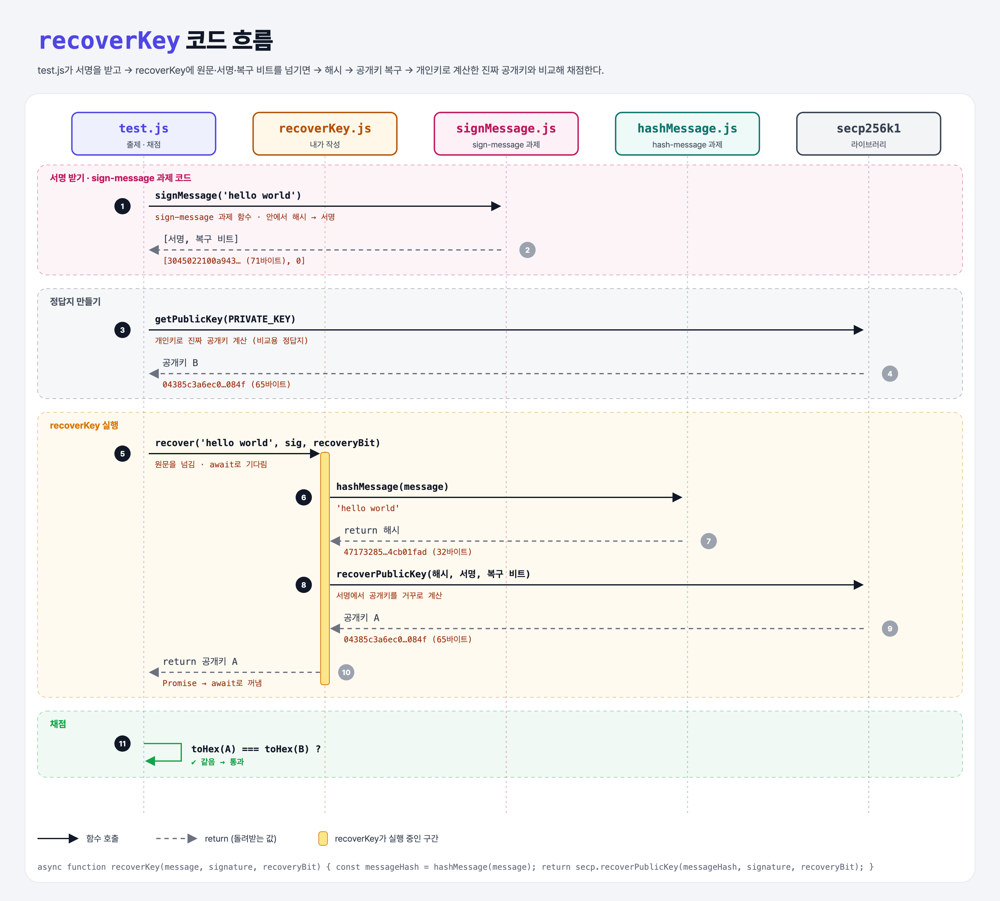

# 03. Recover Key

## 문제

메시지, 서명, 복구 비트(recovery bit)를 받아서 **서명한 사람의 공개키를 복구해 돌려주는** `recoverKey` 함수를 완성하기.
복구 함수에 넘길 때는 메시지를 **해시해서** 넘겨야 한다.

## 한 줄 요약

메시지를 **해시하고 → 해시 + 서명 + 복구 비트로 공개키를 거꾸로 계산**한다. 노드는 이렇게 "이 거래를 누가 서명했는지" 알아낸다.



### 다이어그램 읽는 법

- 위쪽 상자 5개는 등장하는 파일과 라이브러리다. 아래로 갈수록 시간이 흐른다.
- 실선 화살표는 **함수 호출**, 점선 화살표는 **return(돌려받는 값)**이다. 화살표 아래 주황 글씨는 실제로 오가는 값이다.
- 번호 순서대로 따라가면 된다.

| 구간 | 번호 | 일어나는 일 |
|------|------|-------------|
| 서명 받기 | ①~② | test.js가 sign-message 과제의 signMessage로 `[서명, 복구 비트]`를 받음 |
| 정답지 만들기 | ③~④ | 개인키로 진짜 공개키(B)를 계산해 둠 |
| recoverKey 실행 | ⑤~⑩ | 원문을 해시 → 해시·서명·복구 비트로 공개키(A) 복구 → test.js로 돌려줌 |
| 채점 | ⑪ | A와 B가 같은지 비교 |

내가 작성한 코드는 노란 막대 구간(⑤~⑩)뿐이다. 나머지는 test.js, 지난 과제 코드, 라이브러리가 한다.

---

## 0. 이 과제가 말하려는 것

> **서명에 복구 비트까지 들어 있으면, 공개키를 따로 보내지 않아도 서명한 사람을 알아낼 수 있다.**

```
해시하기 ──────→ 서명하기 ──────→ [공개키 복구] ──→ 주소 만들기
hash-message     sign-message     ★ 이 과제          공개키 → 이더리움 주소
                                  해시+서명+복구 비트
                                  → 공개키
```

- 지난 과제에서는 **보내는 쪽**(서명하는 사람)이었다면, 이번에는 **받는 쪽**(블록체인 노드)이다.
- 거래에는 "1 이더를 누구에게 보내고, 수수료는 얼마"라는 의도가 담긴다. 서명은 이 의도를 담은 **해시**에 찍혀 있으므로, 서명만으로 이 행동 전체를 인증할 수 있다.
- 지난 과제 test.js의 테스트 2에서 `secp.recoverPublicKey`를 이미 봤다. 이번에는 그걸 **내가 직접** 함수로 만드는 것이다.

---

## 1. 파일 구성

| 파일 | 역할 |
|------|------|
| `hashMessage.js` | hash-message 과제의 정답 그대로. 메시지 → keccak256 해시 |
| `signMessage.js` | sign-message 과제의 정답 그대로. 메시지 → `[서명, 복구 비트]` |
| `recoverKey.js` | **이번에 완성할 함수** |
| `test.js` | 출제 · 채점 (테스트 1개) |

---

## 2. 정답 코드

```js
const secp = require("ethereum-cryptography/secp256k1");
const hashMessage = require("./hashMessage");

async function recoverKey(message, signature, recoveryBit) {
    const messageHash = hashMessage(message);
    return secp.recoverPublicKey(messageHash, signature, recoveryBit);
}

module.exports = recoverKey;
```

### 한 줄씩

| 코드 | 설명 |
|------|------|
| `hashMessage(message)` | 메시지를 32바이트 해시로 만든다. 서명이 **해시에** 찍혔으니 복구도 **같은 해시로** 해야 한다. |
| `secp.recoverPublicKey(해시, 서명, 복구 비트)` | 세 값으로 공개키를 거꾸로 계산한다. 65바이트 `Uint8Array`(맨 앞 `04` + x, y 좌표)를 돌려준다. |
| `return` | 복구한 공개키를 돌려준다. 빼먹으면 `undefined`(Python의 `None`)가 돌아가서 test.js의 `toHex`에서 `Uint8Array expected` 에러가 난다. |
| `async` | 강의 틀에 원래 붙어 있던 것. `recoverPublicKey`는 동기 함수라 없어도 되지만, test.js가 `await recover(...)`로 부르므로 그대로 둬도 문제없다. |

Python으로 쓰면:

```python
async def recover_key(message, signature, recovery_bit):
    message_hash = hash_message(message)
    return secp.recover_public_key(message_hash, signature, recovery_bit)
```

### 라이브러리 문서에서 찾는 법

강의는 **noble-secp256k1 1.7.1** 문서를 보라고 한다. ethereum-cryptography 1.x가 내부에서 이 라이브러리를 쓰기 때문이다. 문서에 나온 함수 모양:

```
recoverPublicKey(msgHash, signature, recovery, isCompressed = false)
```

| 매개변수 | 넣는 값 |
|----------|---------|
| `msgHash` | 해시 (원문 X) |
| `signature` | 서명 |
| `recovery` | 복구 비트 (0 또는 1) |
| `isCompressed` | 압축 공개키(33바이트)로 받을지. 기본값 `false` → 65바이트. test.js의 `getPublicKey`도 기본이 65바이트라 그대로 두면 짝이 맞는다. |

---

## 3. test.js 한 줄씩

```js
const signMessage = require('./signMessage');   // 원래 '../signMessage' → './'로 수정
const recover = require('./recoverKey');        // 원래 '../recoverKey' → './'로 수정
const secp = require("ethereum-cryptography/secp256k1");
const { assert } = require('chai');
const { toHex } = require("ethereum-cryptography/utils");

const PRIVATE_KEY = "6b911fd3...b29b718e";
```

```js
const [sig, recoveryBit] = await signMessage('hello world');        // 1. 서명 받기
const publicKey = secp.getPublicKey(PRIVATE_KEY);                    // 2. 개인키로 진짜 공개키 계산 (정답지)
const recovered = await recover('hello world', sig, recoveryBit);   // 3. 내 함수로 공개키 복구
assert.equal(toHex(recovered), toHex(publicKey));                    // 4. 둘이 같으면 통과
```

- 지난 과제 테스트 2와 거의 같다. 차이는 **3번을 내 함수가 한다**는 것.
- 3번에 넘기는 건 **원문 `'hello world'`**다. 해시는 내 함수 안에서 해야 한다. 이걸 빼먹으면 에러 없이 엉뚱한 공개키가 나온다.
- `toHex`로 바꿔서 비교하는 이유: `Uint8Array`끼리 `assert.equal`로 비교하면 **내용이 아니라 같은 객체인지**를 보기 때문에 항상 실패한다. 문자열로 바꾸면 내용 비교가 된다. (Python의 `bytes`는 `==`로 내용 비교가 되는 것과 다르다.)

---

## 4. 실제로 나오는 값 (`'hello world'`)

```
해시:          47173285a8d7341e...4cb01fad      (32바이트)
서명:          3045022100a9435a1c84ab3414...9c386289  (71바이트)
복구 비트:      0
복구된 공개키 A: 04385c3a6ec0b9d57a43...044d8f084f  (65바이트)
진짜 공개키 B:  04385c3a6ec0b9d57a43...044d8f084f  ✔ 같음
```

### 일부러 틀려 보면

직접 돌려서 확인한 결과다.

| 바꾼 것 | 결과 |
|---------|------|
| 메시지를 `'hello world!'`로 | 다른 공개키가 나온다 → 위조가 들킨다 |
| 복구 비트를 0 → 1로 | 다른 후보 공개키가 나온다 |
| 해시 없이 원문 그대로 넘김 | 에러 없이 엉뚱한 공개키가 나온다 → 테스트 실패 |
| `return`을 빼먹음 | `undefined`가 돌아가서 `Uint8Array expected` 에러 |

---

## 5. 실행 방법

```bash
npx mocha recover-key/test.js
```

```
  Recover Key
    ✔ should recover the public key from a signed message

  1 passing
```

## 기억할 것

1. **복구할 때도 해시를 넘긴다.** 서명한 대상과 똑같은 해시여야 한다.
2. 순서는 **`recoverPublicKey(해시, 서명, 복구 비트)`**.
3. 이 덕분에 노드는 **거래에 공개키가 없어도** 누가 보냈는지 안다.
4. 바이트 배열은 `toHex`로 바꿔서 비교한다.

## 헷갈렸던 점

- test.js는 원문 `'hello world'`를 넘기는데, 라이브러리는 해시를 받는다. 그 사이에서 **해시하는 일이 내 함수 몫**이다.
- `async`가 붙어 있지만 `recoverPublicKey` 자체는 동기 함수다. `await`는 Promise가 아닌 값에 써도 그 값을 그대로 돌려주므로 문제없다.
- 강의 test.js의 `../` 경로는 같은 폴더에 두면 `./`로 고쳐야 한다.
