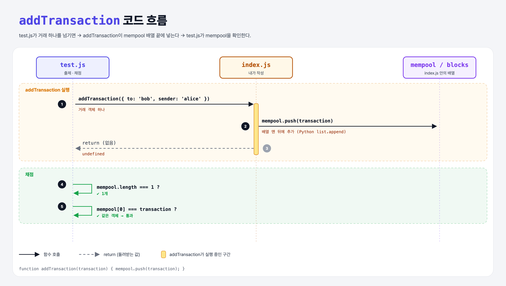

# Add Transaction (Proof of Work Miner 1단계)

## 문제

`addTransaction(transaction)` 함수를 완성해서, 받은 거래를 **mempool 배열에 추가**하기.

## 한 줄 요약

네트워크에서 받은 거래를 블록에 넣기 전까지 **대기실(mempool)**에 쌓아 둔다. → `mempool.push(transaction)`



### 다이어그램 읽는 법

- 위쪽 상자는 등장하는 파일과 값이다. 아래로 갈수록 시간이 흐른다.
- 실선 화살표는 **함수 호출**, 점선 화살표는 **return**이다. 주황 글씨는 실제로 오가는 값이다.

| 구간 | 번호 | 일어나는 일 |
|------|------|-------------|
| addTransaction 실행 | ①~③ | 거래 객체를 받아 mempool 배열 끝에 넣음 |
| 채점 | ④~⑤ | mempool에 1개 있고, 그게 방금 넣은 거래인지 확인 |

---

## 0. 이 과제가 말하려는 것

> **채굴자는 거래를 바로 블록에 넣지 않는다. 먼저 mempool에 모아 두고, 블록을 만들 때 꺼내 쓴다.**

```
[거래 받기 → mempool] → 블록 만들기 → 블록 해시 → 거래 담기 → 작업 증명
 ★ 이 단계               mine-block    block-hash   mine-transactions  target-difficulty
```

- **mempool**(memory pool)은 아직 블록에 들어가지 않은 거래들이 기다리는 곳이다.
- 실제 채굴자는 수수료가 높은 거래부터 골라 블록에 넣는다. 이 실습에서는 단순하게 배열에 차곡차곡 쌓는다.
- Proof of Work Miner는 5단계로, 같은 `index.js`를 한 단계씩 키워 간다.

---

## 1. 파일 구성

| 파일 | 역할 |
|------|------|
| `index.js` | 채굴기 전체. 이번 단계에서는 `addTransaction`만 채운다. |
| `test.js` | 출제 · 채점 (테스트 1개) |

`index.js`의 처음 상태:

| 이름 | 뜻 |
|------|----|
| `TARGET_DIFFICULTY` | 작업 증명의 목표값 (5단계에서 사용) |
| `MAX_TRANSACTIONS` | 블록 하나에 넣을 수 있는 거래 수 = 10 (4단계에서 사용) |
| `mempool` | 대기 중인 거래 배열 |
| `blocks` | 채굴된 블록 배열 |

---

## 2. 정답 코드

```js
function addTransaction(transaction) {
    mempool.push(transaction);
}
```

- `push`는 배열 맨 뒤에 값을 넣는다. Python의 `list.append()`와 같다.
- `mempool`은 `const`로 선언됐지만 내용은 바꿀 수 있다. `const`는 **다른 배열로 바꿔 끼우는 것**만 막는다. (Python에는 이런 구분이 없다.)

```python
def add_transaction(transaction):
    mempool.append(transaction)
```

---

## 3. test.js 한 줄씩

```js
const {addTransaction, mempool} = require('./index');   // 원래 '../index' → './'로 수정

const transaction = { to: 'bob', sender: 'alice' }   // 거래 하나 (Python의 dict)
addTransaction(transaction);
assert.equal(mempool.length, 1);           // mempool에 1개
assert.equal(mempool[0], transaction);     // 그게 방금 넣은 바로 그 객체
```

- `module.exports`로 내보낸 `mempool`은 index.js 안의 **같은 배열**이다. 그래서 test.js에서 길이를 보면 함수가 넣은 결과가 보인다. (Python에서 모듈 변수 `index.mempool`을 보는 것과 같다.)

---

## 4. 일부러 틀려 보면

| 바꾼 것 | 결과 |
|---------|------|
| 함수 안을 비워 둠 | `mempool.length`가 0 → 실패 |
| `mempool = [transaction]`처럼 새 배열 대입 | `const`라서 `TypeError: Assignment to constant variable` |

---

## 5. 실행 방법

```bash
npx mocha week1/add-transaction/test.js
```

```
  addTransaction
    ✔ should add the transaction to the mempool

  1 passing
```

## 기억할 것

1. **mempool** = 블록에 들어가기 전 거래들의 대기실.
2. `push` = Python `append`.
3. `const` 배열도 내용은 바꿀 수 있다. 다른 배열로 바꿔 끼우는 것만 안 된다.

## 헷갈렸던 점

- 강의 test.js는 `../index`를 불러온다. 같은 폴더에 두면 `./index`로 고쳐야 한다.
