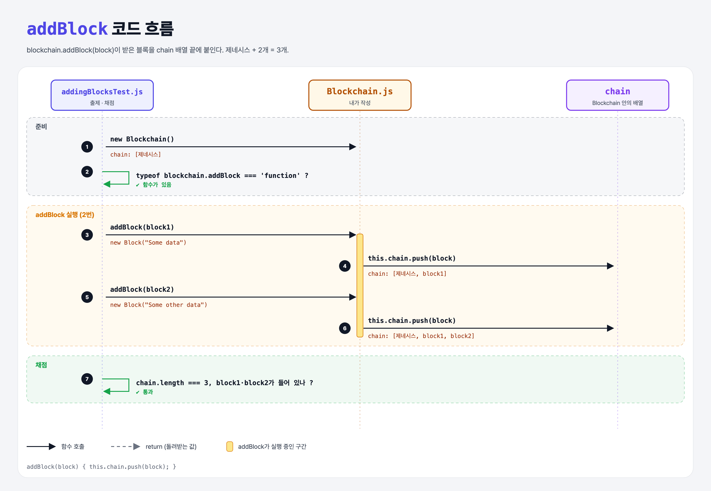

# Adding Blocks (Blockchain Data Structure 4단계)

## 문제

`Blockchain`에 `addBlock(block)` 메서드를 추가해서, 받은 블록을 `chain` 배열에 붙이기.

```js
const blockchain = new Blockchain();
blockchain.addBlock(new Block("Charlie sent Dave 2 BTC"));
console.log(blockchain.chain.length);   // 2 (제네시스 + 새 블록)
```

## 한 줄 요약

`addBlock`은 `this.chain.push(block)` 한 줄이다.



### 다이어그램 읽는 법

| 구간 | 일어나는 일 |
|------|-------------|
| 준비 | 새 Blockchain (제네시스 1개), `addBlock`이 함수인지 확인 |
| addBlock 실행 | block1, block2를 차례로 chain 끝에 붙임 |
| 채점 | 블록 3개, block1과 block2가 들어 있는지 확인 |

---

## 0. 이 과제가 말하려는 것

> **블록체인은 블록을 뒤에 계속 이어 붙이는 구조다.**

```
… → genesis-block → [블록 추가] → 블록 연결 → 체인 검증
                     ★ 이 단계
```

이번에는 그냥 붙이기만 한다. 다음 단계에서 붙일 때 앞 블록과 **연결**한다.

---

## 1. 파일 구성

| 파일 | 역할 |
|------|------|
| `Blockchain.js` | **이번에 고칠 클래스** |
| `Block.js` | 이전 단계 그대로 |
| `addingBlocksTest.js` | 출제 · 채점 (테스트 3개) |

---

## 2. 정답 코드

```js
class Blockchain {
    constructor() {
        this.chain = [new Block("Genesis Block")];
    }

    addBlock(block) {
        this.chain.push(block);
    }
}
```

```python
    def add_block(self, block):
        self.chain.append(block)
```

---

## 3. test 한 줄씩

```js
assert.equal(typeof blockchain.addBlock, 'function');   // addBlock이 함수로 있나

blockchain.addBlock(block1);
blockchain.addBlock(block2);
assert.equal(blockchain.chain.length, 3);               // 제네시스 + 2개
assert(blockchain.chain.some((x) => x === block1), "...");   // block1이 들어 있나
```

- `chain.some((x) => x === block1)`은 "하나라도 조건을 만족하면 true". Python의 `any(x is block1 for x in chain)`.
- `(x) => x === block1`은 화살표 함수. Python의 `lambda x: x is block1`.
- `===`는 **같은 객체인지**를 본다(객체일 때). 그래서 블록을 복사해서 넣으면 실패한다.

---

## 4. 일부러 틀려 보면

| 바꾼 것 | 결과 |
|---------|------|
| `this.chain = [block]` (덮어쓰기) | 제네시스가 사라져서 길이가 1 → 실패 |
| `this.chain.push({ ...block })` (복사본) | 길이는 3이지만 `x === block1`이 거짓 → 실패 |

---

## 5. 실행 방법

```bash
npx mocha week1/adding-blocks/addingBlocksTest.js
```

## 기억할 것

1. `push` = `append`.
2. `arr.some(fn)` = Python `any(...)`, 화살표 함수 = `lambda`.
3. 객체끼리 `===`는 "같은 객체인가".
