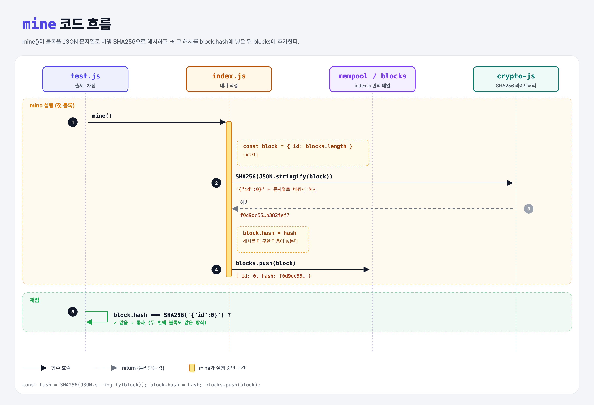

# Block Hash (Proof of Work Miner 3단계)

## 문제

블록을 채굴할 때 **블록의 해시를 구해서 `hash` 속성으로 넣기**.

1. 블록 객체를 `JSON.stringify`로 문자열로 바꾼다.
2. 그 문자열을 `SHA256`으로 해시한다.
3. 결과를 블록의 `hash` 속성에 넣는다.

⚠️ `hash` 속성은 **해시를 다 계산한 다음에** 넣어야 한다.

## 한 줄 요약

블록 내용 전체를 해시해서 블록의 **지문**으로 붙인다. 내용이 하나라도 바뀌면 지문도 바뀐다.



### 다이어그램 읽는 법

| 구간 | 일어나는 일 |
|------|-------------|
| mine 실행 | `{ id: 0 }` → 문자열 `'{"id":0}'` → SHA256 → `block.hash`에 저장 → blocks에 추가 |
| 채점 | 저장된 해시가 `SHA256('{"id":0}')`과 같은지 확인 (두 번째 블록도 같은 방식) |

---

## 0. 이 과제가 말하려는 것

> **블록 헤더를 통째로 해시한 값이 그 블록의 이름표다. 내용이 바뀌면 해시가 바뀌어서 위조가 드러난다.**

```
add-transaction → mine-block → [블록 해시] → 거래 담기 → 작업 증명
                                ★ 이 단계
```

- 각 블록은 이전 블록의 해시도 담는다. 그래서 중간 블록 하나를 고치면 그 뒤 모든 블록의 해시가 줄줄이 바뀐다. (이번 실습에서는 이전 해시까지는 넣지 않는다.)

---

## 1. 파일 구성

| 파일 | 역할 |
|------|------|
| `index.js` | 1~2단계 정답 + 이번 단계 해시 추가 |
| `test.js` | 출제 · 채점 (테스트 4개) |

---

## 2. 정답 코드

```js
function mine() {
    const block = { id: blocks.length };
    const hash = SHA256(JSON.stringify(block));
    block.hash = hash;
    blocks.push(block);
}
```

| 코드 | 설명 |
|------|------|
| `JSON.stringify(block)` | 객체 → JSON 문자열. `{ id: 0 }` → `'{"id":0}'`. Python의 `json.dumps`. |
| `SHA256(...)` | crypto-js의 SHA256. 결과는 **객체**(`WordArray`)이고, `toString()`하면 16진수 64글자가 된다. |
| `block.hash = hash` | 계산이 끝난 뒤에 속성을 붙인다. |

```python
def mine():
    block = {"id": len(blocks)}
    h = sha256(json.dumps(block, separators=(",", ":")).encode()).hexdigest()
    block["hash"] = h
    blocks.append(block)
```

(Python `json.dumps`는 기본으로 공백을 넣어서, JS와 같은 문자열을 만들려면 `separators`를 줘야 한다.)

### 왜 "다 계산한 다음에" 넣나?

해시를 먼저 넣고 계산하면 `hash` 속성까지 포함한 문자열을 해시하게 된다. 그러면 테스트가 기대하는 `SHA256('{"id":0}')`과 달라진다.

---

## 3. test.js 한 줄씩

```js
const expectedHash = SHA256(JSON.stringify({ id: 0 }));      // 정답 해시를 테스트가 직접 계산
const lastBlock = blocks[blocks.length - 1];
assert(lastBlock.hash, "did not find a hash property on the block");
assert.equal(lastBlock.hash.toString(), expectedHash.toString());   // 둘 다 16진수 문자열로 바꿔 비교
```

- `SHA256` 결과는 객체라서 `assert.equal`로 바로 비교하면 "같은 객체인지"를 본다. 그래서 `toString()`으로 바꿔 비교한다. (recover-key의 `toHex` 비교와 같은 이유)

---

## 4. 실제로 나오는 값

```
블록:        { id: 0 }
문자열:      '{"id":0}'
SHA256:     f0d9dc55adf56c34697a435bff3e62db6d2b6c7714793b4a497c640db382fef7
```

### 일부러 틀려 보면

| 바꾼 것 | 결과 |
|---------|------|
| `block.hash`를 먼저 넣고 다시 해시 | `8664d028…` → 기대값 `f0d9dc55…`와 달라서 실패 |
| `SHA256(block)` (문자열로 안 바꿈) | 객체를 그대로 넘겨 엉뚱한 해시 → 실패 |

---

## 5. 실행 방법

```bash
npx mocha week1/block-hash/test.js
```

```
  4 passing
```

## 기억할 것

1. 블록 해시 = `SHA256(JSON.stringify(block))`.
2. `hash` 속성은 계산이 **끝난 뒤** 붙인다.
3. crypto-js의 해시는 객체 → 비교·출력할 때 `toString()`.
