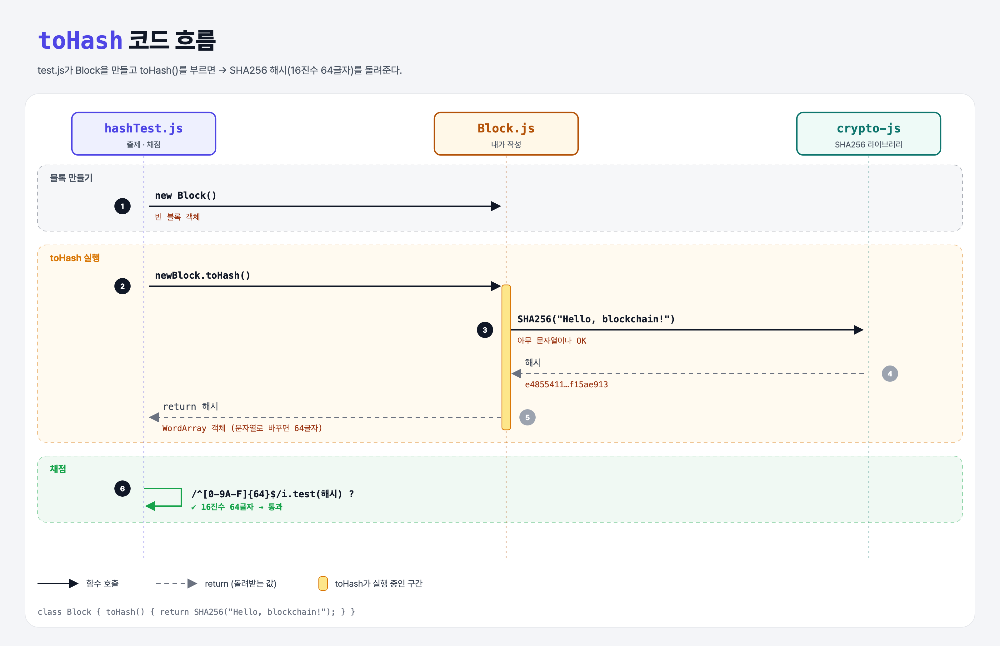

# Blocks and Hashes (Blockchain Data Structure 1단계)

## 문제

`Block` 클래스의 `toHash()`가 **올바른 해시**(16진수 64글자)를 돌려주게 하기. 무엇을 해시하든 상관없다.

## 한 줄 요약

블록마다 자기를 대표하는 **해시**가 있다. 일단은 아무 문자열이나 SHA256으로 해시해서 돌려준다.



### 다이어그램 읽는 법

| 구간 | 일어나는 일 |
|------|-------------|
| 블록 만들기 | test가 `new Block()`으로 블록 객체를 만듦 |
| toHash 실행 | SHA256으로 해시를 만들어 돌려줌 |
| 채점 | 결과가 16진수 64글자인지 정규식으로 확인 |

---

## 0. 이 과제가 말하려는 것

> **블록체인 = 블록이 해시로 줄줄이 이어진 사슬. 그 첫걸음은 블록이 자기 해시를 만들 수 있는 것.**

```
[블록 해시] → 데이터 해시 → 제네시스 블록 → 블록 추가 → 블록 연결 → 체인 검증
 ★ 이 단계   whats-in-a-hash  genesis-block   adding-blocks  linking-blocks  validating-chain
```

- 블록에는 거래 데이터, 블록 정보(메타데이터), 이전 블록과의 연결이 들어간다. 이걸 해시 함수에 넣으면 그 블록만의 고유한 값이 나온다.
- 이번 단계의 블록은 아직 아무것도 담고 있지 않아서, 아무 값이나 해시해도 된다.

---

## 1. 파일 구성

| 파일 | 역할 |
|------|------|
| `Block.js` | **이번에 완성할 클래스** |
| `hashTest.js` | 출제 · 채점 (테스트 1개) |

---

## 2. 정답 코드

```js
const SHA256 = require('crypto-js/sha256');

class Block {
    toHash() {
        return SHA256("Hello, blockchain!");
    }
}

module.exports = Block;
```

- `class Block { toHash() {...} }` = Python의 `class Block:` 안에 `def to_hash(self):`를 둔 것.
- JS 메서드에는 `self`를 따로 쓰지 않는다. 객체 자신은 `this`로 가리킨다 (다음 단계부터 사용).

```python
class Block:
    def to_hash(self):
        return sha256("Hello, blockchain!")
```

---

## 3. test 한 줄씩

```js
const Block = require('./Block');          // 원래 '../Block' → './'로 수정
const assert = require('assert');          // Node 내장 assert (chai 아님)

const newBlock = new Block();               // 객체 만들기. Python의 Block()
assert(/^[0-9A-F]{64}$/i.test(newBlock.toHash()));
```

정규식 `/^[0-9A-F]{64}$/i`:

| 부분 | 뜻 |
|------|----|
| `^` … `$` | 처음부터 끝까지 |
| `[0-9A-F]` | 16진수 글자 하나 |
| `{64}` | 정확히 64개 |
| `i` | 대소문자 무시 |

- `toHash()`는 문자열이 아니라 `WordArray` 객체를 돌려준다. `.test()`가 인자를 문자열로 바꾸면서 `toString()`이 불려 16진수 64글자가 된다.

---

## 4. 실제로 나오는 값

```
SHA256("Hello, blockchain!") → e485541186cd67682999c1ad80eac78fb803ec57885c26d5489efb01f15ae913
```

| 바꾼 것 | 결과 |
|---------|------|
| `return` 빼먹음 | `undefined` → 정규식 불일치로 실패 |
| `return "abc"` | 64글자가 아니라서 실패 |

---

## 5. 실행 방법

```bash
npx mocha week1/blocks-and-hashes/hashTest.js
```

## 기억할 것

1. 블록은 자기 내용을 해시한 값으로 식별된다.
2. JS 클래스: `class 이름 { 메서드() {} }`, 객체는 `new 이름()`.
3. crypto-js 해시는 객체 → 문자열로 바꾸면 16진수 64글자.
