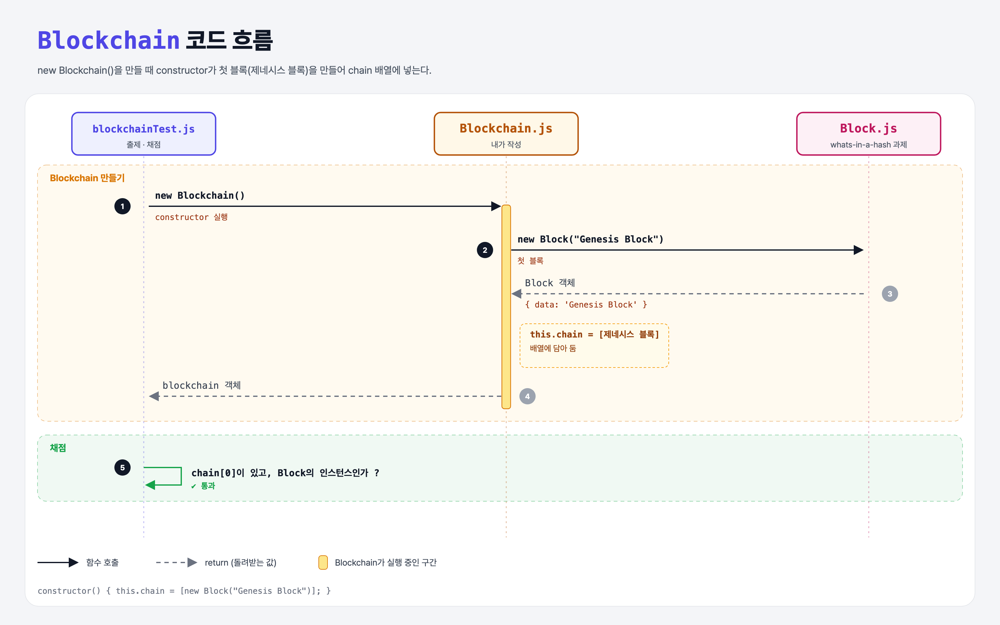

# The Genesis Block (Blockchain Data Structure 3단계)

## 문제

새 파일 `Blockchain.js`의 `Blockchain` 클래스 constructor에서 **첫 블록(제네시스 블록)을 만들어 `chain` 배열에 넣기**.

## 한 줄 요약

블록체인은 만들어지는 순간 **블록 하나(제네시스 블록)**를 가지고 시작한다.



### 다이어그램 읽는 법

| 구간 | 일어나는 일 |
|------|-------------|
| Blockchain 만들기 | constructor가 `new Block("Genesis Block")`을 만들어 `this.chain`에 담음 |
| 채점 | `chain[0]`이 있고, 그게 `Block` 객체인지 확인 |

---

## 0. 이 과제가 말하려는 것

> **모든 블록은 앞 블록을 가리킨다. 그러면 맨 처음 블록은? 앞이 없는 특별한 블록 = 제네시스 블록.**

```
blocks-and-hashes → whats-in-a-hash → [제네시스 블록] → 블록 추가 → 블록 연결 → 체인 검증
                                       ★ 이 단계
```

- 비트코인의 제네시스 블록은 2009년 1월 3일 사토시 나카모토가 채굴했다. 그 블록 데이터 안에는 당시 신문 헤드라인이 들어 있다.

---

## 1. 파일 구성

| 파일 | 역할 |
|------|------|
| `Blockchain.js` | **이번에 완성할 클래스** |
| `Block.js` | whats-in-a-hash 과제의 정답 그대로 |
| `blockchainTest.js` | 출제 · 채점 (테스트 1개) |

---

## 2. 정답 코드

```js
const Block = require('./Block');

class Blockchain {
    constructor() {
        this.chain = [new Block("Genesis Block")];
    }
}

module.exports = Blockchain;
```

```python
class Blockchain:
    def __init__(self):
        self.chain = [Block("Genesis Block")]
```

---

## 3. test 한 줄씩

```js
const blockchain = new Blockchain();
const genesisBlock = blockchain.chain[0];
assert(genesisBlock, 'Could not find the genesis block!');                       // 있나
assert(genesisBlock instanceof Block, 'genesis block should be a block!');       // Block 객체인가
```

- `instanceof`는 Python의 `isinstance(genesis_block, Block)`과 같다.

---

## 4. 일부러 틀려 보면

| 바꾼 것 | 결과 |
|---------|------|
| `this.chain = []` 그대로 | `chain[0]`이 `undefined` → 첫 assert 실패 |
| `this.chain = ["Genesis Block"]` (문자열) | `instanceof Block`이 거짓 → 두 번째 assert 실패 |

---

## 5. 실행 방법

```bash
npx mocha week1/genesis-block/blockchainTest.js
```

## 기억할 것

1. 제네시스 블록 = 체인의 0번 블록, 앞 블록이 없다.
2. `instanceof` = Python `isinstance`.
