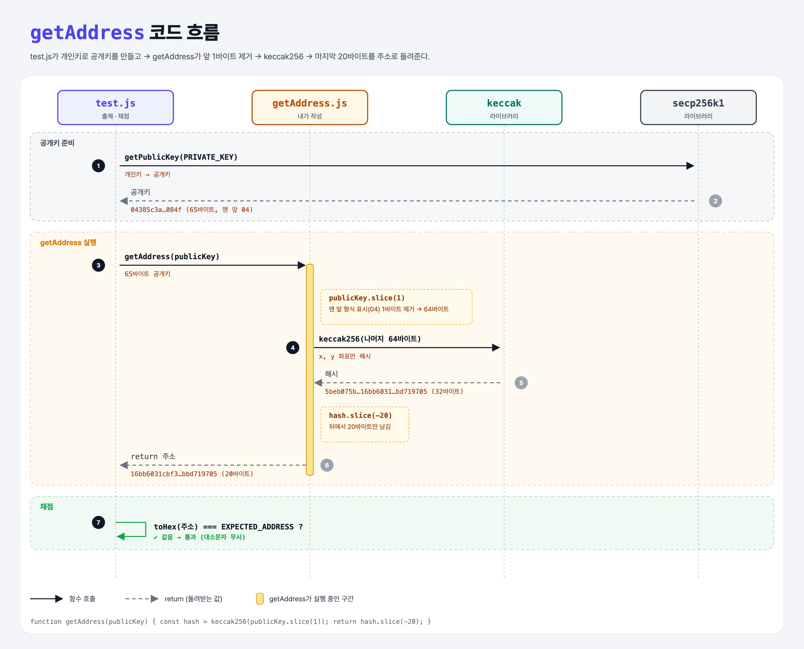

# Key to Address

## 문제

공개키(`Uint8Array`)를 받아서 **이더리움 주소**를 돌려주는 `getAddress` 함수를 완성하기.

1. 공개키의 **첫 바이트를 잘라낸다.** (압축 여부를 나타내는 형식 표시)
2. 나머지를 **keccak256으로 해시**한다.
3. 해시의 **마지막 20바이트**를 돌려준다.

## 한 줄 요약

이더리움 주소 = **keccak256(공개키에서 첫 바이트를 뺀 것)의 마지막 20바이트**.



### 다이어그램 읽는 법

- 위쪽 상자 4개는 등장하는 파일과 라이브러리다. 아래로 갈수록 시간이 흐른다.
- 실선 화살표는 **함수 호출**, 점선 화살표는 **return**이다. 주황 글씨는 실제로 오가는 값이다.
- 노란 점선 상자는 라이브러리를 부르지 않고 **내 함수 안에서 하는 일**이다.

| 구간 | 번호 | 일어나는 일 |
|------|------|-------------|
| 공개키 준비 | ①~② | test.js가 개인키로 65바이트 공개키를 만듦 |
| getAddress 실행 | ③~⑥ | 첫 바이트 제거 → keccak256 → 마지막 20바이트를 주소로 돌려줌 |
| 채점 | ⑦ | 16진수로 바꾼 주소가 정답 주소와 같은지 비교 |

---

## 0. 이 과제가 말하려는 것

> **주소는 공개키에서 만들어진다. 공개키만 있으면 언제든 주소를 다시 계산할 수 있다.**

```
해시하기 ──→ 서명하기 ──→ 공개키 복구 ──→ [주소 만들기]
hash-message  sign-message  recover-key    ★ 이 과제
```

- 비트코인은 주소를 만들 때 체크섬과 Base58 인코딩까지 거친다. 이더리움은 훨씬 단순해서 **공개키 해시의 마지막 20바이트**가 전부다.
- 앞 과제에서 서명으로 공개키를 복구했으니, 이제 그 공개키로 **"이 거래는 이 주소가 보냈다"**까지 알 수 있다. 공개키 Recovery → 주소 계산이 이더리움 거래 검증의 흐름이다.

---

## 1. 파일 구성

| 파일 | 역할 |
|------|------|
| `getAddress.js` | **이번에 완성할 함수** |
| `test.js` | 출제 · 채점 (테스트 1개) |

---

## 2. 정답 코드

```js
const secp = require("ethereum-cryptography/secp256k1");
const { keccak256 } = require("ethereum-cryptography/keccak");

function getAddress(publicKey) {
    const withoutFormatByte = publicKey.slice(1);
    const hash = keccak256(withoutFormatByte);
    return hash.slice(-20);
}

module.exports = getAddress;
```

### 한 줄씩

| 코드 | 설명 |
|------|------|
| `publicKey.slice(1)` | 1번 위치부터 끝까지 잘라 새 배열을 만든다. 맨 앞 1바이트(`04`)가 빠지고 64바이트가 남는다. |
| `keccak256(...)` | 남은 64바이트(x, y 좌표)를 해시한다. 결과는 32바이트. |
| `hash.slice(-20)` | 음수는 **뒤에서부터** 센다. 뒤에서 20번째부터 끝까지 → 마지막 20바이트. |

Python으로 쓰면 슬라이싱과 똑같다.

```python
def get_address(public_key):
    without_format_byte = public_key[1:]
    h = keccak256(without_format_byte)
    return h[-20:]
```

JS의 `slice(1)`은 Python의 `[1:]`, `slice(-20)`은 `[-20:]`과 같다.

### 첫 바이트는 왜 빼나?

공개키 맨 앞 바이트는 **형식 표시**다.

| 첫 바이트 | 뜻 | 길이 |
|-----------|-----|------|
| `04` | 압축 안 함. 뒤에 x, y 좌표가 다 있음 | 65바이트 |
| `02` / `03` | 압축함. x 좌표만 있고, y는 짝수/홀수만 표시 | 33바이트 |

주소는 좌표 값(64바이트)만으로 만든다. 형식 표시까지 같이 해시하면 전혀 다른 주소가 나온다.

---

## 3. test.js 한 줄씩

```js
const getAddress = require('./getAddress');   // 원래 '../getAddress' → './'로 수정
const PRIVATE_KEY = "6b911fd3...b29b718e";
const EXPECTED_ADDRESS = "16bB6031CBF3a12B899aB99D96B64b7bbD719705";

const publicKey = secp.getPublicKey(PRIVATE_KEY);          // 1. 개인키 → 공개키 (65바이트)
const address = toHex(getAddress(publicKey));              // 2. 내 함수로 주소 → 16진수 문자열
assert.equal(address.toLowerCase(), EXPECTED_ADDRESS.toLowerCase());  // 3. 비교
```

- `EXPECTED_ADDRESS`에 대문자와 소문자가 섞여 있는 건 **체크섬 주소(EIP-55)** 형식이라서다. 오타를 잡으려고 일부 글자를 대문자로 쓴다. 값 자체는 같으니 테스트는 둘 다 소문자로 바꿔 비교한다.

---

## 4. 실제로 나오는 값

```
공개키:     04 385c3a6ec0b9d57a...044d8f084f      (65바이트)
첫 바이트 뺀 것:  385c3a6ec0b9d57a...044d8f084f   (64바이트)
keccak256:  5beb075b01b157fecf430684 16bb6031cbf3a12b899ab99d96b64b7bbd719705
            └──── 앞 12바이트 버림 ───┘ └────────── 마지막 20바이트 = 주소 ──────────┘
주소:       0x16bb6031cbf3a12b899ab99d96b64b7bbd719705
```

### 일부러 틀려 보면

직접 돌려서 확인한 결과다.

| 바꾼 것 | 결과 |
|---------|------|
| 첫 바이트를 안 빼고 65바이트 통째로 해시 | `ee966d1e…b3b1a9` → 완전히 다른 주소 |
| `slice(-20)` 대신 `slice(0, 20)` (앞 20바이트) | `5beb075b…a12b` → 다른 주소 |

---

## 5. 실행 방법

```bash
npx mocha week1/key-to-address/test.js
```

```
  Get Address
    ✔ should get the address from a public key

  1 passing
```

## 기억할 것

1. 주소 = **keccak256(공개키[1:])[-20:]**
2. 첫 바이트(`04`)는 형식 표시라서 뺀다.
3. `slice(-20)`처럼 음수는 뒤에서부터 센다 (Python 슬라이싱과 같음).
4. 주소는 20바이트 = 16진수 40글자. 앞에 `0x`를 붙여 쓴다.

## 헷갈렸던 점

- `secp` import는 강의 틀에 있지만 이 함수에서는 쓰지 않는다. 지워도 된다.
- 주소의 대문자/소문자 섞임은 값이 다른 게 아니라 체크섬 표기다.
