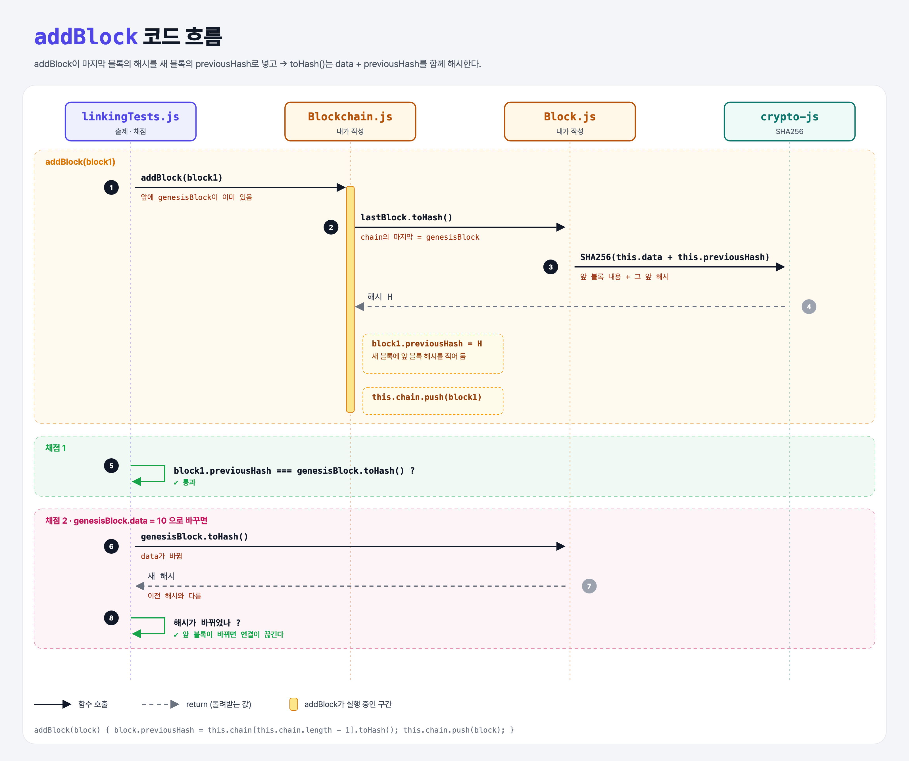

# Linking The Blocks (Blockchain Data Structure 5단계)

## 문제

1. 각 블록에 `previousHash` 속성을 넣는다. 값은 **체인에서 바로 앞 블록의 해시**.
2. 블록 해시를 계산할 때 `previousHash`도 **함께** 해시한다.

힌트: `addBlock`에서 블록을 체인에 넣을 때 `previousHash`를 붙이면 좋다. `SHA256("dog" + "cat")`처럼 `+`로 여러 값을 이어 해시할 수 있다.

## 한 줄 요약

새 블록에 **앞 블록의 해시**를 적어 두고, 그것까지 같이 해시한다. 그래서 앞 블록이 바뀌면 뒤 블록들의 연결이 다 깨진다.



### 다이어그램 읽는 법

| 구간 | 일어나는 일 |
|------|-------------|
| addBlock(block1) | 마지막 블록의 `toHash()` 결과를 `block1.previousHash`에 넣고 체인에 붙임 |
| 채점 1 | `block1.previousHash`가 앞 블록 해시와 같은지 확인 |
| 채점 2 | 앞 블록의 data를 바꾸면 해시가 달라지는지 확인 |

---

## 0. 이 과제가 말하려는 것

> **블록마다 앞 블록의 해시를 품고 있어서 "사슬"이 된다. 중간 하나를 고치면 그 뒤가 줄줄이 어긋난다.**

```
블록 0           블록 1                  블록 2
data: 제네시스   data: Dan               data: Peter
                 previousHash: 8e7a4bc3  previousHash: dcc96691
해시: 8e7a4bc3 ─┘해시: dcc96691 ─────────┘해시: 63fa0ce8
```

블록 0의 data를 바꾸면 해시가 `8e7a4bc3`에서 다른 값이 되고, 블록 1에 적힌 `previousHash`와 안 맞게 된다.

---

## 1. 파일 구성

| 파일 | 역할 |
|------|------|
| `Block.js` | **toHash 수정** (previousHash 포함) |
| `Blockchain.js` | **addBlock 수정** (previousHash 넣기) |
| `linkingTests.js` | 출제 · 채점 (테스트 3개) |

---

## 2. 정답 코드

```js
// Block.js
toHash() {
    return SHA256(this.data + this.previousHash);
}

// Blockchain.js
addBlock(block) {
    const lastBlock = this.chain[this.chain.length - 1];
    block.previousHash = lastBlock.toHash();
    this.chain.push(block);
}
```

| 코드 | 설명 |
|------|------|
| `this.chain[this.chain.length - 1]` | 체인의 마지막 블록 (Python `chain[-1]`) |
| `block.previousHash = ...` | push **하기 전에** 앞 블록 해시를 적어 둔다 |
| `this.data + this.previousHash` | 두 값을 문자열로 이어 붙인 뒤 해시 |

```python
def to_hash(self):
    return sha256(str(self.data) + str(self.previous_hash))

def add_block(self, block):
    block.previous_hash = self.chain[-1].to_hash()
    self.chain.append(block)
```

---

## 3. test 한 줄씩

```js
beforeEach(() => { blockchain = new Blockchain(); });       // 테스트마다 새 체인
genesisBlock = new Block(5);   block1 = new Block(5);
blockchain.addBlock(genesisBlock);  blockchain.addBlock(block1);

assert.equal(block1.previousHash.toString(), genesisBlock.toHash().toString());

genesisBlock.data = 10;                                       // 앞 블록 내용 바꾸기
assert.notEqual(initialGenesisHash, newHash, "...");          // 해시가 바뀌었나
```

- `beforeEach`는 **각** 테스트 전마다 실행된다 (`before`는 한 번).
- 테스트 이름이 `genesisBlock`이지만, 실제로는 진짜 제네시스 블록 **뒤에** 붙는 블록이다. 체인은 [제네시스, genesisBlock, block1].

---

## 4. 일부러 틀려 보면

| 바꾼 것 | 결과 |
|---------|------|
| `toHash`는 그대로 `SHA256(this.data)` | 연결은 되지만 previousHash가 해시에 안 들어가서 문제 조건 위반 |
| push한 **뒤에** 마지막 블록 해시를 넣음 | 자기 자신의 해시를 넣게 됨 → 채점 1 실패 |

---

## 5. 실행 방법

```bash
npx mocha week1/linking-blocks/linkingTests.js
```

## 기억할 것

1. `previousHash` = 앞 블록의 해시.
2. 블록 해시 = `SHA256(data + previousHash)`.
3. 앞 블록이 바뀌면 → 해시가 바뀌고 → 뒤 블록의 `previousHash`와 어긋난다.

## 헷갈렸던 점

- 제네시스 블록은 앞 블록이 없어서 `previousHash`가 `undefined`다. 그래서 `"Genesis Block" + undefined` = `"Genesis Blockundefined"`를 해시한다. 동작에는 문제없지만 실제 체인에서는 0으로 채운 값을 쓴다.
