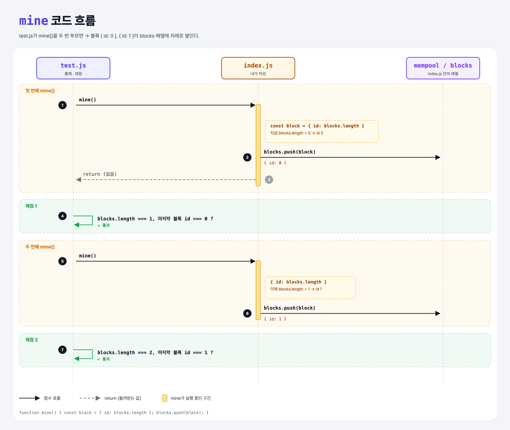

# Mine Block (Proof of Work Miner 2단계)

## 문제

`mine()` 함수가 **새 블록을 만들어 `blocks` 배열에 추가**하게 하기.

- 블록은 `id` 속성 하나만 가진 객체다.
- `id`는 **추가하기 전의 블록 높이**(지금까지 쌓인 블록 수)다.

## 한 줄 요약

`{ id: blocks.length }`를 만들어 `blocks`에 `push`한다. 첫 블록은 0번, 다음은 1번.



### 다이어그램 읽는 법

- 실선 화살표는 **함수 호출**, 점선 화살표는 **return**, 노란 점선 상자는 **함수 안에서 하는 계산**이다.

| 구간 | 일어나는 일 |
|------|-------------|
| 첫 번째 mine() | blocks가 비어 있어서 `id: 0`인 블록이 들어감 |
| 채점 1 | 블록 1개, id 0 확인 |
| 두 번째 mine() | blocks에 1개가 있어서 `id: 1`인 블록이 들어감 |
| 채점 2 | 블록 2개, 마지막 id 1 확인 |

---

## 0. 이 과제가 말하려는 것

> **블록마다 순서 번호(높이)가 있다. 새 블록의 번호는 "지금까지 쌓인 블록 수"다.**

```
add-transaction → [블록 만들기] → 블록 해시 → 거래 담기 → 작업 증명
                   ★ 이 단계
```

- 비트코인 블록 헤더에는 소프트웨어 버전, 시간, 거래들의 머클 루트, 이전 블록 해시, 난이도 등이 들어간다.
- 이 실습에서는 단순하게 `id` 하나로 시작해서, 다음 단계마다 속성을 하나씩 늘린다.
- **블록 높이**: 0번부터 센다. 블록이 0개일 때 만드는 블록은 0번(제네시스 블록).

---

## 1. 파일 구성

| 파일 | 역할 |
|------|------|
| `index.js` | 1단계(addTransaction) 정답 + 이번 단계 `mine` |
| `test.js` | 출제 · 채점 (테스트 4개) |

---

## 2. 정답 코드

```js
function mine() {
    const block = { id: blocks.length };
    blocks.push(block);
}
```

| 코드 | 설명 |
|------|------|
| `{ id: blocks.length }` | 객체 리터럴. Python의 `{"id": len(blocks)}`와 같다. |
| `blocks.length` | push **하기 전에** 읽으니 "추가 전 높이"가 된다. |
| `blocks.push(block)` | 블록 배열 맨 뒤에 추가. |

```python
def mine():
    block = {"id": len(blocks)}
    blocks.append(block)
```

---

## 3. test.js 한 줄씩

```js
describe('first block', () => {
    before(() => { hash = mine(); });          // 이 묶음의 테스트 전에 mine() 한 번
    it('should add to the blocks', () => assert.equal(blocks.length, 1));
    it('should store the expected id', () => {
        const lastBlock = blocks[blocks.length - 1];       // 마지막 블록 (Python의 blocks[-1])
        assert(lastBlock.id != null, "did not find an id property on the block");
        assert.equal(lastBlock.id, 0);
    });
});
describe('second block', ...)   // mine() 한 번 더 → 길이 2, id 1
```

- `before`는 그 `describe` 안의 테스트들이 돌기 전에 **한 번** 실행된다. (pytest의 fixture와 비슷)
- `blocks[blocks.length - 1]`: JS 배열은 `[-1]`이 안 돼서 길이에서 1을 뺀다.
- `!= null`은 `null`과 `undefined`를 둘 다 걸러 낸다. `id`가 0이어도 통과한다. (그냥 `assert(lastBlock.id)`라면 0은 거짓이라 실패한다.)
- `hash = mine()`처럼 반환값을 받지만, 이번 단계에서는 쓰지 않는다.

---

## 4. 일부러 틀려 보면

| 바꾼 것 | 결과 |
|---------|------|
| `id: blocks.length + 1` | 첫 블록 id가 1 → `expected 1 to equal 0` |
| push를 먼저 하고 id를 정함 | 순서가 꼬여 id가 하나씩 밀림 |

---

## 5. 실행 방법

```bash
npx mocha week1/mine-block/test.js
```

```
  mine
    first block
      ✔ should add to the blocks
      ✔ should store the expected id
    second block
      ✔ should add to the blocks
      ✔ should store the expected id

  4 passing
```

## 기억할 것

1. 새 블록 id = **추가 전** `blocks.length`.
2. JS의 마지막 원소: `arr[arr.length - 1]` (Python `arr[-1]`).
3. `before` = 테스트 묶음 전에 한 번 실행.

## 헷갈렸던 점

- 0도 올바른 id다. 그래서 테스트는 `!= null`로 "있는지"만 따로 확인한다.
