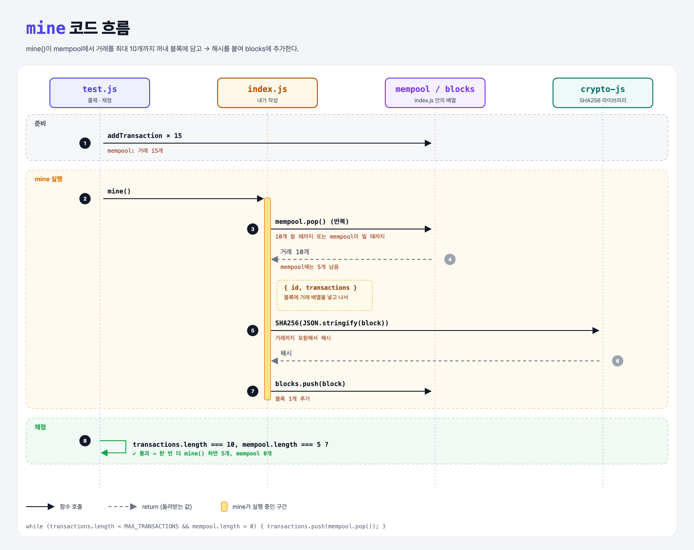

# Mine Transactions (Proof of Work Miner 4단계)

## 문제

`mine()`이 mempool에서 거래를 꺼내 블록의 `transactions` 배열에 담게 하기.

- 블록에 넣은 거래는 mempool에서 **빼야** 한다.
- 해시를 구하기 **전에** `transactions`를 블록에 넣어야 한다.
- ⚠️ 블록 하나에 `MAX_TRANSACTIONS`(10개)보다 많이 넣으면 안 된다.

## 한 줄 요약

mempool에서 **최대 10개**를 꺼내 블록에 담는다. 남은 거래는 다음 블록이 가져간다.



### 다이어그램 읽는 법

| 구간 | 일어나는 일 |
|------|-------------|
| 준비 | 테스트가 거래 15개를 mempool에 넣음 |
| mine 실행 | `pop`으로 10개를 꺼내 블록에 담고, 해시를 구해 blocks에 추가 |
| 채점 | 블록에 10개, mempool에 5개 남았는지 확인 → 한 번 더 mine()하면 5개 담기고 mempool은 0 |

---

## 0. 이 과제가 말하려는 것

> **블록에는 크기 제한이 있다. 다 못 담은 거래는 mempool에서 다음 블록을 기다린다.**

```
add-transaction → mine-block → block-hash → [거래 담기] → 작업 증명
                                            ★ 이 단계
```

- 비트코인은 블록 **용량**(바이트) 제한이 있어서, 거래 크기에 따라 들어가는 개수가 달라진다. 블록 크기를 얼마로 할지는 비트코인 역사에서 큰 논쟁거리였다.
- 이 실습에서는 단순하게 **개수**(10개)로 제한한다.

---

## 1. 파일 구성

| 파일 | 역할 |
|------|------|
| `index.js` | 1~3단계 정답 + 이번 단계 거래 담기 |
| `test.js` | 출제 · 채점 (테스트 9개) |

---

## 2. 정답 코드

```js
function mine() {
    const transactions = [];
    while (transactions.length < MAX_TRANSACTIONS && mempool.length > 0) {
        transactions.push(mempool.pop());
    }
    const block = { id: blocks.length, transactions };
    const hash = SHA256(JSON.stringify(block));
    block.hash = hash;
    blocks.push(block);
}
```

| 코드 | 설명 |
|------|------|
| `while (A && B)` | 블록이 10개 미만이고(A) mempool에 남은 게 있는 동안(B) 반복. `&&`는 Python의 `and`. |
| `mempool.pop()` | 배열 **맨 뒤**에서 하나를 빼서 돌려준다. mempool에서 사라진다. Python `list.pop()`과 같다. |
| `{ id: ..., transactions }` | `transactions: transactions`의 줄임말. 이름이 같으면 한 번만 써도 된다. |
| 해시는 그 다음 | 거래까지 들어간 블록을 해시해야 거래가 바뀌면 해시도 바뀐다. |

```python
def mine():
    transactions = []
    while len(transactions) < MAX_TRANSACTIONS and len(mempool) > 0:
        transactions.append(mempool.pop())
    block = {"id": len(blocks), "transactions": transactions}
    ...
```

### `pop` 대신 `splice`로도 된다

```js
const transactions = mempool.splice(0, MAX_TRANSACTIONS);   // 앞에서 최대 10개를 잘라 내고 돌려줌
```

`splice`는 원래 배열에서 잘라 낸 부분을 **빼면서** 돌려준다. 한 줄로 끝나지만, `while` 쪽이 흐름을 읽기 쉬워서 정답은 `while`로 썼다.

---

## 3. test.js 한 줄씩

```js
describe('with 5 mempool transactions', () => {
    before(() => { for (let i = 0; i < 5; i++) addTransaction({ sender: 'bob', to: 'alice' }); });
    describe('after mining', () => {
        before(() => { mine(); });
        it(...) assert.equal(blocks.length, 1);                                   // 블록 1개
        it(...) assert.equal(blocks[blocks.length - 1].transactions.length, 5);   // 거래 5개
        it(...) assert.equal(mempool.length, 0);                                  // mempool 비었음
    });
});
describe('with 15 mempool transactions', ...)   // 15개 → 블록에 10개, mempool 5개 → 다시 mine → 5개, 0개
```

- `for (let i = 0; i < 5; i++)`는 Python의 `for i in range(5):`.
- 테스트들이 같은 `blocks`, `mempool`을 이어서 쓰기 때문에 블록 수가 1 → 2 → 3으로 늘어난다.

---

## 4. 일부러 틀려 보면

| 바꾼 것 | 결과 |
|---------|------|
| `MAX_TRANSACTIONS` 조건을 빼고 다 담음 | 15개가 한 블록에 → `expected 15 to equal 10` |
| `pop` 대신 `mempool[i]`로 읽기만 함 | mempool이 안 비워짐 → `should clear the mempool` 실패 |
| 해시를 구한 뒤에 transactions를 넣음 | 이 테스트는 통과하지만, 해시가 거래를 보호하지 못한다 (문제 조건 위반) |

---

## 5. 실행 방법

```bash
npx mocha week1/mine-transactions/test.js
```

```
  9 passing
```

## 기억할 것

1. 블록당 거래 수 제한 → 남은 거래는 다음 블록으로.
2. 꺼낸 거래는 mempool에서 **제거**한다 (`pop`, `splice`).
3. 거래를 넣은 **다음에** 해시한다.
4. `{ transactions }` = `{ transactions: transactions }`.

## 헷갈렸던 점

- `pop`은 뒤에서부터 꺼내서 거래 순서가 뒤집힌다. 테스트는 개수만 보니 상관없지만, 순서가 중요하면 `shift`(앞에서 꺼냄)나 `splice(0, n)`을 쓴다.
