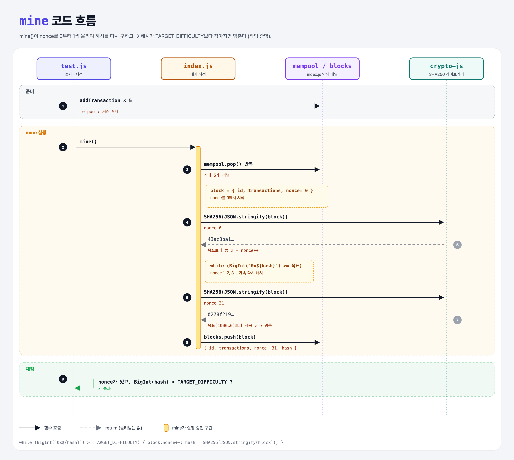

# Target Difficulty (Proof of Work Miner 5단계)

## 문제

블록을 진짜로 **채굴**하기 (작업 증명).

1. 해시를 구하기 전에 블록에 `nonce` 속성을 넣는다. 0에서 시작한다.
2. 해시가 `TARGET_DIFFICULTY`보다 **작아질 때까지** nonce를 바꿔 가며 다시 해시한다.

힌트: 해시를 BigInt로 바꾸려면 `BigInt(\`0x${hash}\`)`.

## 한 줄 요약

nonce를 0, 1, 2…로 올리며 해시를 계속 다시 구한다. **목표보다 작은 해시가 나올 때까지 반복하는 것**이 작업 증명(Proof of Work)이다.



### 다이어그램 읽는 법

| 구간 | 일어나는 일 |
|------|-------------|
| 준비 | 거래 5개를 mempool에 넣음 |
| mine 실행 | 거래를 꺼내고 nonce 0으로 해시 → 목표보다 크면 nonce++ 후 다시 해시 → nonce 31에서 목표보다 작아져서 멈춤 |
| 채점 | nonce가 있는지, 해시가 목표보다 작은지 확인 |

---

## 0. 이 과제가 말하려는 것

> **조건에 맞는 해시는 운에 맡기고 계속 시도하는 수밖에 없다. 그 "시도한 일의 양"이 블록의 신뢰가 된다.**

```
add-transaction → mine-block → block-hash → mine-transactions → [작업 증명]
                                                                ★ 이 단계
```

- 해시는 입력이 조금만 바뀌어도 완전히 달라지고, 결과를 미리 알 수 없다. 그래서 "작은 해시"를 찾으려면 nonce를 바꿔 가며 **무작정 시도**해야 한다.
- 찾기는 어렵지만, 검증은 해시 한 번이면 끝난다. 이 비대칭이 작업 증명의 핵심이다.
- 비트코인은 2016블록(약 2주)마다 난이도를 조정해서 블록이 평균 10분에 하나씩 나오게 한다.

---

## 1. 파일 구성

| 파일 | 역할 |
|------|------|
| `index.js` | 채굴기 완성본 (1~5단계) |
| `test.js` | 출제 · 채점 (테스트 15개) |

---

## 2. 정답 코드

```js
function mine() {
    const transactions = [];
    while (transactions.length < MAX_TRANSACTIONS && mempool.length > 0) {
        transactions.push(mempool.pop());
    }
    const block = { id: blocks.length, transactions, nonce: 0 };
    let hash = SHA256(JSON.stringify(block));
    while (BigInt(`0x${hash}`) >= TARGET_DIFFICULTY) {
        block.nonce++;
        hash = SHA256(JSON.stringify(block));
    }
    block.hash = hash;
    blocks.push(block);
}
```

| 코드 | 설명 |
|------|------|
| `nonce: 0` | "한 번만 쓰는 숫자(number used once)". 해시를 바꾸려고 일부러 넣는 값. |
| `let hash` | 반복하면서 다시 대입하니 `const`가 아니라 `let`. |
| `` `0x${hash}` `` | 템플릿 문자열. `hash`가 문자열로 바뀌어 들어간다. Python의 `f"0x{hash}"`. |
| `BigInt(...)` | 256비트 숫자는 일반 `Number`로는 정확히 못 다룬다. BigInt는 크기 제한이 없는 정수 (Python `int`와 같음). |
| `>=` 동안 반복 | 목표 **미만**이 나올 때까지. |
| `block.nonce++` | nonce를 1 올리고 블록 전체를 다시 해시. |

```python
block = {"id": len(blocks), "transactions": transactions, "nonce": 0}
h = sha256_hex(block)
while int(h, 16) >= TARGET_DIFFICULTY:
    block["nonce"] += 1
    h = sha256_hex(block)
```

Python은 `int`가 원래 크기 제한이 없어서 BigInt가 따로 필요 없다.

---

## 3. test.js 한 줄씩

4단계 테스트에 블록마다 두 개가 더 붙었다.

```js
it('should have a nonce', () => {
    assert.isDefined(blocks[blocks.length - 1].nonce, "did not find a nonce on the block");
});
it('should have a hash lower than the target difficulty', () => {
    const actual = blocks[blocks.length - 1].hash.toString();
    const isLess = BigInt(`0x${actual}`) < TARGET_DIFFICULTY;
    assert(isLess, "expected the hash to be less than the target difficulty");
});
```

- 문자열끼리 `<`로 비교하면 사전 순서라서 틀린다 (`"9" < "10"`은 `false`). 그래서 숫자(BigInt)로 바꿔서 비교한다.

---

## 4. 실제로 나오는 값 (거래 5개, 첫 블록)

```
nonce 0  → 43ac8ba1…   목표보다 큼 ✗
nonce 1  → …           ✗
  …
nonce 31 → 0278f219267f8487d39ab0ff0301724bf971207ad70ff45755aed99fd9e7c4c0  ✔ 목표보다 작음
목표      → 1000000000000000000000000000000000000000000000000000000000000000
```

목표가 `1` 뒤에 0이 63개 → 해시 맨 앞 글자가 `0`이면 통과한다. 16글자 중 1개이니 평균 16번쯤 시도하면 찾는다.

### 일부러 틀려 보면

| 바꾼 것 | 결과 |
|---------|------|
| `block.nonce++`를 빼먹음 | 같은 해시만 계속 나와서 **무한 반복** (테스트가 멈춤) |
| nonce를 블록에 안 넣고 따로 변수로만 셈 | 블록 내용이 그대로라 해시도 그대로 → 무한 반복 |
| 문자열로 비교 (`hash < '1000…'`) | 우연히 맞을 때도 있지만 숫자 비교가 아니라서 위험 |

---

## 5. 실행 방법

```bash
npx mocha week1/target-difficulty/test.js
```

```
  15 passing
```

## 기억할 것

1. 작업 증명 = **목표보다 작은 해시가 나올 때까지 nonce를 바꿔 가며 다시 해시**.
2. 찾기는 어렵고, 검증은 쉽다.
3. 256비트 숫자는 `BigInt`로 비교한다.
4. 반복에서 바뀌는 값은 `let`.

## 헷갈렸던 점

- `TARGET_DIFFICULTY = BigInt(0x0fff…f)`인데 실제 값을 찍어 보면 `0x1000…0`이다. `0x0fff…f`가 먼저 **일반 Number로 읽히면서 반올림**된 다음 BigInt가 되기 때문이다. 정확한 값을 원하면 끝에 `n`을 붙여 `0x0fff…fn`처럼 BigInt 리터럴로 써야 한다. 이 실습에서는 차이가 거의 없어서 그대로 둔다.
