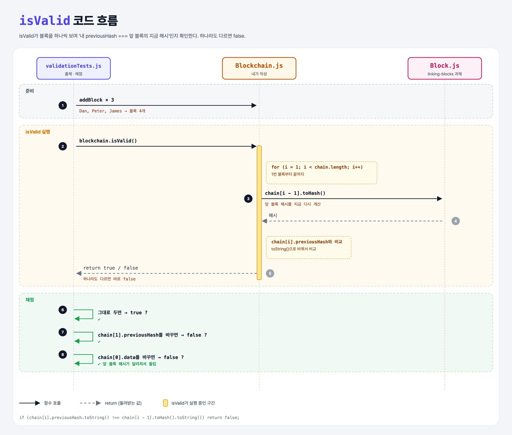

# Validating the Chain (Blockchain Data Structure 6단계)

## 문제

`Blockchain`에 `isValid()`를 만들기. 모든 블록의 `previousHash`가 **앞 블록의 해시와 같은지** 확인해서 `true`/`false`를 돌려준다.

힌트: `SHA256` 결과는 객체라서 `toString()`으로 바꿔 비교해야 한다.

```js
SHA256("a") === SHA256("a")                        // false (서로 다른 객체)
SHA256("a").toString() === SHA256("a").toString()  // true
```

## 한 줄 요약

1번 블록부터 끝까지 돌면서 `chain[i].previousHash === chain[i-1].toHash()`인지 본다. 하나라도 다르면 위조.



### 다이어그램 읽는 법

| 구간 | 일어나는 일 |
|------|-------------|
| 준비 | 블록 3개를 추가 → 체인에 4개 |
| isValid 실행 | 각 블록에서 앞 블록 해시를 **지금 다시 계산**해서 적혀 있는 previousHash와 비교 |
| 채점 | 그대로면 true, previousHash나 data를 건드리면 false |

---

## 0. 이 과제가 말하려는 것

> **노드는 받은 체인을 그대로 믿지 않고 직접 검증한다. 여러 버전이 있으면 "가장 긴 유효한 체인"을 따른다.**

```
… → adding-blocks → linking-blocks → [체인 검증]
                                      ★ 이 단계
```

---

## 1. 파일 구성

| 파일 | 역할 |
|------|------|
| `Blockchain.js` | **isValid 추가** |
| `Block.js` | linking-blocks 과제 그대로 |
| `validationTests.js` | 출제 · 채점 (테스트 3개) |

---

## 2. 정답 코드

```js
isValid() {
    for (let i = 1; i < this.chain.length; i++) {
        const previous = this.chain[i - 1];
        const current = this.chain[i];
        if (current.previousHash.toString() !== previous.toHash().toString()) {
            return false;
        }
    }
    return true;
}
```

| 코드 | 설명 |
|------|------|
| `i = 1`부터 | 0번(제네시스)은 앞 블록이 없어서 검사할 게 없다 |
| `previous.toHash()` | 저장된 값이 아니라 **지금 내용으로 다시 계산**한 해시. 그래서 data가 바뀌면 들킨다 |
| `!==` | 다르면 바로 `false` |
| 끝까지 통과 | `true` |

```python
def is_valid(self):
    for i in range(1, len(self.chain)):
        if str(self.chain[i].previous_hash) != str(self.chain[i - 1].to_hash()):
            return False
    return True
```

---

## 3. test 한 줄씩

```js
blockchain.addBlock(new Block("Dan")); ... ("Peter") ... ("James")
assert(blockchain.isValid());                                   // 그대로면 유효

blockchain.chain[1].previousHash = SHA256("gibberish");         // 연결 고리 위조
assert(!blockchain.isValid());

blockchain.chain[0].data = "Something Else";                     // 제네시스 내용 위조
assert(!blockchain.isValid());
```

---

## 4. 실제로 나오는 값

```
0  Genesis Block   previousHash: undefined   해시: 8e7a4bc3…
1  Dan             previousHash: 8e7a4bc3…   해시: dcc96691…
2  Peter           previousHash: dcc96691…   해시: 63fa0ce8…
→ isValid() = true

chain[0].data = "Something Else" → 0번 해시가 c3dcb357…로 바뀜
→ 1번의 previousHash(8e7a4bc3…)와 안 맞음 → isValid() = false
```

| 바꾼 것 | 결과 |
|---------|------|
| `toString()` 없이 객체끼리 `!==` | 항상 다르다고 나와서 정상 체인도 false → 첫 테스트 실패 |
| `i = 0`부터 시작 | `chain[-1]`이 `undefined` → `TypeError` |

---

## 5. 실행 방법

```bash
npx mocha week1/validating-chain/validationTests.js
```

## 기억할 것

1. 검증 = 모든 i에 대해 `chain[i].previousHash === chain[i-1].toHash()`.
2. 해시는 **다시 계산**해서 비교한다. 그래야 data 위조도 잡힌다.
3. crypto-js 해시 비교는 `toString()` 후에.
