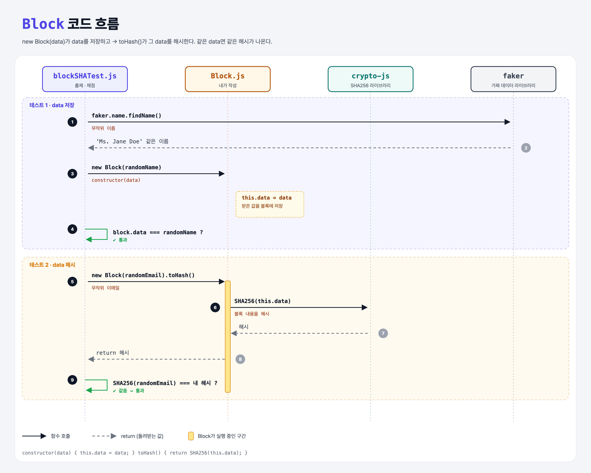

# What's in a Hash? (Blockchain Data Structure 2단계)

## 문제

1. `Block`에 **constructor**를 추가해서, 받은 `data`를 `this.data`에 저장하기.
2. `toHash()`가 그 **data를 해시**하게 하기.

```js
const block = new Block("Alice sent Bob 1 BTC");
console.log(block.data);   // Alice sent Bob 1 BTC
```

## 한 줄 요약

블록의 해시를 **블록 내용(data)에 묶는다.** 내용이 같으면 해시도 같고, 내용이 바뀌면 해시도 바뀐다.



### 다이어그램 읽는 법

| 구간 | 일어나는 일 |
|------|-------------|
| 테스트 1 | faker로 만든 무작위 이름을 넣고 `block.data`에 그대로 있는지 확인 |
| 테스트 2 | 무작위 이메일로 블록을 만들고, `toHash()`가 `SHA256(이메일)`과 같은지 확인 |

---

## 0. 이 과제가 말하려는 것

> **해시가 데이터에서 나오기 때문에, 데이터를 몰래 바꾸면 해시가 달라져서 들킨다.**

```
blocks-and-hashes → [데이터 해시] → 제네시스 블록 → 블록 추가 → 블록 연결 → 체인 검증
                     ★ 이 단계
```

---

## 1. 파일 구성

| 파일 | 역할 |
|------|------|
| `Block.js` | **이번에 고칠 클래스** |
| `blockSHATest.js` | 출제 · 채점 (테스트 2개) |

---

## 2. 정답 코드

```js
class Block {
    constructor(data) {
        this.data = data;
    }

    toHash() {
        return SHA256(this.data);
    }
}
```

| 코드 | 설명 |
|------|------|
| `constructor(data)` | `new Block(...)`할 때 자동으로 실행되는 함수. Python의 `__init__`. |
| `this.data = data` | 객체에 속성을 붙인다. Python의 `self.data = data`. |
| `SHA256(this.data)` | 저장해 둔 data를 해시한다. |

```python
class Block:
    def __init__(self, data):
        self.data = data

    def to_hash(self):
        return sha256(self.data)
```

---

## 3. test 한 줄씩

```js
const randomName = require('faker').name.findName();     // 무작위 이름 (예: "Ms. Jane Doe")
assert.equal(randomName, new Block(randomName).data);    // 넣은 값이 그대로 저장됐나

const randomEmail = require('faker').internet.email();   // 무작위 이메일
const myHash = SHA256(randomEmail).toString();           // 테스트가 직접 계산한 정답
const yourHash = new Block(randomEmail).toHash().toString();
assert.equal(myHash, yourHash);
```

- **faker**는 가짜 데이터(이름, 이메일 등)를 만들어 주는 라이브러리다. 정해진 값만 맞히는 꼼수를 막으려고 매번 다른 값을 쓴다.

---

## 4. 일부러 틀려 보면

| 바꾼 것 | 결과 |
|---------|------|
| `toHash`에서 여전히 `"Hello, blockchain!"`을 해시 | 해시가 이메일과 무관 → 테스트 2 실패 |
| constructor에서 `data`를 저장 안 함 | `block.data`가 `undefined` → 테스트 1 실패 |

---

## 5. 실행 방법

```bash
npx mocha week1/whats-in-a-hash/blockSHATest.js
```

## 기억할 것

1. `constructor` = `__init__`, `this` = `self`.
2. 해시는 블록 **내용**에서 만든다.

## 헷갈렸던 점

- 최신 `faker` 패키지(6.x)는 비어 있어서 동작하지 않는다. 강의와 같은 `faker@5.5.3`을 설치했다. (`npm install faker@5.5.3`)
