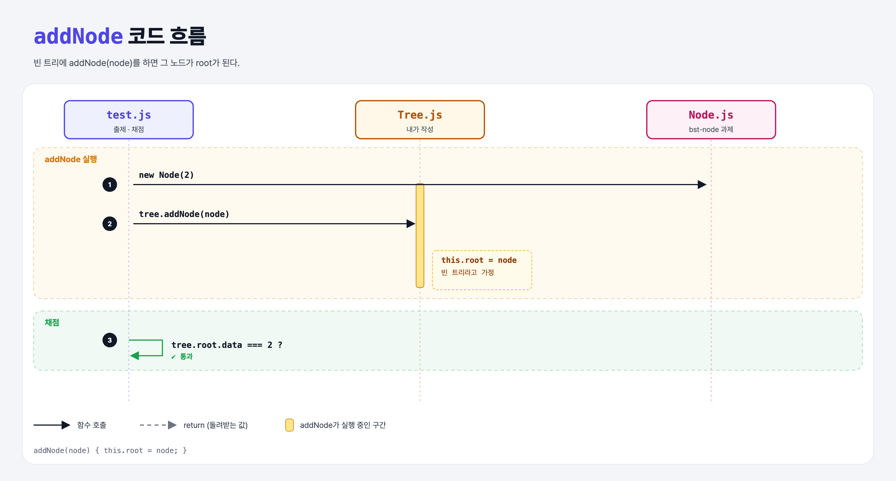

# Adding a Root (Build a Binary Search Tree 3단계)

## 문제

`Tree`에 `addNode(node)` 메서드를 만들기. 이번 단계에서는 트리가 **비어 있다고 가정**하고, 받은 노드를 root로 둔다.

```js
const tree = new Tree();
tree.addNode(new Node(5));
tree.root.data;   // 5
```

## 한 줄 요약

빈 트리에 처음 들어오는 노드가 root가 된다. → `this.root = node`



---

## 0. 이 과제가 말하려는 것

> **노드 추가를 한 번에 일반화하기는 어렵다. 가장 쉬운 경우(빈 트리)부터 하나씩 늘려 간다.**

```
bst-node → bst-root → [루트 추가] → 첫 층 → 여러 층 → 검색
                       ★ 이 단계
```

---

## 1. 파일 구성

| 파일 | 역할 |
|------|------|
| `Tree.js` | **addNode 추가** |
| `Node.js` | bst-node 과제 그대로 |
| `test.js` | 출제 · 채점 (테스트 2개) |

---

## 2. 정답 코드

```js
addNode(node) {
    this.root = node;
}
```

---

## 3. test.js 한 줄씩

```js
assert.strictEqual(tree.root, null);       // 처음엔 비어 있고
tree.addNode(new Node(2));                 // before에서 추가
assert(tree.root, "did not find a root on the tree");
assert.equal(tree.root.data, 2);
```

---

## 4. 일부러 틀려 보면

| 바꾼 것 | 결과 |
|---------|------|
| `this.root = node.data` | root가 노드가 아니라 숫자 2 → `tree.root.data`가 `undefined` → 실패 |

---

## 5. 실행 방법

```bash
npx mocha week2/bst-add-root/test.js
```

## 기억할 것

1. 빈 트리의 첫 노드 = root.
2. 노드 **객체**를 넣는다 (값만 넣지 않는다).
