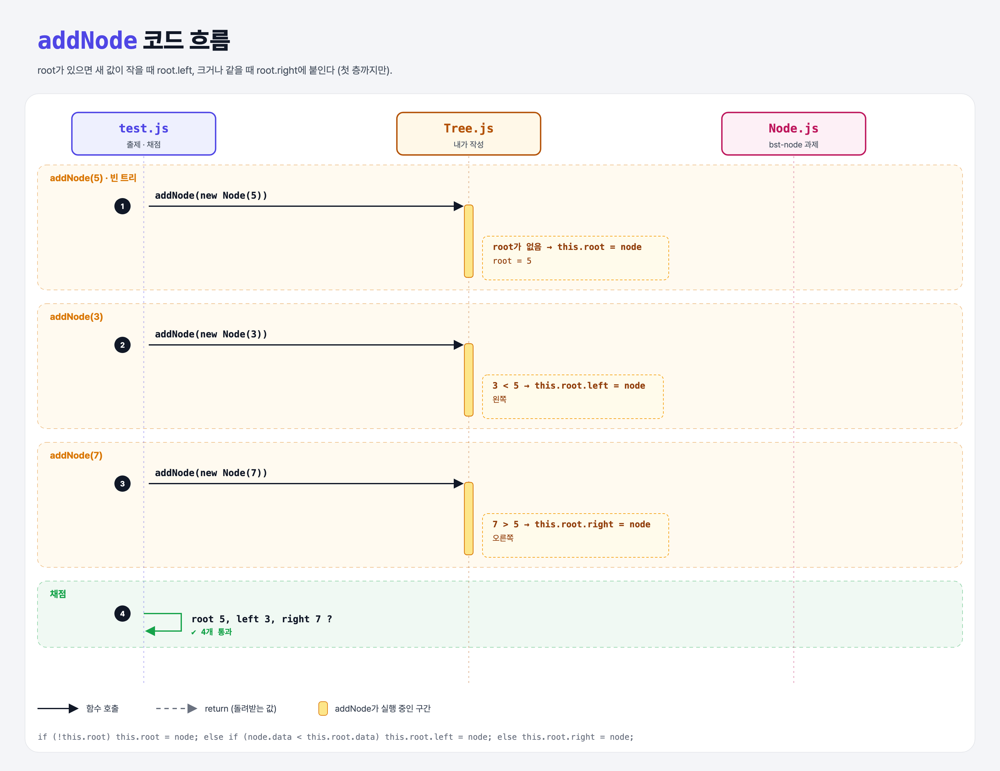

# First Layer (Build a Binary Search Tree 4단계)

## 문제

root가 이미 있을 때도 `addNode`가 동작하게 하기. 새 값이 root보다 **작으면 왼쪽**, **크면 오른쪽**에 붙인다. (이번엔 root 바로 아래 첫 층까지만)

```js
tree.addNode(new Node(5));
tree.addNode(new Node(3));
tree.addNode(new Node(7));
tree.root.left.data;    // 3
tree.root.right.data;   // 7
```

## 한 줄 요약

`root가 없으면 root로 / 작으면 root.left / 아니면 root.right`.



### 다이어그램 읽는 법

| 구간 | 일어나는 일 |
|------|-------------|
| addNode(5) | 빈 트리 → root |
| addNode(3) | 3 < 5 → 왼쪽 |
| addNode(7) | 7 > 5 → 오른쪽 |

---

## 0. 이 과제가 말하려는 것

> **BST의 규칙은 하나: 작으면 왼쪽, 크면 오른쪽. 맨 아래 노드들은 잎(leaves)이라 부른다.**

```
bst-node → bst-root → bst-add-root → [첫 층] → 여러 층 → 검색
                                      ★ 이 단계
```

---

## 1. 파일 구성

| 파일 | 역할 |
|------|------|
| `Tree.js` | **addNode에 왼쪽/오른쪽 경우 추가** |
| `Node.js` | bst-node 과제 그대로 |
| `test.js` | 출제 · 채점 (테스트 4개) |

---

## 2. 정답 코드

```js
addNode(node) {
    if (!this.root) {
        this.root = node;
    } else if (node.data < this.root.data) {
        this.root.left = node;
    } else {
        this.root.right = node;
    }
}
```

| 코드 | 설명 |
|------|------|
| `!this.root` | root가 `null`이면 참. Python `if not self.root:` |
| `else if` | Python의 `elif` |

---

## 3. test.js 한 줄씩

```js
// before: addNode(5)  → root.data === 5
//   before: addNode(3) → root.left.data === 3
//   before: addNode(7) → root.right.data === 7
```

`describe` 안의 `before`들이 차례로 실행돼서 같은 트리에 5 → 3 → 7이 쌓인다.

---

## 4. 일부러 틀려 보면

| 바꾼 것 | 결과 |
|---------|------|
| 부등호를 반대로 (`>`) | 3이 오른쪽, 7이 왼쪽 → 둘 다 실패 |
| root 확인 없이 바로 비교 | 빈 트리에서 `this.root.data` → `TypeError` |

---

## 5. 실행 방법

```bash
npx mocha week2/bst-first-layer/test.js
```

## 기억할 것

1. 작으면 왼쪽, 크면 오른쪽.
2. 이 버전은 첫 층만 된다. 3 다음에 2를 넣으면 3을 **덮어써 버린다** → 다음 단계에서 고친다.
