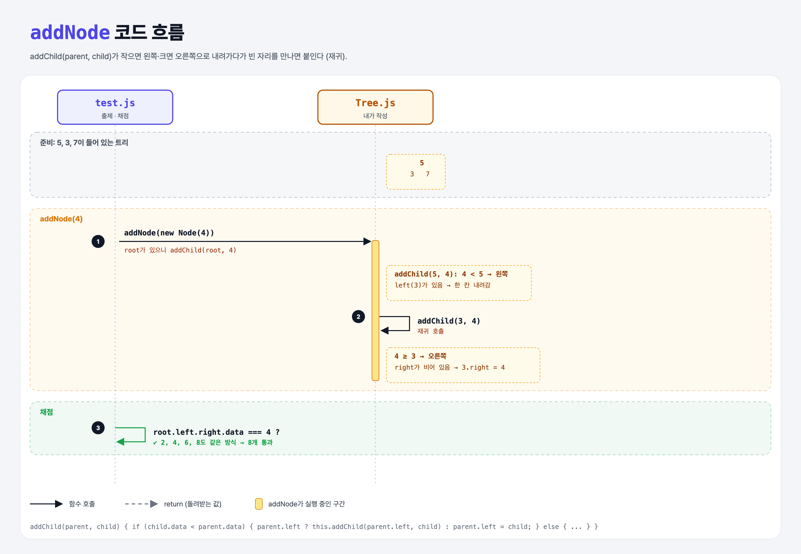

# Many Layers (Build a Binary Search Tree 5단계)

## 문제

트리가 아무리 깊어져도 `addNode`가 올바른 자리에 노드를 붙이게 일반화하기. (반복문이나 재귀 둘 다 가능)

## 한 줄 요약

자리가 차 있으면 **그 자식으로 한 칸 내려가서 같은 일을 반복**한다. 빈 자리를 만나면 붙인다. → 재귀 함수 `addChild(parent, child)`.



### 다이어그램 읽는 법

| 구간 | 일어나는 일 |
|------|-------------|
| 준비 | 5(root), 3(왼쪽), 7(오른쪽)이 있는 트리 |
| addNode(4) | 5에서 왼쪽으로 → 3이 있으니 `addChild(3, 4)`를 다시 부름 → 3의 오른쪽이 비어 있어서 붙임 |
| 채점 | `root.left.right`가 4인지 확인 (2, 6, 8도 같은 방식) |

노란 상자는 함수 안에서 하는 판단이고, ②는 **자기 자신을 다시 부르는 호출(재귀)**이다.

---

## 0. 이 과제가 말하려는 것

> **트리는 "노드 아래에 또 트리가 있는" 구조라서, 같은 함수를 자식에게 다시 부르면 깊이에 상관없이 처리된다.**

```
bst-node → … → bst-first-layer → [여러 층] → 검색
                                  ★ 이 단계
```

```
          5
       3     7
     2   4  6   8
```

---

## 1. 파일 구성

| 파일 | 역할 |
|------|------|
| `Tree.js` | **addNode 일반화 + addChild 추가** |
| `Node.js` | bst-node 과제 그대로 |
| `test.js` | 출제 · 채점 (테스트 8개) |

---

## 2. 정답 코드

```js
addNode(node) {
    if (!this.root) {
        this.root = node;
        return;
    }
    this.addChild(this.root, node);
}

addChild(parent, child) {
    if (child.data < parent.data) {
        if (parent.left) {
            this.addChild(parent.left, child);   // 왼쪽이 차 있음 → 한 칸 내려가서 다시
        } else {
            parent.left = child;                 // 비어 있음 → 여기에 붙임
        }
    } else {
        if (parent.right) {
            this.addChild(parent.right, child);
        } else {
            parent.right = child;
        }
    }
}
```

```python
def add_child(self, parent, child):
    if child.data < parent.data:
        if parent.left:
            self.add_child(parent.left, child)
        else:
            parent.left = child
    else:
        if parent.right:
            self.add_child(parent.right, child)
        else:
            parent.right = child
```

### 반복문으로 쓰면

```js
let current = this.root;
while (true) {
    const side = node.data < current.data ? 'left' : 'right';
    if (!current[side]) { current[side] = node; return; }
    current = current[side];
}
```

`current[side]`처럼 대괄호에 문자열을 넣으면 속성 이름을 변수로 고를 수 있다 (Python의 `getattr`).

---

## 3. test.js 한 줄씩

```js
// 5 → 3 → 2 → 4 → 7 → 6 → 8 순서로 추가하며 매번 위치 확인
assert.equal(tree.root.left.left.data, 2);
assert.equal(tree.root.left.right.data, 4);
assert.equal(tree.root.right.left.data, 6);
assert.equal(tree.root.right.right.data, 8);
```

- 테스트 이름이 `after adding another lesser node`로 반복되지만 실제 값은 2, 4, 6, 8이다.

---

## 4. 일부러 틀려 보면

| 바꾼 것 | 결과 |
|---------|------|
| 4단계 코드 그대로 | 2를 넣으면 `root.left`(3)를 덮어씀 → 실패 |
| 재귀 호출에서 `parent`를 그대로 넘김 (`this.addChild(parent, child)`) | 같은 곳을 계속 돌아 **무한 재귀** → `Maximum call stack size exceeded` |

---

## 5. 실행 방법

```bash
npx mocha week2/bst-many-layers/test.js
```

## 기억할 것

1. 재귀 = 자기 자신을 더 작은 문제(자식 노드)로 다시 부르기.
2. 멈추는 조건(빈 자리)이 꼭 있어야 한다.
