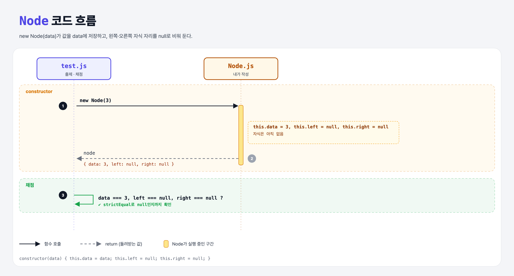

# Creating a Node (Build a Binary Search Tree 1단계)

## 문제

트리의 각 원소가 될 `Node` 클래스의 constructor 완성하기. `data`에 값을 저장하고, `left`와 `right`에는 `null`을 넣는다.

```js
const node = new Node(5);
node.data;   // 5
node.left;   // null
node.right;  // null
```

## 한 줄 요약

노드 = **값 하나 + 왼쪽 자식 자리 + 오른쪽 자식 자리**.



### 다이어그램 읽는 법

| 구간 | 일어나는 일 |
|------|-------------|
| constructor | data 저장, left/right는 비워 둠(null) |
| 채점 | data가 3이고, left/right가 정확히 null인지 확인 |

---

## 0. 이 과제가 말하려는 것

> **이진 탐색 트리(BST): 각 노드의 왼쪽에는 더 작은 값, 오른쪽에는 더 큰 값만 둔다. 그래서 찾을 때 반씩 버리며 내려갈 수 있다.**

```
      5          ← root
    3   7        ← 3은 5보다 작아서 왼쪽, 7은 커서 오른쪽
```

```
[노드] → 트리 → 루트 추가 → 첫 층 → 여러 층(재귀) → 검색
 ★ 이 단계  bst-root  bst-add-root  bst-first-layer  bst-many-layers  bst-search
```

- 블록체인의 **머클 트리**(다음 과제)도 트리 구조라서, 먼저 기본 트리를 만들어 본다.

---

## 1. 파일 구성

| 파일 | 역할 |
|------|------|
| `Node.js` | **이번에 완성할 클래스** |
| `test.js` | 출제 · 채점 (테스트 3개) |

---

## 2. 정답 코드

```js
class Node {
    constructor(data) {
        this.data = data;
        this.left = null;
        this.right = null;
    }
}
```

```python
class Node:
    def __init__(self, data):
        self.data = data
        self.left = None
        self.right = None
```

JS의 `null`은 Python의 `None`. ("값이 없음"을 일부러 넣은 것)

---

## 3. test.js 한 줄씩

```js
assert.equal(node.data, 3);
assert.strictEqual(node.left, null);    // 정확히 null이어야 함
assert.strictEqual(node.right, null);
```

- `equal`은 느슨한 비교(`==`)라서 `undefined == null`도 참이다. `strictEqual`(`===`)은 **정확히 null**이어야 통과한다. 그래서 left를 아예 안 만들면(`undefined`) 실패한다.

---

## 4. 일부러 틀려 보면

| 바꾼 것 | 결과 |
|---------|------|
| `this.left`를 안 만듦 | `undefined !== null` → 실패 |

---

## 5. 실행 방법

```bash
npx mocha week2/bst-node/test.js
```

## 기억할 것

1. 노드 = data + left + right.
2. `null` = `None`. `undefined`는 "아예 안 정해짐".
3. `strictEqual`은 `===`로 비교.
