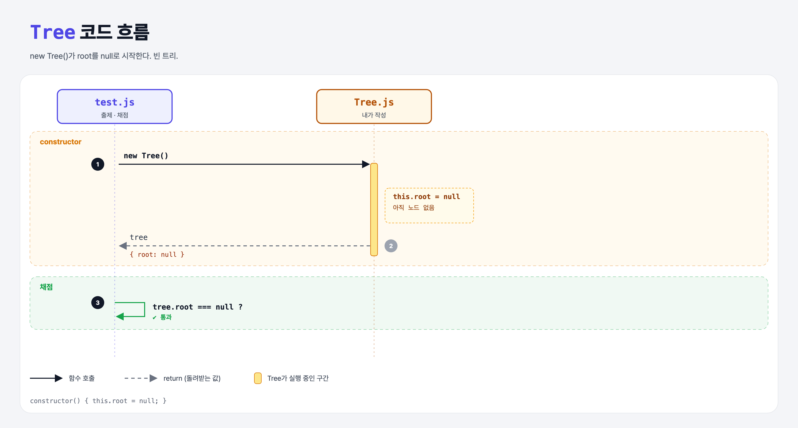

# Storing the Root (Build a Binary Search Tree 2단계)

## 문제

새 파일 `Tree.js`의 `Tree` constructor에서 `root`를 `null`로 저장하기.

## 한 줄 요약

트리는 **맨 위 노드(root) 하나만** 기억한다. 나머지는 root에서 left/right를 따라가면 다 닿는다. 처음엔 비어 있다.



---

## 0. 이 과제가 말하려는 것

> **트리 객체는 root만 알면 된다. 연결 리스트가 head만 아는 것과 같다.**

```
bst-node → [트리] → 루트 추가 → 첫 층 → 여러 층 → 검색
            ★ 이 단계
```

---

## 1. 파일 구성

| 파일 | 역할 |
|------|------|
| `Tree.js` | **이번에 완성할 클래스** |
| `Node.js` | bst-node 과제 그대로 |
| `test.js` | 출제 · 채점 (테스트 1개) |

---

## 2. 정답 코드

```js
class Tree {
    constructor() {
        this.root = null;
    }
}
```

```python
class Tree:
    def __init__(self):
        self.root = None
```

---

## 3. test.js 한 줄씩

```js
const tree = new Tree();
assert.strictEqual(tree.root, null);
```

---

## 5. 실행 방법

```bash
npx mocha week2/bst-root/test.js
```

## 기억할 것

1. 트리는 root만 들고 있다.
