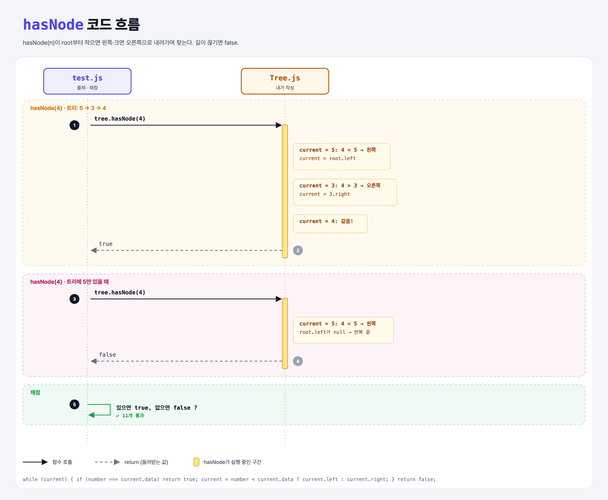

# Search Tree (Build a Binary Search Tree 6단계)

## 문제

`hasNode(number)`를 만들기. 트리에 그 값을 가진 노드가 있으면 `true`, 없으면 `false`.

## 한 줄 요약

root부터 **작으면 왼쪽, 크면 오른쪽**으로 내려간다. 같은 값을 만나면 `true`, 더 갈 곳이 없으면 `false`.



### 다이어그램 읽는 법

| 구간 | 일어나는 일 |
|------|-------------|
| hasNode(4), 트리 5→3→4 | 5에서 왼쪽 → 3에서 오른쪽 → 4 발견 → true |
| hasNode(4), 트리에 5만 | 5에서 왼쪽으로 가려는데 null → false |

---

## 0. 이 과제가 말하려는 것

> **정렬 규칙 덕분에 한 번 비교할 때마다 절반을 버린다. 노드가 100만 개여도 균형 잡힌 트리라면 20번 정도 비교면 찾는다.**

```
bst-node → … → bst-many-layers → [검색]
                                  ★ 이 단계
```

---

## 1. 파일 구성

| 파일 | 역할 |
|------|------|
| `Tree.js` | 완성본 (addNode + hasNode) |
| `Node.js` | bst-node 과제 그대로 |
| `test.js` | 출제 · 채점 (테스트 11개) |

---

## 2. 정답 코드

```js
hasNode(number) {
    let current = this.root;
    while (current) {
        if (number === current.data) {
            return true;
        }
        current = number < current.data ? current.left : current.right;
    }
    return false;
}
```

| 코드 | 설명 |
|------|------|
| `while (current)` | current가 `null`이 되면 멈춤 (길이 끊김) |
| `조건 ? A : B` | 삼항 연산자. Python의 `A if 조건 else B` |

```python
def has_node(self, number):
    current = self.root
    while current:
        if number == current.data:
            return True
        current = current.left if number < current.data else current.right
    return False
```

---

## 3. test.js 한 줄씩

```js
assert(tree.hasNode(5), "did not find a node with data 5");
assert.isNotTrue(tree.hasNode(4));     // 아직 4가 없을 때는 true가 아니어야 함
```

- `isNotTrue`는 "`true`가 아니면 통과". `false`를 돌려주면 확실히 통과한다.

---

## 4. 일부러 틀려 보면

| 바꾼 것 | 결과 |
|---------|------|
| 끝에 `return false`를 빼먹음 | `undefined` 반환 → `isNotTrue`는 통과하지만 의도가 불분명 |
| 빈 트리에서 `this.root.data`부터 비교 | `TypeError` |

---

## 5. 실행 방법

```bash
npx mocha week2/bst-search/test.js
```

## 기억할 것

1. BST 검색 = 작으면 왼쪽, 크면 오른쪽, 같으면 찾음, null이면 없음.
2. 삼항 연산자 `a ? b : c` = `b if a else c`.
