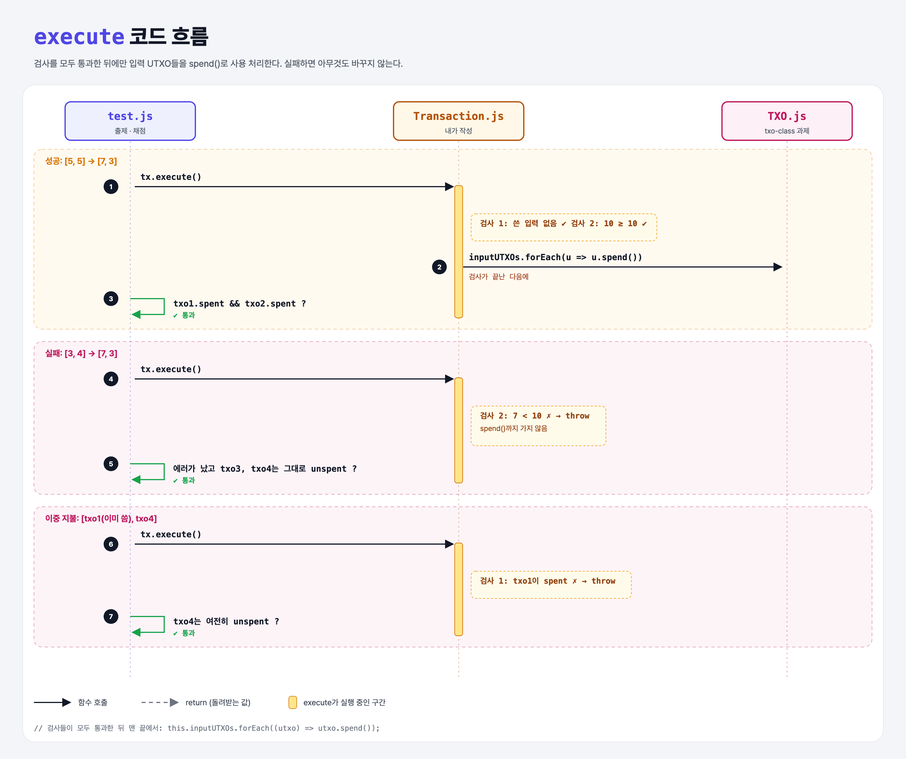

# Successful Transaction (Coding the UTXO Model 4단계)

## 문제

`execute()`에서 에러 없이 끝나면(거래 성공), **입력 UTXO들을 모두 사용 처리(`spend()`)**하기.

## 한 줄 요약

검사를 **다 통과한 다음에** 입력 쪽지들을 "썼음"으로 바꾼다. 실패한 거래는 아무것도 바꾸지 않는다.



### 다이어그램 읽는 법

| 구간 | 일어나는 일 |
|------|-------------|
| 성공 | 검사 2개 통과 → `forEach`로 입력 모두 `spend()` |
| 실패 (금액 부족) | 검사 2에서 throw → spend까지 안 감 → 입력은 그대로 |
| 이중 지불 | 검사 1에서 throw → 같이 들어온 멀쩡한 입력도 그대로 |

---

## 0. 이 과제가 말하려는 것

> **거래가 블록에 들어가면 입력은 "쓴 것"이 되고, 출력은 새로 쓸 수 있는 UTXO가 된다. 블록체인의 목적이 바로 이중 지불을 막는 것.**

```
txo-class → utxo-inputs → sufficient-input → [입력 사용 처리] → 수수료
                                              ★ 이 단계
```

---

## 1. 파일 구성

| 파일 | 역할 |
|------|------|
| `Transaction.js` | **맨 끝에 spend 처리 추가** |
| `TXO.js` | txo-class 과제 그대로 |
| `test.js` | 출제 · 채점 (테스트 3개) |

---

## 2. 정답 코드

```js
execute() {
    // 검사 1: 이미 쓴 입력이 있으면 throw
    // 검사 2: 금액이 부족하면 throw
    ...
    this.inputUTXOs.forEach((utxo) => utxo.spend());
}
```

- `forEach`는 배열의 각 원소에 함수를 실행한다. Python의 `for utxo in inputs: utxo.spend()`.
- **위치가 핵심**이다. `throw`는 함수를 그 자리에서 끝내기 때문에, 검사 뒤에 두면 실패한 거래는 spend까지 가지 않는다.

---

## 3. test.js 한 줄씩

```js
const txo1 = new TXO(fromAddress, 5);  ...  txo4 = 4
const outputTXO1 = new TXO(toAddress, 7);
const outputTXO2 = new TXO(fromAddress, 3);   // 거스름돈: 보낸 사람에게 다시 돌아오는 출력

// 1) [txo1, txo2] → [7, 3]: 성공 → txo1, txo2 둘 다 spent
// 2) [txo3, txo4] → [7, 3]: 7 < 10 실패 → txo3, txo4 그대로
// 3) [txo1, txo4] → [7, 3]: txo1은 1)에서 이미 씀 → 실패 → txo4는 그대로
```

- 세 테스트가 같은 TXO를 이어서 쓴다. 3번은 1번에서 txo1이 이미 spent가 된 것을 이용한 **이중 지불 시도**다.
- `outputTXO2`처럼 보낸 사람 주소로 가는 출력이 **거스름돈**이다. UTXO는 쪼개 쓸 수 없어서 통째로 쓰고 남는 금액을 자기에게 다시 보낸다.

---

## 4. 일부러 틀려 보면

| 바꾼 것 | 결과 |
|---------|------|
| spend를 검사들 **앞**에 둠 | 실패한 거래에서도 입력이 spent가 됨 → 2, 3번 테스트 실패 |

---

## 5. 실행 방법

```bash
npx mocha week2/mark-spent/test.js
```

## 기억할 것

1. 상태를 바꾸는 일(spend)은 **모든 검사가 끝난 뒤에**.
2. 거스름돈 = 보낸 사람에게 돌아오는 출력 UTXO.
