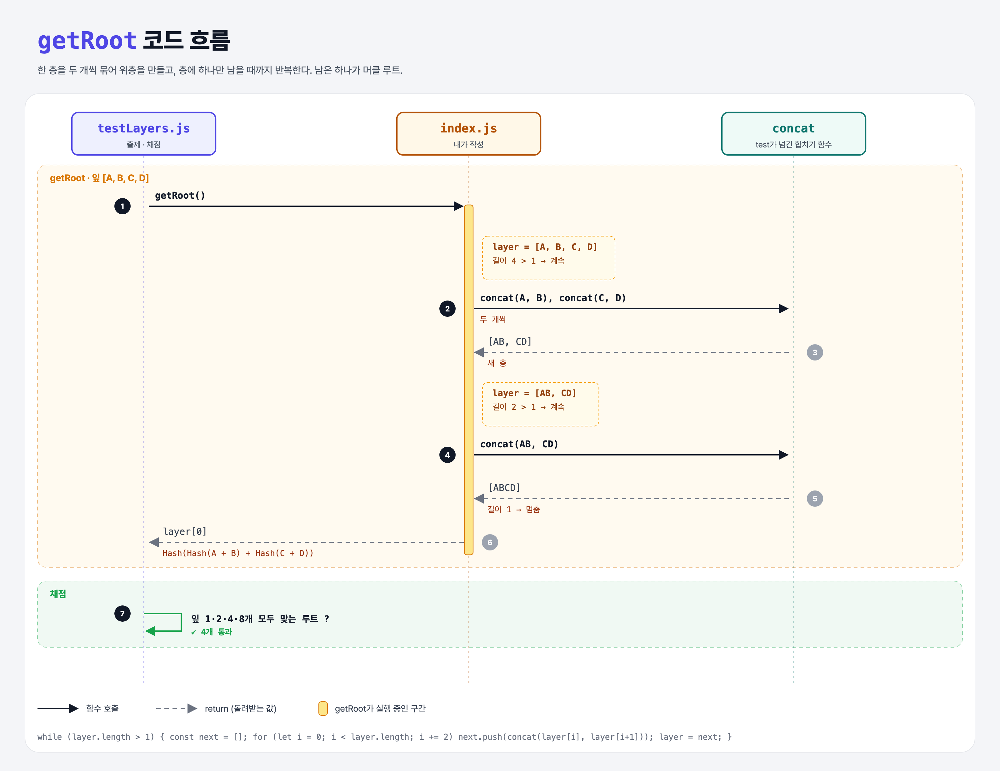

# Multiple Layers (Merkle Trees 2단계)

## 문제

잎이 1, 2, 4, 8개일 때도 `getRoot()`가 동작하게 하기.

```
      ABCD
     /    \
   AB      CD
  /  \    /  \
 A    B  C    D
```

## 한 줄 요약

**층(layer)** 단위로 생각한다. 지금 층을 두 개씩 합쳐 다음 층을 만들고, 층에 하나만 남을 때까지 반복.



### 다이어그램 읽는 법

| 구간 | 일어나는 일 |
|------|-------------|
| getRoot | [A, B, C, D] → [AB, CD] → [ABCD] → 하나 남았으니 그게 루트 |

---

## 0. 이 과제가 말하려는 것

> **머클 트리의 목적: 많은 데이터를 해시 하나로 대표하고, 나중에 일부만으로 "이 데이터가 들어 있다"를 증명하는 것.**

```
merkle-two-leaves → [여러 층] → 홀수 잎 → 증명 만들기 → 증명 검증
                     ★ 이 단계
```

---

## 1. 파일 구성

| 파일 | 역할 |
|------|------|
| `index.js` | **getRoot 일반화** |
| `testLayers.js` | 출제 · 채점 (테스트 4개) |

---

## 2. 정답 코드

```js
getRoot() {
    let layer = this.leaves;
    while (layer.length > 1) {
        const nextLayer = [];
        for (let i = 0; i < layer.length; i += 2) {
            nextLayer.push(this.concat(layer[i], layer[i + 1]));
        }
        layer = nextLayer;
    }
    return layer[0];
}
```

| 코드 | 설명 |
|------|------|
| `while (layer.length > 1)` | 하나 남을 때까지 |
| `i += 2` | 두 칸씩 건너뛰며 짝 (i, i+1) |
| 잎이 1개면 | 반복을 안 하고 그 잎이 곧 루트 |

```python
def get_root(self):
    layer = self.leaves
    while len(layer) > 1:
        layer = [self.concat(layer[i], layer[i + 1]) for i in range(0, len(layer), 2)]
    return layer[0]
```

---

## 3. test 한 줄씩

```js
['A']                     → "A"
['A','B']                 → "Hash(A + B)"
['A','B','C','D']         → "Hash(Hash(A + B) + Hash(C + D))"
['A',…,'H'] (8개)         → "Hash(Hash(Hash(A + B) + Hash(C + D)) + Hash(Hash(E + F) + Hash(G + H)))"
```

---

## 4. 일부러 틀려 보면

| 바꾼 것 | 결과 |
|---------|------|
| 잎 3개를 넣으면 | `layer[3]`이 `undefined` → `Hash(C + undefined)` (다음 단계에서 해결) |

---

## 5. 실행 방법

```bash
npx mocha week2/merkle-multiple-layers/testLayers.js
```

## 기억할 것

1. 층 단위로 두 개씩 합친다 → 하나 남으면 루트.
2. 잎이 n개면 층은 약 log₂n개.
