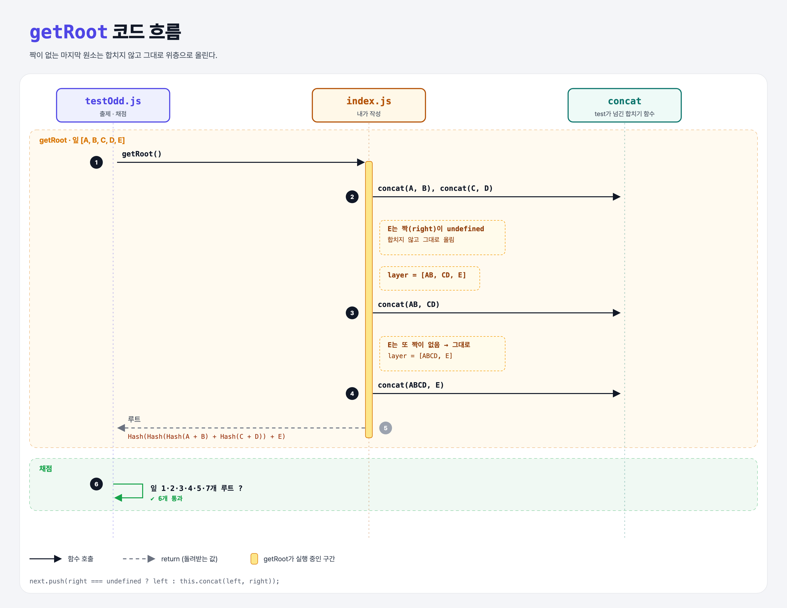

# Odd Leaves (Merkle Trees 3단계)

## 문제

잎 개수가 홀수일 때 처리하기. **짝이 없는 원소는 합치지 않고 그대로 한 층 위로 올린다.**

```
    Root
   /    \
  AB     C
 /  \    |
A    B   C
```

## 한 줄 요약

`right`가 없으면 `left`를 그대로 다음 층에 넣는다.



### 다이어그램 읽는 법

| 구간 | 일어나는 일 |
|------|-------------|
| [A, B, C, D, E] | AB, CD를 만들고 E는 그대로 → [AB, CD, E] → ABCD, E 그대로 → [ABCD, E] → 합쳐서 루트 |

---

## 0. 이 과제가 말하려는 것

```
merkle-two-leaves → merkle-multiple-layers → [홀수 잎] → 증명 만들기 → 증명 검증
                                              ★ 이 단계
```

- 이 실습은 짝 없는 원소를 **그대로 올린다**. 비트코인은 대신 **마지막 원소를 복제해서 자기 자신과 합친다** (`Hash(E + E)`). 방식은 달라도 "모든 잎이 루트에 반영된다"는 점은 같다.

---

## 1. 파일 구성

| 파일 | 역할 |
|------|------|
| `index.js` | **홀수 처리 추가** |
| `testOdd.js` | 출제 · 채점 (테스트 6개) |

---

## 2. 정답 코드

```js
for (let i = 0; i < layer.length; i += 2) {
    const left = layer[i];
    const right = layer[i + 1];
    if (right === undefined) {
        nextLayer.push(left);                      // 짝 없음 → 그대로 올림
    } else {
        nextLayer.push(this.concat(left, right));
    }
}
```

- 배열 범위를 벗어난 인덱스를 읽으면 JS는 에러 대신 `undefined`를 준다. (Python은 `IndexError`)

---

## 3. test 한 줄씩

```js
['A','B','C']                 → "Hash(Hash(A + B) + C)"
['A','B','C','D','E']         → "Hash(Hash(Hash(A + B) + Hash(C + D)) + E)"
['A',…,'G'] (7개)             → "Hash(Hash(Hash(A + B) + Hash(C + D)) + Hash(Hash(E + F) + G))"
```

---

## 4. 일부러 틀려 보면

| 바꾼 것 | 결과 |
|---------|------|
| `if (!right)` | 지금은 통과하지만, 잎 값이 `0`이나 `''`이면 짝이 있어도 없다고 착각 → `=== undefined`가 안전 |

---

## 5. 실행 방법

```bash
npx mocha week2/merkle-odd-leaves/testOdd.js
```

## 기억할 것

1. 짝 없는 원소는 그대로 위로.
2. JS 배열 범위 밖 = `undefined` (에러 아님).
