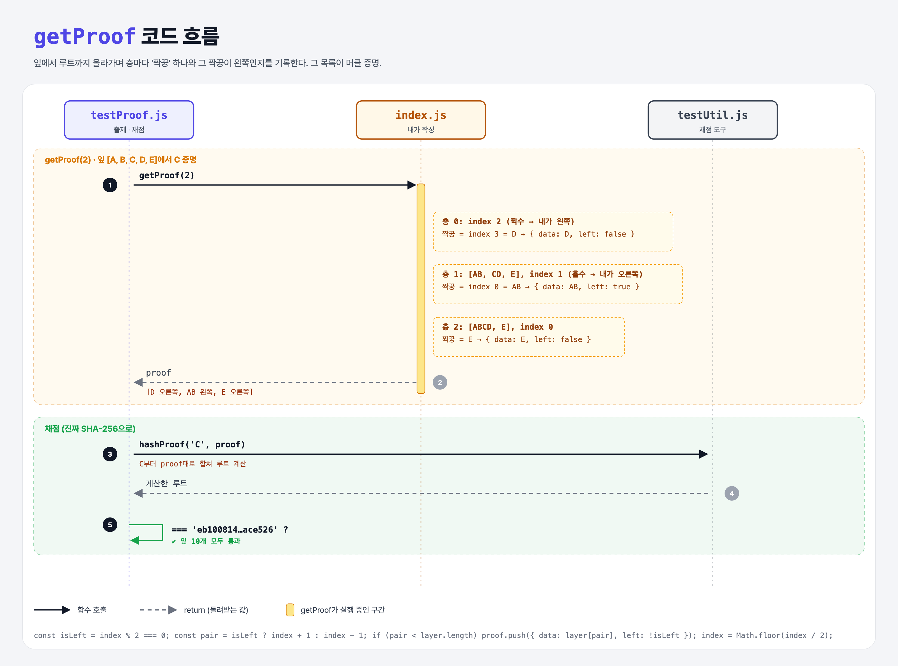

# Build the Proof (Merkle Trees 4단계)

## 문제

`getProof(index)` 만들기. 잎 하나가 트리 안에 있다는 **머클 증명**을 돌려준다.

증명 = `{ data: 합칠 해시, left: 그 해시가 왼쪽인지 }`의 배열.

```
        Root
       /    \
    ABCD     E
    /  \     |
  AB    CD   E
 / \   / \   |
A   B C   D  E
```

C의 증명:

```js
[
  { data: 'D',  left: false },   // C 오른쪽에 D → CD
  { data: 'AB', left: true },    // CD 왼쪽에 AB → ABCD
  { data: 'E',  left: false },   // ABCD 오른쪽에 E → Root
]
```

## 한 줄 요약

잎에서 루트까지 올라가며 **층마다 내 짝꿍 하나**를 적는다. A, B를 몰라도 AB만 있으면 된다.



### 다이어그램 읽는 법

| 구간 | 일어나는 일 |
|------|-------------|
| getProof(2) | 층 0: C(짝수 자리) → 짝꿍 D(오른쪽) / 층 1: CD(홀수 자리) → 짝꿍 AB(왼쪽) / 층 2: ABCD → 짝꿍 E(오른쪽) |
| 채점 | testUtil의 `hashProof`가 잎과 증명으로 루트를 직접 계산 → 정답 루트와 비교 |

(그림의 예시는 잎 5개, 실제 채점은 잎 10개 A~J로 한다.)

---

## 0. 이 과제가 말하려는 것

> **거래 1만 개가 든 블록이라도, 내 거래가 들어 있다는 증명은 해시 14개 정도면 된다. 증명 크기는 log₂n으로 늘어난다.**

```
… → merkle-odd-leaves → [증명 만들기] → 증명 검증
                         ★ 이 단계
```

---

## 1. 파일 구성

| 파일 | 역할 |
|------|------|
| `index.js` | **getProof 추가** (getRoot와 함께 쓰려고 `nextLayer`로 정리) |
| `testUtil.js` | 채점 도구: 진짜 SHA-256, `hashProof` |
| `testProof.js` | 출제 · 채점 (잎 10개 → 테스트 10개) |

---

## 2. 정답 코드

```js
nextLayer(layer) {
    const next = [];
    for (let i = 0; i < layer.length; i += 2) {
        const left = layer[i];
        const right = layer[i + 1];
        next.push(right === undefined ? left : this.concat(left, right));
    }
    return next;
}

getProof(index) {
    const proof = [];
    let layer = this.leaves;
    while (layer.length > 1) {
        const isLeft = index % 2 === 0;                 // 짝수 자리면 내가 왼쪽
        const pairIndex = isLeft ? index + 1 : index - 1;
        if (pairIndex < layer.length) {                 // 짝꿍이 있을 때만 (홀수 잎 처리)
            proof.push({ data: layer[pairIndex], left: !isLeft });
        }
        layer = this.nextLayer(layer);                  // 한 층 위로
        index = Math.floor(index / 2);                  // 위층에서의 내 자리
    }
    return proof;
}
```

| 코드 | 설명 |
|------|------|
| `index % 2 === 0` | 짝수면 왼쪽, 홀수면 오른쪽 자리 |
| `left: !isLeft` | 짝꿍은 나와 반대쪽 |
| `Math.floor(index / 2)` | 위층 자리 = 지금 자리 ÷ 2 (Python `index // 2`) |
| `pairIndex < layer.length` | 짝꿍이 없으면(그대로 올라가는 경우) 증명에 넣지 않음 |

---

## 3. test 한 줄씩

```js
const hashTree = new MerkleTree(leaves.map(sha256), concatHash);   // 진짜 SHA-256 트리
const lettersTree = new MerkleTree(leaves, concatLetters);           // 틀렸을 때 보여 줄 글자 트리

const proof = hashTree.getProof(i);
const hashedProof = hashProof(leaf, proof).toString('hex');           // 잎 + 증명 → 루트 계산
assert.equal(hashedProof, root);                                      // 'eb100814…ace526'
```

- 틀리면 `lettersTree`로 같은 증명을 글자로 보여 줘서 어디가 틀렸는지 알려 준다.
- testUtil의 `hashProof`: `left`가 true면 `[proof.data, data]`, 아니면 `[data, proof.data]` 순서로 합친다.

---

## 4. 일부러 틀려 보면

| 바꾼 것 | 결과 |
|---------|------|
| `left: isLeft` (반대로) | 합치는 순서가 뒤집혀 루트가 달라짐 → 실패 |
| `pairIndex < layer.length` 검사 빼기 | 짝 없는 잎에서 `{ data: undefined }`가 들어가 → `Buffer.concat` 에러 |

---

## 5. 실행 방법

```bash
npx mocha week2/merkle-proof/testProof.js
```

## 기억할 것

1. 증명 = 층마다 짝꿍 해시 + 그게 왼쪽인지.
2. 위층 자리 = `Math.floor(index / 2)`.
3. 증명 크기 ≈ log₂(잎 개수).
