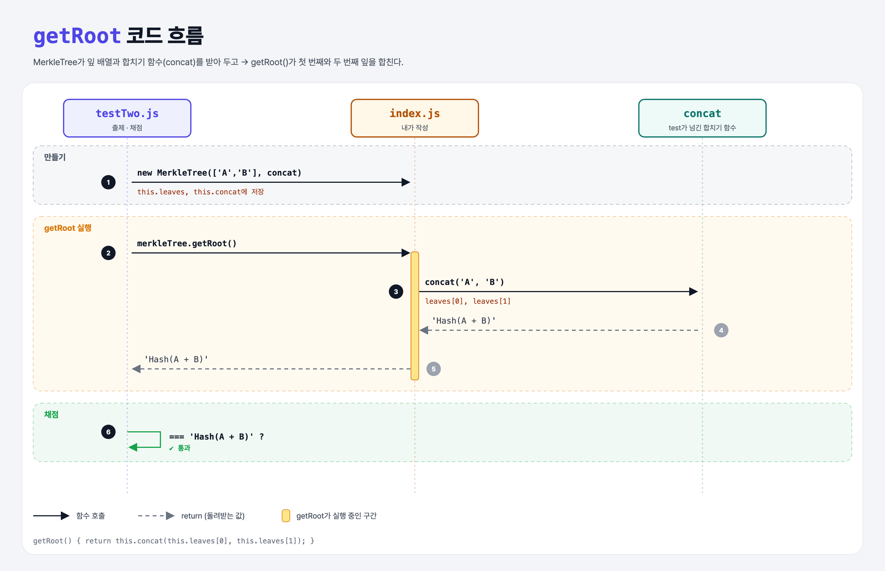

# Combine Two Leaves (Merkle Trees 1단계)

## 문제

`MerkleTree` 클래스 만들기.

1. constructor는 **잎(leaf) 배열**과 **두 잎을 합쳐 해시하는 함수(concat)**를 받아 저장한다.
2. `getRoot()`는 일단 **첫 번째와 두 번째 잎을 concat으로 합친 값**을 돌려준다.

```
  Root
  /  \
 A    B
```

## 한 줄 요약

머클 루트 = 잎들을 두 개씩 합쳐 올라가서 남는 하나. 이번엔 잎이 2개라 한 번 합치면 끝.



---

## 0. 이 과제가 말하려는 것

> **머클 트리는 잎들을 두 개씩 해시로 묶어 층층이 올라가 하나의 루트를 만든다. 블록에는 거래 전체 대신 이 루트 하나만 넣는다.**

```
[잎 2개] → 여러 층 → 홀수 잎 → 증명 만들기 → 증명 검증
 ★ 이 단계  merkle-multiple-layers  merkle-odd-leaves  merkle-proof  merkle-verify
```

- concat을 **밖에서 받는** 이유: 테스트에서는 `Hash(A + B)` 같은 글자로 구조를 눈으로 확인하고, 실제로는 SHA-256을 넣어 쓸 수 있게 하려고.

---

## 1. 파일 구성

| 파일 | 역할 |
|------|------|
| `index.js` | **이번에 완성할 MerkleTree** |
| `testTwo.js` | 출제 · 채점 (테스트 1개) |

---

## 2. 정답 코드

```js
class MerkleTree {
    constructor(leaves, concat) {
        this.leaves = leaves;
        this.concat = concat;
    }

    getRoot() {
        return this.concat(this.leaves[0], this.leaves[1]);
    }
}
```

- 함수도 값이라서 속성에 저장해 두고 `this.concat(a, b)`로 부를 수 있다. Python에서 `self.concat = concat`으로 함수를 저장하는 것과 같다.

---

## 3. test 한 줄씩

```js
const leaves = ['A', 'B'];
const concat = (a, b) => `Hash(${a} + ${b})`;   // 진짜 해시 대신 글자로 보여 주는 가짜 해시
const merkleTree = new MerkleTree(leaves, concat);
assert.equal(merkleTree.getRoot(), "Hash(A + B)");
```

---

## 4. 일부러 틀려 보면

| 바꾼 것 | 결과 |
|---------|------|
| `concat(leaves[1], leaves[0])` | `Hash(B + A)` → 실패. 해시는 **순서가 중요**하다 |

---

## 5. 실행 방법

```bash
npx mocha week2/merkle-two-leaves/testTwo.js
```

## 기억할 것

1. 머클 루트 = 잎들을 두 개씩 합쳐 올라간 끝.
2. `Hash(A + B)` ≠ `Hash(B + A)`.
