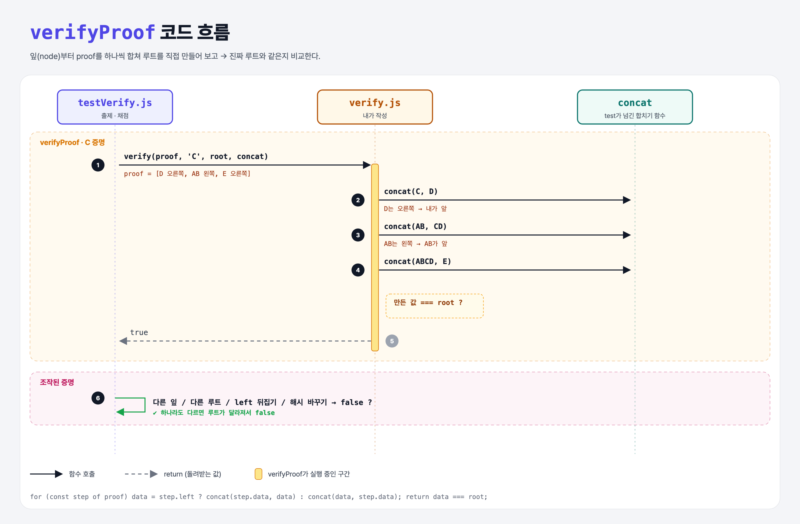

# Verify your Proof (Merkle Trees 5단계)

## 문제

`verifyProof(proof, node, root, concat)` 완성하기.

- `node`(잎)부터 시작해서 `proof`의 해시들을 차례로 합친다.
- 그렇게 만든 루트가 진짜 `root`와 `===`로 같으면 `true`.

## 한 줄 요약

받은 증명으로 루트를 **직접 다시 만들어 보고**, 같으면 그 잎은 트리 안에 있다.



### 다이어그램 읽는 법

| 구간 | 일어나는 일 |
|------|-------------|
| verifyProof | C → (C + D) → (AB + CD) → (ABCD + E) → root와 비교 → true |
| 조작된 증명 | 다른 잎·다른 루트·left 뒤집기·해시 바꾸기 → 루트가 달라져서 false |

---

## 0. 이 과제가 말하려는 것

> **검증하는 사람(Verifier)은 트리 전체를 몰라도 된다. 루트 하나와 짧은 증명만 있으면 확인할 수 있다.**

```
… → merkle-proof → [증명 검증]
                    ★ 이 단계
```

- 비트코인 라이트 지갑(SPV)이 블록 전체를 받지 않고도 내 거래를 확인하는 방법이 이것이다.

---

## 1. 파일 구성

| 파일 | 역할 |
|------|------|
| `verify.js` | **이번에 완성할 함수** |
| `index.js` | merkle-proof 과제 그대로 |
| `testVerify.js` | 출제 · 채점 (테스트 15개) |

---

## 2. 정답 코드

```js
function verifyProof(proof, node, root, concat) {
    let data = node;
    for (const step of proof) {
        data = step.left ? concat(step.data, data) : concat(data, step.data);
    }
    return data === root;
}
```

| 코드 | 설명 |
|------|------|
| `for (const step of proof)` | 배열 원소를 하나씩. Python `for step in proof:` |
| `step.left ? A : B` | 짝꿍이 왼쪽이면 짝꿍을 앞에, 아니면 뒤에 |

```python
def verify_proof(proof, node, root, concat):
    data = node
    for step in proof:
        data = concat(step["data"], data) if step["left"] else concat(data, step["data"])
    return data == root
```

---

## 3. test 한 줄씩

```js
// 잎 11개 A~K, root = "Hash(Hash(Hash(Hash(A + B) + Hash(C + D)) + Hash(Hash(E + F) + Hash(G + H))) + Hash(Hash(I + J) + K))"
assert.equal(verify(tree.getProof(i), leaves[i], root, concat), true);    // 모든 잎 11개 → true

verify(tree.getProof(2), leaves[3], root, concat)      // C의 증명으로 D를 검증 → false
verify(proof, leaves[2], badRoot, concat)              // 루트가 다름 → false
proof[1].left = !proof[1].left                         // 왼쪽/오른쪽 뒤집기 → false
proof[2].data = "Q"                                    // 증명 해시 바꾸기 → false
```

- `for…in`이 아니라 `for…of`다. `for…in`은 인덱스("0", "1"…)를 돌아서 `step.left`가 `undefined`가 된다.

---

## 4. 일부러 틀려 보면

| 바꾼 것 | 결과 |
|---------|------|
| `left`를 무시하고 항상 `concat(data, step.data)` | 왼쪽 짝꿍이 있는 잎에서 루트가 달라짐 → 정상 증명도 false |
| `for (const step in proof)` | step이 문자열 인덱스 → 엉뚱한 결과 |

---

## 5. 실행 방법

```bash
npx mocha week2/merkle-verify/testVerify.js
```

## 기억할 것

1. 검증 = 잎 + 증명으로 루트를 다시 만들어 비교.
2. 왼쪽/오른쪽 순서가 하나라도 틀리면 다른 해시.
3. 배열 순회는 `for…of` (Python의 `for x in list`).
