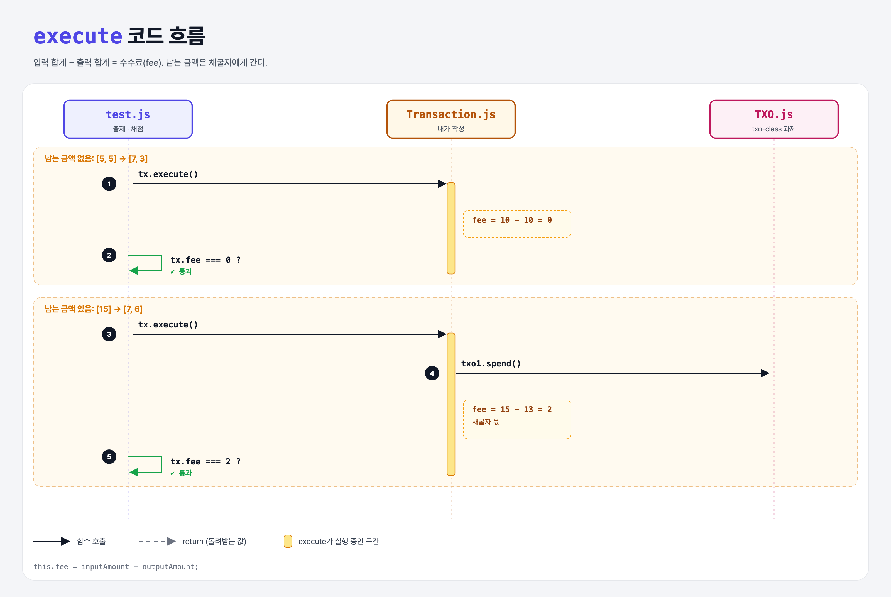

# Miner's Fee (Coding the UTXO Model 5단계)

## 문제

`execute()` 끝에서 **수수료 = 입력 합계 − 출력 합계**를 계산해 `this.fee`에 저장하기.

```js
const tx = new Transaction([new TXO(from, 5)], [new TXO(to, 3)]);
tx.execute();
tx.fee;   // 2
```

## 한 줄 요약

입력이 출력보다 많을 때 **남는 금액은 채굴자 몫(수수료)**이다.



### 다이어그램 읽는 법

| 구간 | 일어나는 일 |
|------|-------------|
| 남는 금액 없음 | 10 − 10 = 0 |
| 남는 금액 있음 | 15 − 13 = 2 |

---

## 0. 이 과제가 말하려는 것

> **3단계에서 "출력이 입력보다 적으면" 에러를 내지 않은 이유: 그 차이가 바로 수수료다.**

```
txo-class → utxo-inputs → sufficient-input → mark-spent → [수수료]
                                                          ★ 이 단계
```

- 수수료를 많이 낼수록 채굴자가 내 거래를 다음 블록에 먼저 넣어 준다.
- 비트코인은 공급량이 정해져 있다. 블록 보상은 시간이 지나면 줄어들다 끝나고, 결국 채굴자의 보상은 수수료만 남는다.
- 비트코인 거래에는 "수수료" 칸이 따로 없다. **입력 − 출력**이 곧 수수료다. 그래서 거스름돈 출력을 빠뜨리면 남은 돈이 전부 수수료로 날아간다.

---

## 1. 파일 구성

| 파일 | 역할 |
|------|------|
| `Transaction.js` | 완성본 (1~5단계) |
| `TXO.js` | txo-class 과제 그대로 |
| `test.js` | 출제 · 채점 (테스트 2개) |

---

## 2. 정답 코드

```js
execute() {
    // 검사 1, 검사 2 ...
    const inputAmount = this.inputUTXOs.reduce((sum, utxo) => sum + utxo.amount, 0);
    const outputAmount = this.outputUTXOs.reduce((sum, utxo) => sum + utxo.amount, 0);
    ...
    this.inputUTXOs.forEach((utxo) => utxo.spend());

    this.fee = inputAmount - outputAmount;
}
```

- 3단계에서 만든 `inputAmount`, `outputAmount`를 그대로 다시 쓴다.
- 금액이 부족하면 이미 throw됐으니, 여기까지 오면 fee는 항상 0 이상이다.

---

## 3. test.js 한 줄씩

```js
// [5, 5] → [7, 3]: 남는 것 없음
assert.equal(tx.fee, 0);
// [15] → [7, 6]: 2가 남음
assert.equal(tx.fee, 2);
```

---

## 4. 일부러 틀려 보면

| 바꾼 것 | 결과 |
|---------|------|
| `outputAmount - inputAmount` | −2 → 실패 |
| `fee`를 지역 변수로만 계산 (`const fee = ...`) | `tx.fee`가 `undefined` → 실패 |

---

## 5. 실행 방법

```bash
npx mocha week2/miners-fee/test.js
```

## 기억할 것

1. 수수료 = 입력 합계 − 출력 합계.
2. 객체에 값을 남기려면 `this.fee = ...` (지역 변수 X).
3. 거스름돈 출력을 빼먹으면 남은 돈이 전부 수수료가 된다.
