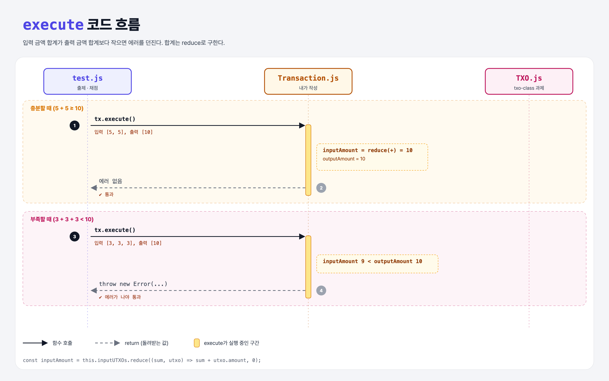

# Ensure Sufficient Input (Coding the UTXO Model 3단계)

## 문제

입력 UTXO 금액의 합이 출력 UTXO 금액의 합보다 **작으면** `execute()`에서 에러를 던지기.

## 한 줄 요약

가진 쪽지들보다 더 많이 보낼 수는 없다. → `입력 합계 < 출력 합계`면 `throw`.



### 다이어그램 읽는 법

| 구간 | 일어나는 일 |
|------|-------------|
| 충분할 때 | 입력 10 ≥ 출력 10 → 통과 |
| 부족할 때 | 입력 9 < 출력 10 → 에러 |

---

## 0. 이 과제가 말하려는 것

> **지갑은 작은 UTXO 여러 개를 모아서 하나의 큰 출력으로 만들기도 한다. 중요한 건 입력 합계가 출력 합계를 덮는 것.**

```
txo-class → utxo-inputs → [금액 검사] → 입력 사용 처리 → 수수료
                          ★ 이 단계
```

예: 0.1 BTC짜리 UTXO 5개 → 다음 거래에서 0.5 BTC 하나로 합쳐질 수 있다.

---

## 1. 파일 구성

| 파일 | 역할 |
|------|------|
| `Transaction.js` | **금액 검사 추가** |
| `TXO.js` | txo-class 과제 그대로 |
| `test.js` | 출제 · 채점 (테스트 2개) |

---

## 2. 정답 코드

```js
execute() {
    const anySpent = this.inputUTXOs.some((utxo) => utxo.spent);
    if (anySpent) {
        throw new Error("Cannot include a spent UTXO as an input!");
    }

    const inputAmount = this.inputUTXOs.reduce((sum, utxo) => sum + utxo.amount, 0);
    const outputAmount = this.outputUTXOs.reduce((sum, utxo) => sum + utxo.amount, 0);
    if (inputAmount < outputAmount) {
        throw new Error("Not enough input to cover the outputs!");
    }
}
```

### `reduce` 읽는 법

```js
[5, 5].reduce((sum, x) => sum + x, 0)
// sum=0, x=5  → 5
// sum=5, x=5  → 10   → 결과 10
```

- 배열을 하나의 값으로 "접는다". 두 번째 인자 `0`이 시작값.
- Python으로는 `sum(u.amount for u in inputs)`이면 끝난다.

---

## 3. test.js 한 줄씩

```js
// 충분: [5, 5] → [10]   에러가 나면 실패
// 부족: [3, 3, 3] → [10]  에러가 나야 통과
assert(ex, "Did not throw an exception for a lack of UTXO funds!");
```

---

## 4. 일부러 틀려 보면

| 바꾼 것 | 결과 |
|---------|------|
| `reduce`에 시작값 `0`을 빼먹음 | 첫 원소(TXO 객체)가 sum이 되어 `"[object Object]5"` 같은 문자열 → 비교가 엉망 |
| `<=`로 비교 | 딱 맞게 보내는 정상 거래(10 → 10)도 에러 → 첫 테스트 실패 |

---

## 5. 실행 방법

```bash
npx mocha week2/sufficient-input/test.js
```

## 기억할 것

1. 입력 합계 ≥ 출력 합계여야 한다.
2. `reduce((sum, x) => sum + x, 0)` = Python `sum(...)`. 시작값 0을 꼭 준다.
