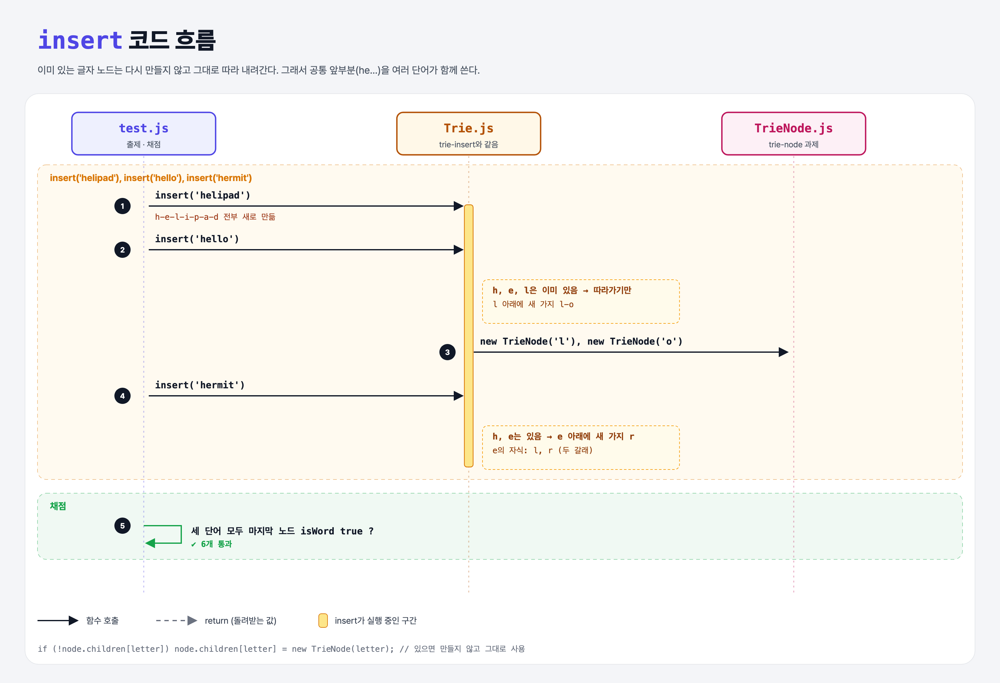

# Branching (Learn Tries 3단계)

## 문제

여러 단어를 넣었을 때 **가지가 갈라지도록** insert 처리하기. (앞 단계 코드가 이미 이렇게 동작하면 그대로 통과)

```
        h
        |
        e
       / \
      l   r          ← e의 자식이 두 개
     / \   \
    i   l   m
    |   |   |
    p   o   i
    |       |
    a       t
    |
    d
```

## 한 줄 요약

이미 있는 글자 노드는 **새로 만들지 않고 따라간다.** 그래서 `he`를 helipad, hello, hermit이 함께 쓴다.



---

## 0. 이 과제가 말하려는 것

> **공통 접두사를 한 번만 저장한다. 비슷한 키가 많을수록 공간을 아낀다.**

```
trie-node → trie-insert → [가지치기] → 단어 찾기
                           ★ 이 단계
```

---

## 1. 파일 구성

| 파일 | 역할 |
|------|------|
| `Trie.js` | trie-insert와 같음 (수정 없이 통과) |
| `TrieNode.js` | trie-node 과제 그대로 |
| `test.js` | 출제 · 채점 (테스트 6개) |

---

## 2. 정답 코드

trie-insert의 코드 그대로다. 핵심은 이 한 줄:

```js
if (!node.children[letter]) {          // 없을 때만 만든다
    node.children[letter] = new TrieNode(letter);
}
```

만약 이 `if` 없이 **항상 새로 만들면**, `hello`를 넣는 순간 `h`가 새 노드로 바뀌어 `helipad`의 경로가 통째로 사라진다.

---

## 3. test.js 한 줄씩

```js
let words = ['helipad', 'hello', 'hermit'];
words.forEach(word => trie.insert(word));

const finalNode = word.split("").reduce((node, letter) => node.children[letter], trie.root);
assert(finalNode);
assert.equal(finalNode.isWord, true, "...");
```

- `word.split("")`: 글자 배열 (Python `list(word)`).
- `reduce`로 root에서 시작해 글자마다 `children[letter]`로 내려간다. 마지막에 도착한 노드가 `finalNode`.

---

## 4. 일부러 틀려 보면

| 바꾼 것 | 결과 |
|---------|------|
| `if` 없이 항상 `new TrieNode` | 나중 단어가 앞 단어 경로를 덮어씀 → helipad 테스트 실패 |

---

## 5. 실행 방법

```bash
npx mocha week2/trie-branching/test.js
```

## 기억할 것

1. 있는 노드는 재사용 → 접두사 공유.
2. 단어 끝 표시(`isWord`)는 노드마다 따로 있어서 hel**lo**와 hel**ipad**가 섞이지 않는다.
