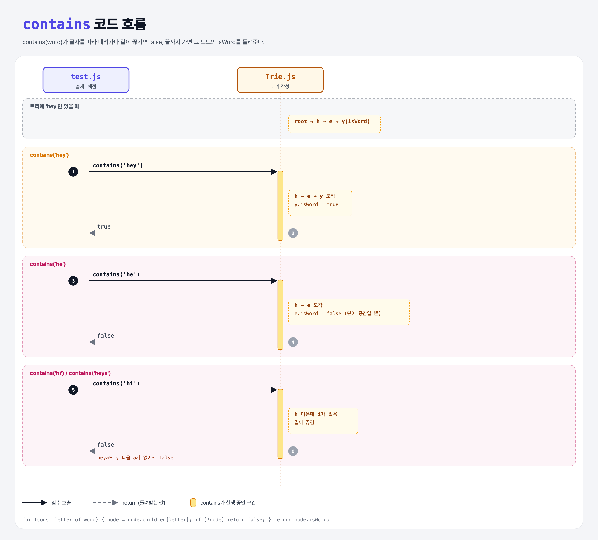

# Does it Contain the Word? (Learn Tries 4단계)

## 문제

`contains(word)` 만들기. 트라이에 그 단어가 있으면 `true`, 없으면 `false`.

```js
trie.insert('happy');  trie.insert('healthy');
trie.contains('happy');      // true
trie.contains('whimsical');  // false
trie.contains('health');     // false ← 경로는 있지만 단어로 끝나지 않음
```

## 한 줄 요약

글자를 따라 내려가다 **길이 끊기면 false**, 끝까지 가면 그 노드의 **isWord**를 돌려준다.



### 다이어그램 읽는 법

| 구간 | 일어나는 일 |
|------|-------------|
| contains('hey') | h → e → y 도착, y.isWord = true → true |
| contains('he') | e까지 갔지만 e.isWord = false → false |
| contains('hi') | h 다음 i가 없음 → false |

---

## 0. 이 과제가 말하려는 것

> **찾는 시간은 저장된 단어 수와 상관없이 단어 길이만큼이다.**

```
trie-node → trie-insert → trie-branching → [단어 찾기]
                                            ★ 이 단계
```

---

## 1. 파일 구성

| 파일 | 역할 |
|------|------|
| `Trie.js` | 완성본 (insert + contains) |
| `TrieNode.js` | trie-node 과제 그대로 |
| `test.js` | 출제 · 채점 (테스트 2개) |

---

## 2. 정답 코드

```js
contains(word) {
    let node = this.root;
    for (const letter of word) {
        node = node.children[letter];
        if (!node) {
            return false;
        }
    }
    return node.isWord;
}
```

```python
def contains(self, word):
    node = self.root
    for letter in word:
        node = node.children.get(letter)
        if node is None:
            return False
    return node.is_word
```

- JS 객체에 없는 키를 읽으면 `undefined`가 나온다 (Python `dict.get`처럼 에러 없음).

---

## 3. test.js 한 줄씩

```js
trie.insert('hey');
assert(trie.contains('hey'), "...");
assert(!trie.contains('hello'), "...");   // e 다음 l이 없음
assert(!trie.contains('he'), "...");      // 경로는 있지만 isWord false
assert(!trie.contains('hi'), "...");      // h 다음 i가 없음
assert(!trie.contains('heya'), "...");    // y 다음 a가 없음
```

---

## 4. 일부러 틀려 보면

| 바꾼 것 | 결과 |
|---------|------|
| 끝에서 `return true` | `he`가 있다고 나옴 → 실패 |
| `if (!node)` 검사 빼기 | 다음 반복에서 `undefined.children` → `TypeError` |

---

## 5. 실행 방법

```bash
npx mocha week2/trie-contains/test.js
```

## 기억할 것

1. 경로가 있다고 단어가 있는 건 아니다 → `isWord`로 확인.
2. 없는 키 = `undefined` → 그 자리에서 false.
