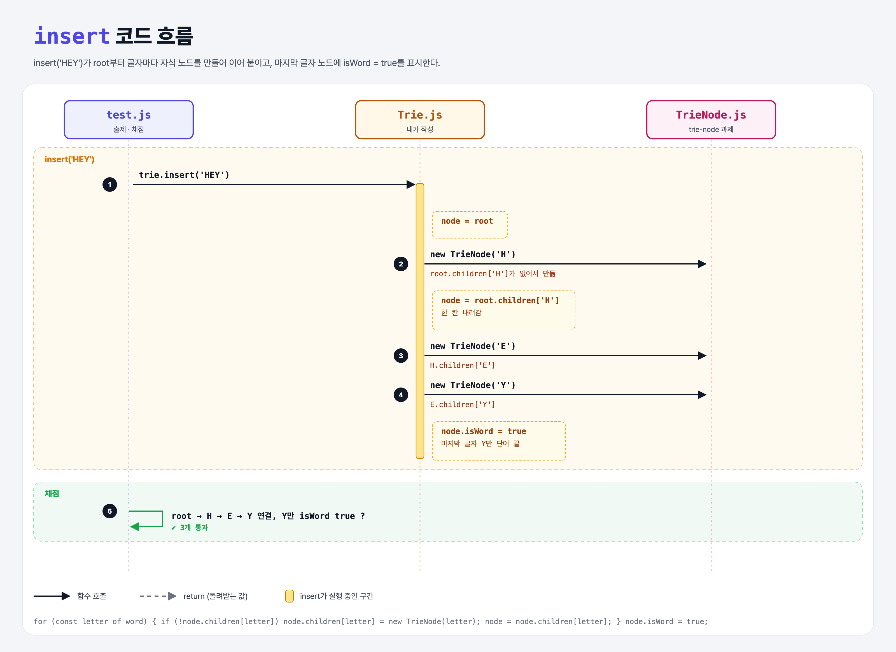

# Simple Trie Insert (Learn Tries 2단계)

## 문제

`Trie`에 `insert(word)` 만들기. 단어를 글자로 쪼개 글자마다 노드를 만들고, `children`으로 이어 붙인다. **마지막 글자 노드만** `isWord = true`.

```js
trie.insert('HEY');
// root.children['H'] → H.children['E'] → E.children['Y'] (isWord: true)
```

## 한 줄 요약

`node`를 root에 두고 글자마다 **없으면 만들고 → 한 칸 내려간다.** 끝나면 그 노드에 단어 끝 표시.



---

## 0. 이 과제가 말하려는 것

```
trie-node → [단어 넣기] → 가지치기 → 단어 찾기
             ★ 이 단계
```

---

## 1. 파일 구성

| 파일 | 역할 |
|------|------|
| `Trie.js` | **insert 추가** |
| `TrieNode.js` | trie-node 과제 그대로 |
| `test.js` | 출제 · 채점 (테스트 3개) |

---

## 2. 정답 코드

```js
insert(word) {
    let node = this.root;
    for (const letter of word) {
        if (!node.children[letter]) {
            node.children[letter] = new TrieNode(letter);
        }
        node = node.children[letter];
    }
    node.isWord = true;
}
```

| 코드 | 설명 |
|------|------|
| `for (const letter of word)` | 문자열도 글자 하나씩 돌 수 있다 (Python `for letter in word`) |
| `node.children[letter]` | 객체에 변수 이름으로 접근 (Python `node.children[letter]`) |
| `node = …` | 한 칸 아래 노드로 이동. 그래서 `let` |

```python
def insert(self, word):
    node = self.root
    for letter in word:
        if letter not in node.children:
            node.children[letter] = TrieNode(letter)
        node = node.children[letter]
    node.is_word = True
```

---

## 3. test.js 한 줄씩

```js
const firstNode = trie.root.children['H'];
assert.equal(firstNode.key, 'H', ...);
assert(firstNode.children['E'], ...);                         // 다음 글자와 연결
assert.equal(firstNode.isWord, false, ...);                   // 중간 글자는 false
...
assert.equal(Object.keys(thirdNode.children).length, 0, ...); // 마지막 Y는 자식 없음
assert.equal(thirdNode.isWord, true, ...);                    // 마지막만 true
```

- `Object.keys(obj).length`는 Python의 `len(d)`.

---

## 4. 일부러 틀려 보면

| 바꾼 것 | 결과 |
|---------|------|
| 반복문 안에서 매번 `isWord = true` | H, E도 true → 실패 |
| `node = …`로 내려가지 않음 | 모든 글자가 root 바로 밑에 붙음 → 실패 |

---

## 5. 실행 방법

```bash
npx mocha week2/trie-insert/test.js
```

## 기억할 것

1. 없으면 만들고, 내려가고, 끝에 표시.
2. `isWord`는 마지막 글자에만.
