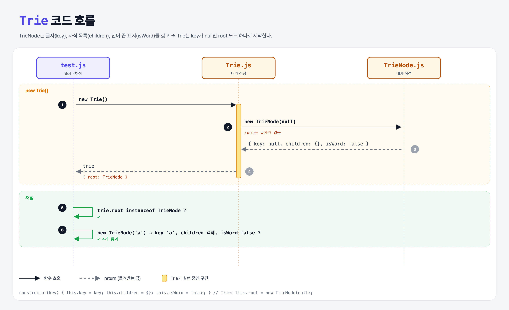

# Trie & Trie Node (Learn Tries 1단계)

## 문제

`TrieNode`와 `Trie`의 constructor 완성하기.

| 클래스 | 속성 | 값 |
|--------|------|-----|
| `TrieNode` | `key` | 받은 글자 (문자열) |
| | `children` | 자식 노드들을 담는 객체, 처음엔 `{}` |
| | `isWord` | 이 노드에서 단어가 끝나는지, 처음엔 `false` |
| `Trie` | `root` | key가 `null`인 `TrieNode` (맨 위 부모) |

## 한 줄 요약

트라이(trie) = **글자 하나가 노드 하나**인 트리. 위에서부터 글자를 따라 내려가면 단어가 된다.

```
root(null) → h → e → y
```



---

## 0. 이 과제가 말하려는 것

> **트라이는 공통 앞부분(접두사)을 함께 쓰는 트리다. 이더리움은 계정 상태를 이 구조를 변형한 "Patricia Merkle Trie"에 저장한다.**

```
[노드 만들기] → 단어 넣기 → 가지치기 → 단어 찾기
 ★ 이 단계     trie-insert  trie-branching  trie-contains
```

- 이더리움 노드는 트라이 4개를 관리한다: 상태(계정), 저장소(컨트랙트 데이터), 거래, 영수증(로그).

---

## 1. 파일 구성

| 파일 | 역할 |
|------|------|
| `TrieNode.js` | **노드 클래스** |
| `Trie.js` | **트라이 클래스** |
| `test.js` | 출제 · 채점 (테스트 4개) |

---

## 2. 정답 코드

```js
class TrieNode {
    constructor(key) {
        this.key = key;
        this.children = {};
        this.isWord = false;
    }
}

class Trie {
    constructor() {
        this.root = new TrieNode(null);
    }
}
```

- `children`을 배열이 아니라 **객체**로 두는 이유: `children['h']`처럼 글자로 바로 찾을 수 있어서. Python의 `dict`와 같다.

```python
class TrieNode:
    def __init__(self, key):
        self.key = key
        self.children = {}
        self.is_word = False
```

---

## 3. test.js 한 줄씩

```js
assert(trie.root instanceof TrieNode, "...");
assert.equal(new TrieNode('a').key, 'a', "...");
assert.equal(typeof node.children, 'object', "...");   // typeof {} === 'object'
assert.equal(node.isWord, false, "...");
```

---

## 5. 실행 방법

```bash
npx mocha week2/trie-node/test.js
```

## 기억할 것

1. 트라이 노드 = 글자 + 자식들(dict) + 단어 끝 표시.
2. root는 글자가 없는(`null`) 출발점.
