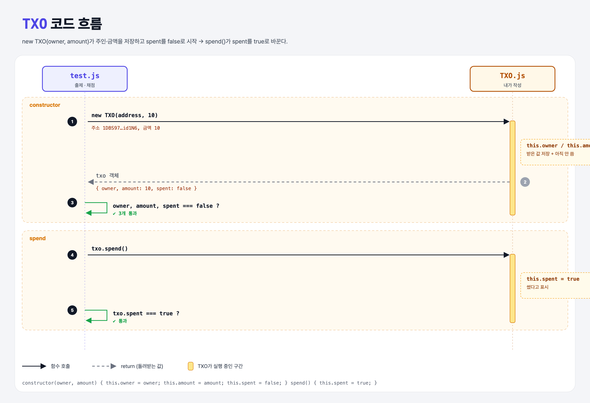

# TXO Class (Coding the UTXO Model 1단계)

## 문제

`TXO`(Transaction Output) 클래스 완성하기.

- constructor: 받은 `owner`, `amount`를 같은 이름의 속성에 저장하고, `spent`는 `false`로 시작.
- `spend()`: `spent`를 `true`로 바꾼다.

```js
const txo = new TXO("1FNv3tXLkejPBYxDHDaZz6ENNz3zn3G4GM", 10);
txo.owner;   // 1FNv3t...
txo.amount;  // 10
txo.spent;   // false
txo.spend();
txo.spent;   // true
```

## 한 줄 요약

비트코인의 돈은 "잔액"이 아니라 **주인과 금액이 적힌 쪽지(TXO)들**이다. 쪽지는 한 번 쓰면 끝(`spent = true`).



### 다이어그램 읽는 법

| 구간 | 일어나는 일 |
|------|-------------|
| constructor | 주인·금액 저장, spent는 false → 3가지 확인 |
| spend | spent가 true로 바뀌는지 확인 |

---

## 0. 이 과제가 말하려는 것

> **UTXO 모델: 계정마다 잔액을 적어 두지 않고, 아직 안 쓴 출력(UTXO)들을 모아 그 사람의 돈으로 본다.**

```
[TXO 만들기] → 입력 검사(이중 지불) → 금액 검사 → 입력 사용 처리 → 수수료
 ★ 이 단계     utxo-inputs           sufficient-input  mark-spent      miners-fee
```

| | UTXO 모델 (비트코인) | 계정 모델 (이더리움) |
|---|---|---|
| 돈의 단위 | 쓰지 않은 출력 쪽지들 | 계정의 잔액 숫자 |
| 내 잔액 | 내 UTXO 금액을 다 더한 것 | 계정에 적힌 값 |
| 쓸 때 | 쪽지를 통째로 쓰고, 거스름돈은 새 쪽지로 받음 | 잔액에서 뺌 |

- **UTXO** = Unspent Transaction Output (아직 안 쓴 출력). 쓰고 나면 그냥 TXO.

---

## 1. 파일 구성

| 파일 | 역할 |
|------|------|
| `TXO.js` | **이번에 완성할 클래스** |
| `test.js` | 출제 · 채점 (테스트 4개) |

---

## 2. 정답 코드

```js
class TXO {
    constructor(owner, amount) {
        this.owner = owner;
        this.amount = amount;
        this.spent = false;
    }

    spend() {
        this.spent = true;
    }
}
```

```python
class TXO:
    def __init__(self, owner, amount):
        self.owner = owner
        self.amount = amount
        self.spent = False

    def spend(self):
        self.spent = True
```

---

## 3. test.js 한 줄씩

```js
const TXO = require('./TXO');                         // 원래 '../TXO' → './'로 수정
const txo = new TXO("1DBS97W3jWw6FnAqdduK1NW6kFo3Aid1N6", 10);

assert.equal(txo.owner, address);     // 주인
assert.equal(txo.amount, amount);     // 금액
assert.equal(txo.spent, false);       // 처음엔 안 씀
txo.spend();
assert.equal(txo.spent, true);        // 쓰고 나면 true
```

---

## 4. 일부러 틀려 보면

| 바꾼 것 | 결과 |
|---------|------|
| `this.spent`를 안 만듦 | `undefined`라서 `assert.equal(undefined, false)` 실패 |
| 속성 이름을 `this.address`로 | `txo.owner`가 없어서 실패 |

---

## 5. 실행 방법

```bash
npx mocha week2/txo-class/test.js
```

## 기억할 것

1. 비트코인 = UTXO 모델, 이더리움 = 계정 모델.
2. TXO = 주인 + 금액 + 썼는지 여부.
