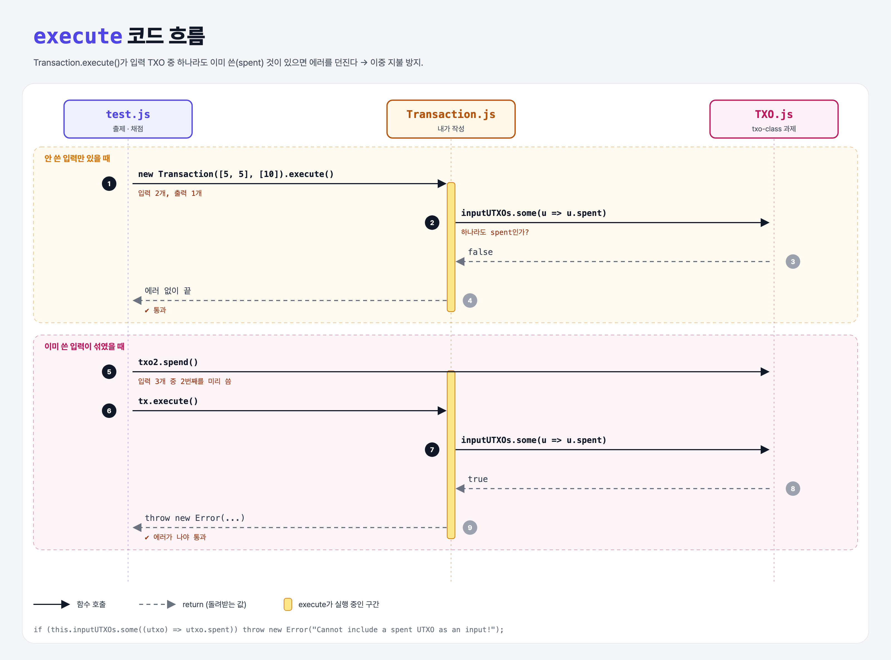

# Ensure Inputs are UTXOs (Coding the UTXO Model 2단계)

## 문제

새 파일 `Transaction.js`의 `Transaction` 클래스 완성하기.

1. constructor에서 `inputUTXOs`, `outputUTXOs`(둘 다 TXO 배열)를 저장한다.
2. `execute()`에서 입력 중 **이미 쓴 TXO가 하나라도 있으면 에러**를 던진다.

## 한 줄 요약

이미 쓴 쪽지를 또 쓰는 것(**이중 지불**)을 막는다. → `some(utxo => utxo.spent)`이면 `throw`.



### 다이어그램 읽는 법

| 구간 | 일어나는 일 |
|------|-------------|
| 안 쓴 입력만 | `some`이 false → 에러 없이 끝남 |
| 쓴 입력이 섞임 | `some`이 true → 에러를 던짐 |

---

## 0. 이 과제가 말하려는 것

> **거래는 여러 입력 UTXO를 모아 여러 출력 UTXO를 만든다. 입력은 반드시 "아직 안 쓴" 것이어야 한다.**

```
txo-class → [입력 검사] → 금액 검사 → 입력 사용 처리 → 수수료
             ★ 이 단계
```

- 비트코인 거래 하나에 입력·출력이 여러 개일 수 있다. 여기에 스크립트를 붙여 복잡한 조건도 만들 수 있지만, 보통은 "이 주소의 주인만 쓸 수 있다"는 조건 하나다.

---

## 1. 파일 구성

| 파일 | 역할 |
|------|------|
| `Transaction.js` | **이번에 완성할 클래스** |
| `TXO.js` | txo-class 과제 정답 그대로 |
| `test.js` | 출제 · 채점 (테스트 2개) |

---

## 2. 정답 코드

```js
class Transaction {
    constructor(inputUTXOs, outputUTXOs) {
        this.inputUTXOs = inputUTXOs;
        this.outputUTXOs = outputUTXOs;
    }

    execute() {
        const anySpent = this.inputUTXOs.some((utxo) => utxo.spent);
        if (anySpent) {
            throw new Error("Cannot include a spent UTXO as an input!");
        }
    }
}
```

| 코드 | 설명 |
|------|------|
| `arr.some(fn)` | 하나라도 `fn`이 참이면 `true`. Python `any(u.spent for u in inputs)`. |
| `throw new Error(...)` | 예외 발생. Python `raise Exception(...)`. |

---

## 3. test.js 한 줄씩

```js
// 정상: 안 쓴 TXO 2개
try { tx.execute(); }
catch (ex) { assert.fail(ex.message); }   // 에러가 나면 실패 처리

// 이중 지불: 3개 중 txo2를 미리 spend()
let ex;
try { tx.execute(); }
catch (_ex) { ex = _ex; }                  // 에러를 잡아서 저장
assert(ex, "Did not throw an exception with a spent input TXO!");   // 에러가 있어야 통과
```

- `try / catch`는 Python의 `try / except`.

---

## 4. 일부러 틀려 보면

| 바꾼 것 | 결과 |
|---------|------|
| `some` 대신 `every` | 모두 spent일 때만 에러 → 하나만 쓴 경우를 놓쳐서 실패 |
| `throw` 대신 `return false` | 에러가 안 나서 두 번째 테스트 실패 |

---

## 5. 실행 방법

```bash
npx mocha week2/utxo-inputs/test.js
```

## 기억할 것

1. 이중 지불 방지 = 입력 중 spent가 있으면 거부.
2. `some` = `any`, `throw` = `raise`, `try/catch` = `try/except`.
