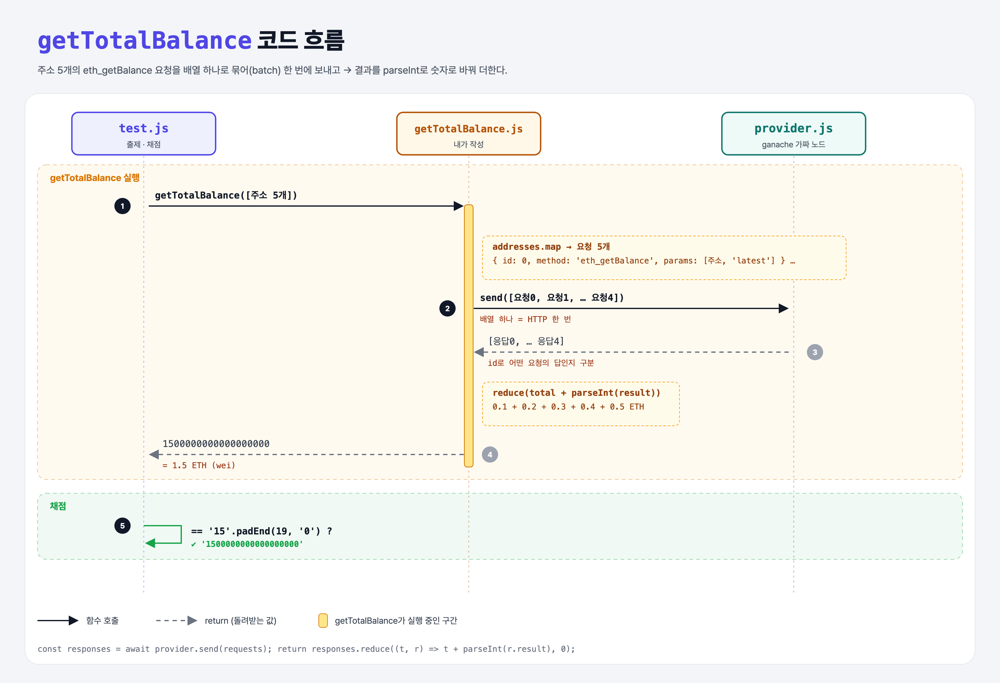

# Batch Transactions (JSON-RPC Requests 5단계)

## 문제

`getTotalBalance(addresses)`가 주소 여러 개의 잔액을 **모두 더해** 돌려주게 하기. 요청을 **배열로 묶어(batch)** 한 번에 보낸다.

## 한 줄 요약

요청 여러 개를 배열 하나로 보내면 응답도 배열로 온다. 각 응답의 `result`를 `parseInt`로 숫자로 바꿔 더한다.



---

## 0. 이 과제가 말하려는 것

> **`id`의 쓸모: 요청을 묶어 보내면 응답 순서와 상관없이 id로 짝을 맞춘다. HTTP 왕복을 한 번으로 줄인다.**

```
… → total-transactions → [묶음 요청]
                          ★ 이 단계
```

```js
const responses = await provider.send([request1, request2]);
// [ { id: 1, jsonrpc: '2.0', result: '0x0' }, { id: 2, jsonrpc: '2.0', result: '1612393685706' } ]
```

---

## 1. 파일 구성

| 파일 | 역할 |
|------|------|
| `getTotalBalance.js` | **이번에 완성할 함수** |
| `provider.js` | 계정 5개 (0.1 ~ 0.5 ETH) |
| `promisify.js` | 콜백 → Promise 도우미 |
| `test.js` | 출제 · 채점 (테스트 1개) |

---

## 2. 정답 코드

```js
async function getTotalBalance(addresses) {
    const requests = addresses.map((address, i) => ({
        jsonrpc: "2.0",
        id: i,
        method: "eth_getBalance",
        params: [address, "latest"],
    }));

    const responses = await provider.send(requests);

    return responses.reduce((total, response) => total + parseInt(response.result), 0);
}
```

| 코드 | 설명 |
|------|------|
| `addresses.map((address, i) => ({ … }))` | 주소마다 요청 객체 하나. 객체를 바로 반환하려면 `({ })`처럼 괄호로 감싼다 |
| `provider.send(requests)` | 배열을 통째로 보냄 |
| `parseInt("0x16345785d8a0000")` | `0x`로 시작하면 16진수로 읽는다 → 100000000000000000 |

```python
requests_ = [{"jsonrpc": "2.0", "id": i, "method": "eth_getBalance", "params": [a, "latest"]}
             for i, a in enumerate(addresses)]
responses = send(requests_)
return sum(int(r["result"], 16) for r in responses)
```

---

## 3. test.js 한 줄씩

```js
// provider.js: 계정 i의 잔액 = (i + 1).toString().padEnd(18, "0")
//   → "100000000000000000" (0.1 ETH), "200000000000000000" (0.2 ETH) … "500000000000000000"
assert.equal(totalBalance, "15".padEnd(19, "0"));   // "1500000000000000000" = 1.5 ETH
```

- `padEnd(n, "0")`: 길이가 n이 될 때까지 뒤에 "0"을 붙인다 (Python `s.ljust(n, "0")`).

---

## 4. 일부러 틀려 보면

| 바꾼 것 | 결과 |
|---------|------|
| `parseInt` 없이 `total + response.result` | 문자열 이어 붙이기 → `"00x16…0x2c…"` → 실패 |
| 요청을 5번 따로 `await` | 결과는 맞지만 HTTP 5번 (이 과제의 목적과 다름) |

### 큰 수 주의

wei 값은 금방 `Number`의 정확한 범위(약 9×10¹⁵)를 넘는다. 이번 합계 1.5×10¹⁸은 우연히 정확히 표현되지만, 실제 앱에서는 `BigInt(response.result)`로 더하는 게 안전하다.

---

## 5. 실행 방법

```bash
npx mocha week3/batch-balance/test.js --exit
```

## 로컬 실행 환경 메모

강의 사이트는 `ganache-core`(옛 이름)를 쓴다. 로컬에서는 같은 역할을 하는 최신 패키지 `ganache@7`을 설치했고, 사이트에서 숨겨져 있던 `promisify.js`는 같은 역할로 직접 만들었다. 새 ganache는 계정 잔액을 **16진수 문자열**로만 받아서, provider.js의 잔액 값만 같은 값의 16진수로 바꿨다. 정답 코드(내가 작성한 파일)는 사이트와 똑같다.

ganache가 백그라운드 연결을 열어 두기 때문에 테스트가 끝나도 프로세스가 안 끝날 수 있다. 그래서 `--exit`를 붙여 실행한다.

## 기억할 것

1. 요청 배열 → 응답 배열, `id`로 짝 맞추기.
2. `parseInt("0x…")`는 16진수로 읽는다.
3. 큰 금액은 `BigInt`가 안전.
