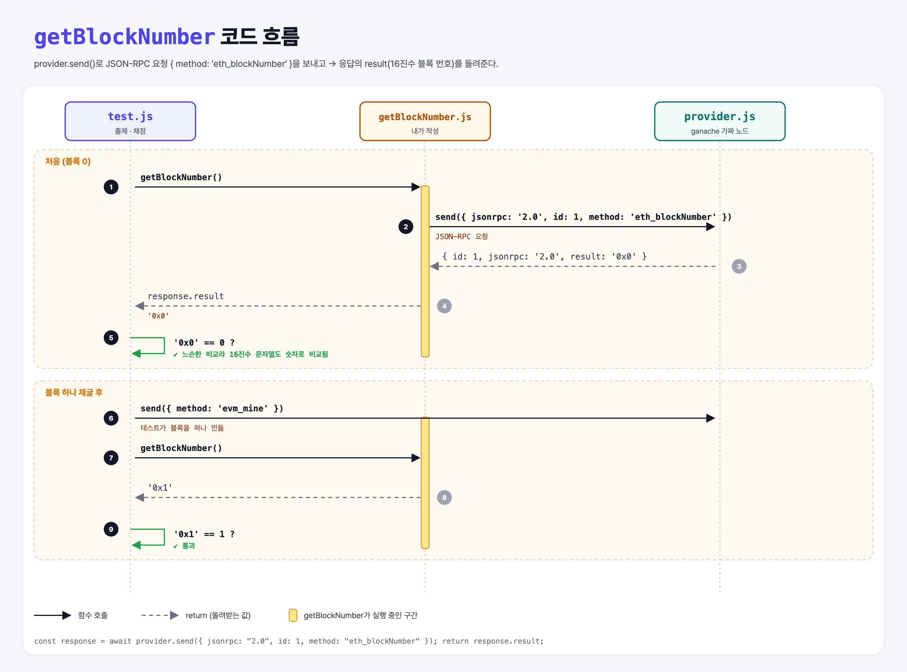

# Current Block Number (JSON-RPC Requests 1단계)

## 문제

`getBlockNumber()`가 이더리움 노드에 **JSON-RPC 요청**을 보내 현재 블록 번호를 받아 돌려주게 하기. 메서드 이름은 `eth_blockNumber`.

## 한 줄 요약

`provider.send({ jsonrpc: "2.0", id: 1, method: "eth_blockNumber" })` → 응답의 `result`가 블록 번호.



### 다이어그램 읽는 법

| 구간 | 일어나는 일 |
|------|-------------|
| 처음 | 요청을 보내면 `{ result: '0x0' }`이 와서 0번 블록 |
| 채굴 후 | 테스트가 `evm_mine`으로 블록을 하나 만들고 다시 물으면 `'0x1'` |

---

## 0. 이 과제가 말하려는 것

> **이더리움 노드와 대화하는 표준 방법은 JSON-RPC다. "이 메서드를 이 인자로 실행해 줘"라는 JSON을 보내고, 결과를 JSON으로 받는다.**

```
[블록 번호] → 잔액 → nonce → 블록의 거래 수 → 묶음 요청
 ★ 이 단계   get-balance  get-nonce  total-transactions  batch-balance
```

| 필드 | 뜻 |
|------|-----|
| `jsonrpc` | 규격 버전, 항상 `"2.0"` |
| `id` | 요청 번호. 응답에 같은 id가 붙어 와서 짝을 맞춘다 |
| `method` | 실행할 함수 이름 |
| `params` | 함수에 넘길 인자 배열 |

- 실제 서비스에서는 Alchemy 같은 노드 서비스 주소로 보낸다. 이 실습은 **ganache**(내 컴퓨터 안의 가짜 이더리움)로 연습한다.
- 이더리움은 약 12초마다 블록이 하나씩 생긴다. 첫 블록(0번)은 2015년 7월 30일.

---

## 1. 파일 구성

| 파일 | 역할 |
|------|------|
| `getBlockNumber.js` | **이번에 완성할 함수** |
| `provider.js` | ganache 가짜 노드를 만들고 `send`를 await 가능하게 감쌈 |
| `promisify.js` | 콜백 함수를 Promise로 바꾸는 도우미 |
| `test.js` | 출제 · 채점 (테스트 2개) |

---

## 2. 정답 코드

```js
async function getBlockNumber() {
    const response = await provider.send({
        jsonrpc: "2.0",
        id: 1,
        method: "eth_blockNumber",
    });

    return response.result;
}
```

Python으로 비슷하게 쓰면 (requests 라이브러리로 HTTP 노드에 보낼 때):

```python
response = requests.post(NODE_URL, json={"jsonrpc": "2.0", "id": 1, "method": "eth_blockNumber"}).json()
return response["result"]
```

---

## 3. test.js 한 줄씩

```js
const blockNumber = await getBlockNumber();
assert.equal(blockNumber, 0);       // '0x0' == 0 → true

provider.send({ id: 1, jsonrpc: "2.0", method: "evm_mine" });   // ganache 전용: 블록 하나 강제로 만들기
assert.equal(blockNumber, 1);       // '0x1' == 1 → true
```

- 결과는 `'0x0'` 같은 **16진수 문자열**인데, chai의 `assert.equal`은 `==`(느슨한 비교)라서 `Number('0x1')` = 1로 바뀌어 비교된다.

---

## 4. 일부러 틀려 보면

| 바꾼 것 | 결과 |
|---------|------|
| `return response` (result 안 꺼냄) | 객체 전체가 반환돼서 0과 다름 → 실패 |
| `await` 빼먹음 | Promise 객체를 다룸 → `response.result`가 `undefined` |

---

## 5. 실행 방법

```bash
npx mocha week3/block-number/test.js --exit
```

## 로컬 실행 환경 메모

강의 사이트는 `ganache-core`(옛 이름)를 쓴다. 로컬에서는 같은 역할을 하는 최신 패키지 `ganache@7`을 설치했고, 사이트에서 숨겨져 있던 `promisify.js`는 같은 역할로 직접 만들었다. 새 ganache는 계정 잔액을 **16진수 문자열**로만 받아서, provider.js의 잔액 값만 같은 값의 16진수로 바꿨다. 정답 코드(내가 작성한 파일)는 사이트와 똑같다.

ganache가 백그라운드 연결을 열어 두기 때문에 테스트가 끝나도 프로세스가 안 끝날 수 있다. 그래서 `--exit`를 붙여 실행한다.

## 기억할 것

1. JSON-RPC 요청 = `{ jsonrpc, id, method, params }`.
2. 응답의 값은 `result`에 들어 있다.
3. 숫자는 16진수 문자열로 온다.
