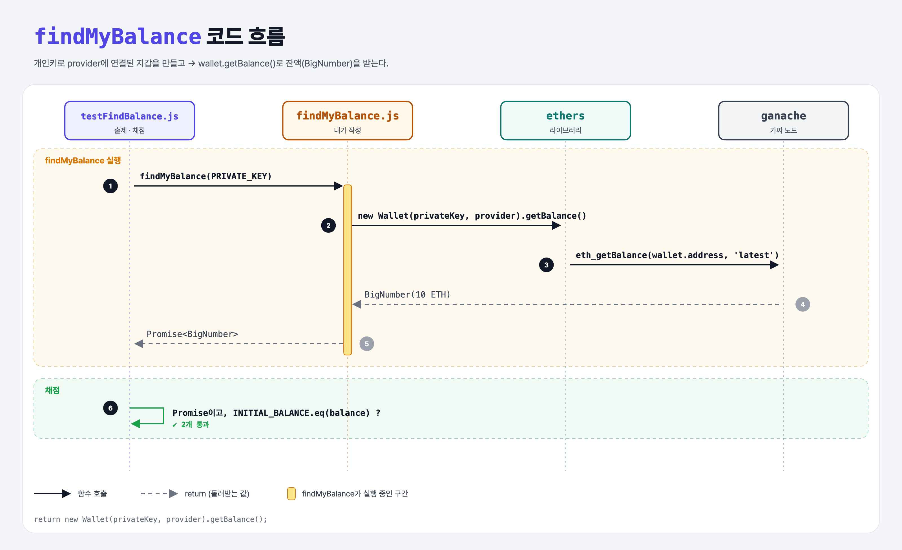

# Retrieve the Balance (Intro to Ethers.js 5단계)

## 문제

`findMyBalance(privateKey)`: 개인키에 해당하는 주소의 잔액을 돌려주는 Promise를 반환하기.

## 한 줄 요약

`new Wallet(privateKey, provider).getBalance()`.



---

## 0. 이 과제가 말하려는 것

```
… → ethers-nonce → [잔액] → 기부하기
                    ★ 이 단계
```

provider에 연결된 Wallet이 쓸 수 있는 주요 메서드:

| 메서드 | 하는 일 |
|--------|---------|
| `getBalance()` | 내 잔액 |
| `getTransactionCount()` | 내 nonce |
| `sendTransaction(tx)` | 서명 + 전송 |
| `signMessage(msg)` | 메시지 서명 |

---

## 1. 파일 구성

| 파일 | 역할 |
|------|------|
| `findMyBalance.js` | **이번에 완성할 함수** |
| `config.js` | 10 ETH 테스트 계정 + `INITIAL_BALANCE` |
| `testFindBalance.js` | 출제 · 채점 (테스트 2개) |

---

## 2. 정답 코드

```js
function findMyBalance(privateKey) {
    const wallet = new Wallet(privateKey, provider);
    return wallet.getBalance();
}
```

- `async`가 없어도 `getBalance()`가 Promise를 돌려주니 그대로 return하면 된다.

---

## 3. test 한 줄씩

```js
assert(findMyBalance(PRIVATE_KEY) instanceof Promise);
const balance = await findMyBalance(PRIVATE_KEY);
assert(INITIAL_BALANCE.eq(balance));     // BigNumber끼리는 .eq()로 비교
```

- ethers v5의 금액은 **BigNumber** 객체다. `===`로 비교하면 객체 비교라 항상 false. `.eq()`, `.gt()`, `.add()` 같은 메서드를 쓴다.

---

## 5. 실행 방법

```bash
npx mocha week3/ethers-balance/testFindBalance.js --exit
```

## 로컬 실행 환경 메모

강의 사이트에서 숨겨져 있던 `config.js`는 같은 역할로 직접 만들었다. 테스트 계정(개인키 `0xf2f48ee1…257d`, 주소 `0x5409ED02…A631`)에 10 ETH를 넣은 ganache 가짜 노드를 만든다. 강의는 `ganache-core`, 로컬은 최신 `ganache@7`을 쓴다. 정답 코드는 사이트와 같다. ethers는 강의와 같은 **5.x**(`ethers@5.7.2`)를 설치했다 (6.x는 사용법이 달라서 이 코드가 동작하지 않는다).

## 기억할 것

1. provider에 연결된 지갑 = 내 계정 정보를 바로 조회.
2. BigNumber 비교는 `.eq()`.
