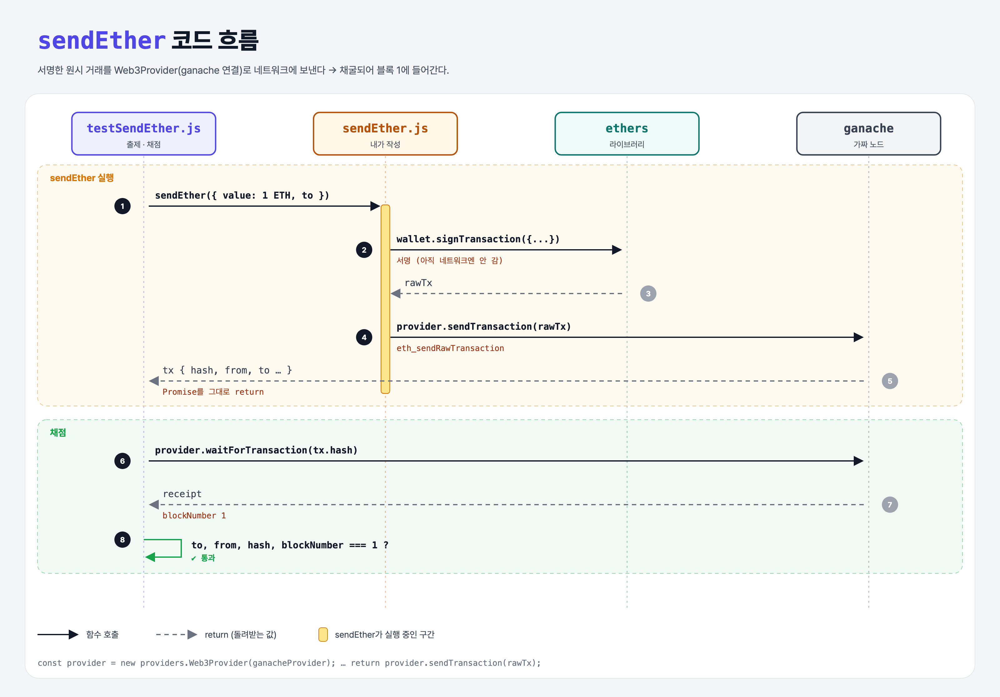

# Connect to Ethereum (Intro to Ethers.js 3단계)

## 문제

1. ganache에 연결된 ethers **provider**를 만든다: `new providers.Web3Provider(ganacheProvider)`
2. 서명한 원시 거래를 `provider.sendTransaction(rawTx)`로 **네트워크에 보내고**, 그 Promise를 돌려준다.

## 한 줄 요약

서명만으로는 아무 일도 안 일어난다. **provider로 노드에 보내야(broadcast)** 채굴되어 블록에 들어간다.



---

## 0. 이 과제가 말하려는 것

```
ethers-wallets → ethers-sign → [네트워크 연결] → nonce → 잔액 → 기부하기
                                ★ 이 단계
```

| | 하는 일 |
|---|---|
| **Wallet** | 개인키를 갖고 서명 |
| **Provider** | 노드와 통신 (읽기, 거래 전송) |

- 실제 서비스에서는 `new providers.AlchemyProvider(...)`처럼 노드 서비스에 연결한다. 이 실습은 ganache.

---

## 1. 파일 구성

| 파일 | 역할 |
|------|------|
| `sendEther.js` | **provider 만들기 + 전송** |
| `config.js` | 10 ETH 테스트 계정이 있는 ganache (사이트에서는 숨김) |
| `testSendEther.js` | 출제 · 채점 (테스트 2개) |

---

## 2. 정답 코드

```js
const provider = new providers.Web3Provider(ganacheProvider);
const wallet = new Wallet(PRIVATE_KEY);

async function sendEther({ value, to }) {
    const rawTx = await wallet.signTransaction({
        value, to,
        gasLimit: 0x5208,       // 21000
        gasPrice: 0x3b9aca00    // 1 gwei
    });

    return provider.sendTransaction(rawTx);
}
```

- `sendEther({ value, to })`: 객체를 받아서 바로 풀어 쓰는 **구조 분해 매개변수**. Python이라면 `def send_ether(value, to)`에 키워드 인자로 넘기는 느낌.
- `{ value, to, … }` = `{ value: value, to: to, … }`.

---

## 3. test 한 줄씩

```js
tx = await sendEther({ value: ethers.utils.parseEther("1.0"), to: "0xdD0D…DE92" });
assert(tx, "The function did not resolve with a transaction. Did you return the transaction promise?");
assert.equal(tx.from, "0x5409ED021D9299bf6814279A6A1411A7e866A631");
const receipt = await provider.waitForTransaction(tx.hash);   // 채굴될 때까지 기다리기
assert.equal(receipt.blockNumber, 1);
```

---

## 4. 일부러 틀려 보면

| 바꾼 것 | 결과 |
|---------|------|
| `return` 빼먹음 | `tx`가 `undefined` → "Did you return the transaction promise?" |

---

## 5. 실행 방법

```bash
npx mocha week3/ethers-connect/testSendEther.js --exit
```

## 로컬 실행 환경 메모

강의 사이트에서 숨겨져 있던 `config.js`는 같은 역할로 직접 만들었다. 테스트 계정(개인키 `0xf2f48ee1…257d`, 주소 `0x5409ED02…A631`)에 10 ETH를 넣은 ganache 가짜 노드를 만든다. 강의는 `ganache-core`, 로컬은 최신 `ganache@7`을 쓴다. 정답 코드는 사이트와 같다. ethers는 강의와 같은 **5.x**(`ethers@5.7.2`)를 설치했다 (6.x는 사용법이 달라서 이 코드가 동작하지 않는다).

## 기억할 것

1. Wallet = 서명, Provider = 노드와 통신.
2. 서명 → 전송(broadcast) → 채굴 → 영수증(receipt).
