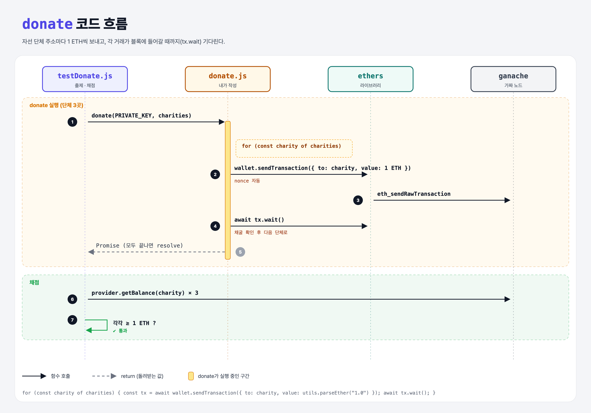

# Donating to Charities (Intro to Ethers.js 6단계)

## 문제

`donate(privateKey, charities)`: 10 ETH가 든 지갑에서 자선 단체 주소마다 **최소 1 ETH씩** 보내기. 모든 기부가 끝나면 resolve되는 Promise를 돌려준다.

## 한 줄 요약

지갑을 provider에 연결 → 단체마다 `sendTransaction` → `tx.wait()`로 채굴 확인.



---

## 0. 이 과제가 말하려는 것

> **지금까지 배운 것(지갑, provider, 전송, nonce)을 모두 합친다.**

```
… → ethers-balance → [기부하기]
                      ★ 이 단계
```

---

## 1. 파일 구성

| 파일 | 역할 |
|------|------|
| `donate.js` | **이번에 완성할 함수** |
| `config.js` | ethers-connect와 같음 |
| `testDonate.js` | 출제 · 채점 (테스트 2개) |

---

## 2. 정답 코드

```js
async function donate(privateKey, charities) {
    const wallet = new Wallet(privateKey, provider);
    for (const charity of charities) {
        const tx = await wallet.sendTransaction({
            to: charity,
            value: utils.parseEther("1.0"),
        });
        await tx.wait();
    }
}
```

| 코드 | 설명 |
|------|------|
| `for…of` + `await` | 하나씩 차례로 보낸다. nonce가 0, 1, 2로 꼬이지 않는다 |
| `tx.wait()` | 그 거래가 블록에 들어갈 때까지 기다림 |
| gasLimit/gasPrice 생략 | provider가 추정해서 채운다 |

```python
async def donate(private_key, charities):
    wallet = Wallet(private_key, provider)
    for charity in charities:
        tx = await wallet.send_transaction(to=charity, value=parse_ether("1.0"))
        await tx.wait()
```

---

## 3. test 한 줄씩

```js
const donationPromise = donate(PRIVATE_KEY, charities);
assert(donationPromise instanceof Promise);              // async 함수는 항상 Promise
await donationPromise;
const balance = await provider.getBalance(charities[i]);
assert.isAtLeast(+balance, +ethers.utils.parseEther("1.0"));   // +BigNumber → 숫자로 변환
```

---

## 4. 일부러 틀려 보면

| 바꾼 것 | 결과 |
|---------|------|
| `charities.forEach(async c => …)` | forEach는 await를 기다리지 않아서, donate가 기부가 끝나기 전에 resolve됨 |

---

## 5. 실행 방법

```bash
npx mocha week3/ethers-donate/testDonate.js --exit
```

## 로컬 실행 환경 메모

강의 사이트에서 숨겨져 있던 `config.js`는 같은 역할로 직접 만들었다. 테스트 계정(개인키 `0xf2f48ee1…257d`, 주소 `0x5409ED02…A631`)에 10 ETH를 넣은 ganache 가짜 노드를 만든다. 강의는 `ganache-core`, 로컬은 최신 `ganache@7`을 쓴다. 정답 코드는 사이트와 같다. ethers는 강의와 같은 **5.x**(`ethers@5.7.2`)를 설치했다 (6.x는 사용법이 달라서 이 코드가 동작하지 않는다).

## 기억할 것

1. 반복하며 await하려면 `for…of` (forEach X).
2. `tx.wait()` = 채굴 확인.
