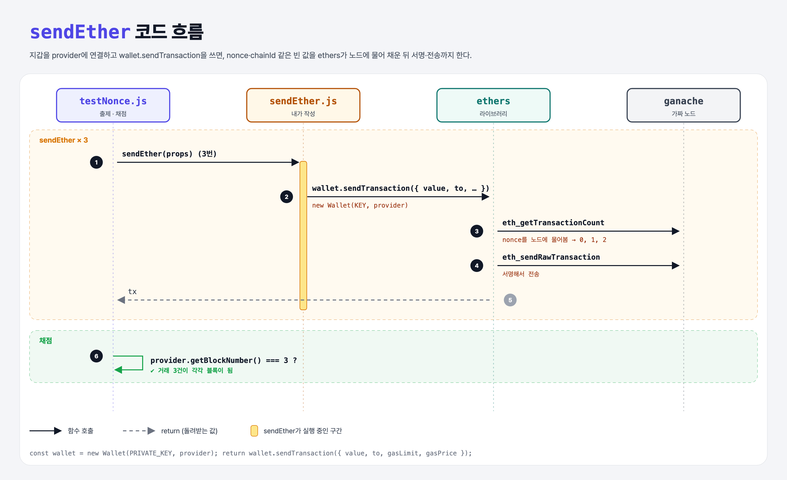

# Account Nonce (Intro to Ethers.js 4단계)

## 문제

거래를 여러 번 보내도 동작하게 하기. 앞 단계 코드는 nonce를 안 넣어서 두 번째 거래부터 거부된다.

```
TXRejectedError: the tx doesn't have the correct nonce. account has nonce of: 1 tx has nonce of: 0
```

해결: 지갑을 provider에 연결하고 `wallet.sendTransaction`을 쓴다. 빠진 값(nonce 등)을 ethers가 채워 준다.

## 한 줄 요약

`new Wallet(PRIVATE_KEY, provider)` + `wallet.sendTransaction({...})` = 빈칸 채우기 + 서명 + 전송을 한 번에.



---

## 0. 이 과제가 말하려는 것

> **거래마다 nonce가 0, 1, 2…로 올라가야 한다. 손으로 세지 말고 노드에 물어 채우게 하자.**

```
… → ethers-connect → [nonce] → 잔액 → 기부하기
                      ★ 이 단계
```

`wallet.sendTransaction`이 내부에서 하는 일:

1. `nonce`가 없으면 `eth_getTransactionCount`로 받아 채움
2. `chainId`, 가스 값 등 빈 값을 노드에 물어 채움
3. 서명 → `eth_sendRawTransaction`으로 전송

다른 방법: `provider.getTransactionCount(wallet.address)`로 nonce를 직접 받아 `signTransaction`에 넣어도 된다.

---

## 1. 파일 구성

| 파일 | 역할 |
|------|------|
| `sendEther.js` | **wallet.sendTransaction으로 바꿈** |
| `config.js` | ethers-connect와 같음 |
| `testNonce.js` | 출제 · 채점 (테스트 1개) |

---

## 2. 정답 코드

```js
const provider = new providers.Web3Provider(ganacheProvider);
const wallet = new Wallet(PRIVATE_KEY, provider);    // ← 두 번째 인자로 provider 연결

async function sendEther({ value, to }) {
    return wallet.sendTransaction({
        value, to,
        gasLimit: 0x5208,
        gasPrice: 0x3b9aca00
    });
}
```

---

## 3. test 한 줄씩

```js
await sendEther(props);  await sendEther(props);  await sendEther(props);
const blockNumber = await provider.getBlockNumber();
assert.equal(blockNumber, 3);     // ganache는 거래마다 블록을 하나씩 만든다 → 3
```

---

## 4. 일부러 틀려 보면

| 바꾼 것 | 결과 |
|---------|------|
| 앞 단계 코드 그대로 | 강의 사이트(ganache-core)에서는 위의 `TXRejectedError` |

로컬의 새 ganache에서는 앞 단계 코드도 에러가 나지 않았다. nonce 0인 **똑같은 원시 거래**를 세 번 보내서 해시가 같기 때문이다 (직접 확인함). 즉 실제로는 같은 거래가 반복된 것이라, 세 번 보낸 게 아니다.

---

## 5. 실행 방법

```bash
npx mocha week3/ethers-nonce/testNonce.js --exit
```

## 로컬 실행 환경 메모

강의 사이트에서 숨겨져 있던 `config.js`는 같은 역할로 직접 만들었다. 테스트 계정(개인키 `0xf2f48ee1…257d`, 주소 `0x5409ED02…A631`)에 10 ETH를 넣은 ganache 가짜 노드를 만든다. 강의는 `ganache-core`, 로컬은 최신 `ganache@7`을 쓴다. 정답 코드는 사이트와 같다. ethers는 강의와 같은 **5.x**(`ethers@5.7.2`)를 설치했다 (6.x는 사용법이 달라서 이 코드가 동작하지 않는다).

## 기억할 것

1. 지갑에 provider를 연결하면 `sendTransaction`이 nonce를 알아서 채운다.
2. nonce가 같으면 같은 거래로 취급된다.
