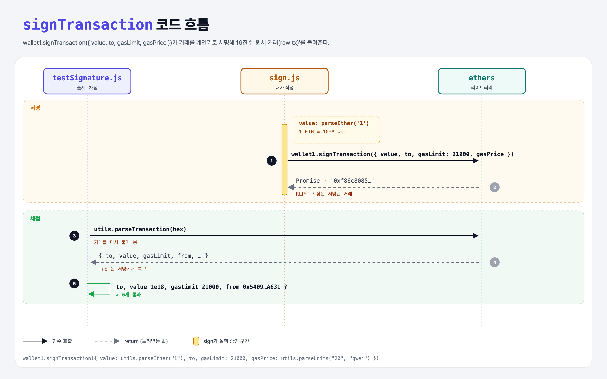

# Sign a Transaction (Intro to Ethers.js 2단계)

## 문제

`wallet1.signTransaction({...})`의 빈 값을 채워 거래를 서명하기.

| 필드 | 값 |
|------|-----|
| `value` | 1 ETH (wei 단위) |
| `to` | `"0xdD0DC6FB59E100ee4fA9900c2088053bBe14DE92"` |
| `gasLimit` | 21000 (ETH 송금에 드는 가스) |
| `gasPrice` | 가스 1단위당 가격 (이 실습은 옛 방식 Type 0 거래) |

## 한 줄 요약

거래 내용을 채워 `signTransaction`에 넘기면 **서명된 원시 거래(16진수 문자열)**를 돌려준다. 아직 네트워크에 보내지는 않는다.



---

## 0. 이 과제가 말하려는 것

> **거래가 누구에게서 왔는지, 정말 본인이 허락했는지는 서명으로 증명한다. 1주차 sign-message와 같은 원리를 거래에 적용한 것.**

```
ethers-wallets → [거래 서명] → 네트워크 연결 → nonce → 잔액 → 기부하기
                  ★ 이 단계
```

| 용어 | 뜻 |
|------|-----|
| **wei** | 가장 작은 단위. 1 ETH = 10¹⁸ wei, 1 gwei = 10⁹ wei |
| **gasLimit** | 이 거래에 쓸 가스 최대치. 단순 송금은 정확히 21000 |
| **gasPrice / baseFeePerGas** | 가스 1단위 가격. 네트워크 수요에 따라 오르내린다. 기본 수수료는 소각(burn)된다 |
| **maxPriorityFeePerGas** | 검증자에게 주는 팁 |
| **maxFeePerGas** | 기본 + 팁의 최대치 |

최소 송금 비용 = 21000 × baseFeePerGas.

---

## 1. 파일 구성

| 파일 | 역할 |
|------|------|
| `sign.js` | **이번에 채울 파일** |
| `wallets.js` | ethers-wallets 과제 그대로 |
| `testSignature.js` | 출제 · 채점 (테스트 6개) |

---

## 2. 정답 코드

```js
const signaturePromise = wallet1.signTransaction({
    value: utils.parseEther("1"),
    to: "0xdD0DC6FB59E100ee4fA9900c2088053bBe14DE92",
    gasLimit: 21000,
    gasPrice: utils.parseUnits("20", "gwei"),
});
```

| 코드 | 설명 |
|------|------|
| `utils.parseEther("1")` | "1" ETH → 1000000000000000000 wei (BigNumber) |
| `utils.parseUnits("20", "gwei")` | 20 gwei → 20000000000 wei |
| `signTransaction`은 Promise | `await` 없이 바로 export → 테스트가 `await`한다 |

---

## 3. test 한 줄씩

```js
assert(signaturePromise instanceof Promise);
const hex = await signaturePromise;                  // '0xf86c8085…' (111바이트 = 16진수 222글자)
assert(/^0x[0-9A-Fa-f]+$/.test(hex));
parsed = utils.parseTransaction(hex);                // 서명된 거래를 다시 풀기
assert.equal(parsed.value.toString(), "1000000000000000000");
assert(parsed.gasLimit.eq(21000));                   // BigNumber 비교는 .eq()
assert.equal(parsed.from, "0x5409ED021D9299bf6814279A6A1411A7e866A631");   // from은 서명에서 복구
```

- 원시 거래에는 `from`이 **없다**. 서명에서 공개키를 복구해 주소를 계산한다 (recover-key 과제와 같은 원리).

---

## 4. 일부러 틀려 보면

| 바꾼 것 | 결과 |
|---------|------|
| `value: 1` | 1 wei만 보냄 → value 테스트 실패 |
| `gasLimit` 빼먹음 | 0이 되어 gasLimit 테스트 실패 |

---

## 5. 실행 방법

```bash
npx mocha week3/ethers-sign/testSignature.js
```

## 기억할 것

1. 금액은 wei로. `parseEther`, `parseUnits`를 쓴다.
2. 송금 gasLimit = 21000.
3. 서명된 거래에는 from이 없고, 서명에서 복구한다.
