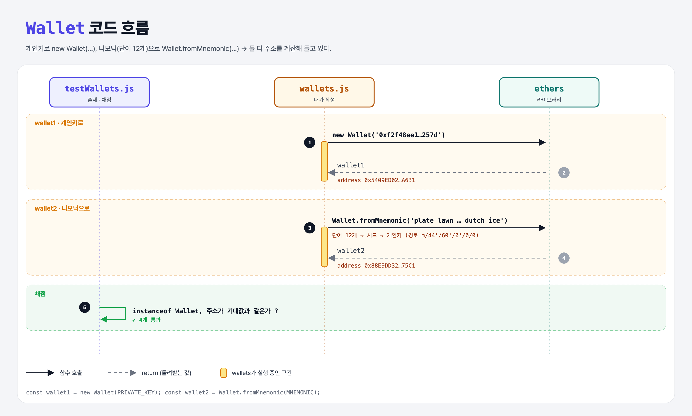

# Making Wallets (Intro to Ethers.js 1단계)

## 문제

ethers.js로 지갑 두 개 만들기.

1. `wallet1`: 개인키 `"0xf2f48ee19680706196e2e339e5da3491186e0c4c5030670656b0e0164837257d"`로
2. `wallet2`: 니모닉 `"plate lawn minor crouch bubble evidence palace fringe bamboo laptop dutch ice"`로

⚠️ 이 키와 단어들은 공개된 연습용이라 메인넷에서 절대 쓰면 안 된다. 공개된 키의 주소는 봇이 감시하고 있어서 돈을 넣으면 몇 초 안에 사라진다.

## 한 줄 요약

`new Wallet(개인키)` / `Wallet.fromMnemonic(단어들)` — 지갑은 개인키를 들고 주소를 계산해 둔다.



---

## 0. 이 과제가 말하려는 것

> **1주차에 손으로 했던 일(개인키 → 공개키 → 주소, 서명)을 ethers.js가 한 번에 해 준다.**

```
[지갑] → 거래 서명 → 네트워크 연결 → nonce → 잔액 → 기부하기
 ★ 이 단계  ethers-sign  ethers-connect  ethers-nonce  ethers-balance  ethers-donate
```

- **니모닉**(mnemonic): 개인키를 사람이 적어 둘 수 있게 단어 12~24개로 바꾼 것. 지갑 앱의 "복구 문구"가 이것이다. 단어 → 시드 → 정해진 경로(`m/44'/60'/0'/0/0`)로 개인키를 만든다.

---

## 1. 파일 구성

| 파일 | 역할 |
|------|------|
| `wallets.js` | **지갑 두 개 만들기** |
| `testWallets.js` | 출제 · 채점 (테스트 4개) |

---

## 2. 정답 코드

```js
const wallet1 = new Wallet("0xf2f48ee19680706196e2e339e5da3491186e0c4c5030670656b0e0164837257d");
const wallet2 = Wallet.fromMnemonic("plate lawn minor crouch bubble evidence palace fringe bamboo laptop dutch ice");
```

- `new Wallet(...)`은 생성자, `Wallet.fromMnemonic(...)`은 **정적 메서드**(클래스에 붙은 함수, Python의 `@classmethod`).

---

## 3. test 한 줄씩

```js
assert(wallet1 instanceof Wallet);
assert.equal(wallet1.address, "0x5409ED021D9299bf6814279A6A1411A7e866A631");   // 3주차 JSON-RPC 테스트 계정과 같은 주소
assert.equal(wallet2.address, "0x88E9DD325BA8329dDD9825c1d24e8470b25575C1");
```

- 주소의 대소문자 섞임은 체크섬 표기(EIP-55)다 (key-to-address 과제 참고).

---

## 4. 일부러 틀려 보면

| 바꾼 것 | 결과 |
|---------|------|
| 니모닉 마지막 단어를 바꿈 | 니모닉 안의 체크섬이 안 맞아 `invalid checksum` 에러 |

---

## 5. 실행 방법

```bash
npx mocha week3/ethers-wallets/testWallets.js
```

## 기억할 것

1. 지갑 = 개인키 + 그걸로 계산한 주소 + 서명 기능.
2. 니모닉도 개인키만큼 위험하다.
