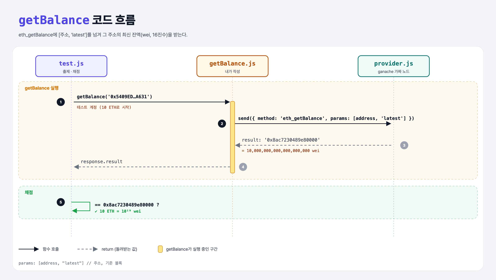

# Get Balance (JSON-RPC Requests 2단계)

## 문제

`getBalance(address)`가 `eth_getBalance`로 그 주소의 잔액을 받아 돌려주게 하기. 기준 블록은 가장 최근(`"latest"`).

## 한 줄 요약

`params: [address, "latest"]` — 주소와 "어느 시점의 잔액인지"를 함께 넘긴다.



---

## 0. 이 과제가 말하려는 것

> **이더리움은 계정 모델이라 주소마다 잔액이 바로 적혀 있다. 블록 시점을 골라 과거 잔액도 물을 수 있다.**

```
block-number → [잔액] → nonce → 블록의 거래 수 → 묶음 요청
                ★ 이 단계
```

| 블록 태그 | 뜻 |
|-----------|-----|
| `"latest"` | 가장 최근 채굴된 블록 |
| `"pending"` | 아직 채굴 전인 거래까지 반영 |
| `"earliest"` | 0번 블록 |
| `"safe"`, `"finalized"` | 되돌려질 가능성이 낮은/없는 블록 |
| `"0x10"` | 특정 블록 번호 |

- 잔액 단위는 **wei**. 1 ETH = 10¹⁸ wei.

---

## 1. 파일 구성

| 파일 | 역할 |
|------|------|
| `getBalance.js` | **이번에 완성할 함수** |
| `provider.js` | 10 ETH를 가진 테스트 계정이 있는 가짜 노드 |
| `promisify.js` | 콜백 → Promise 도우미 |
| `test.js` | 출제 · 채점 (테스트 1개) |

---

## 2. 정답 코드

```js
async function getBalance(address) {
    const response = await provider.send({
        jsonrpc: "2.0",
        id: 1,
        method: "eth_getBalance",
        params: [address, "latest"],
    });

    return response.result;
}
```

---

## 3. test.js 한 줄씩

```js
const balance = await getBalance("0x5409ED021D9299bf6814279A6A1411A7e866A631");
assert.equal(balance, 0x8ac7230489e80000);   // 16진수 숫자 = 10000000000000000000 = 10 ETH
```

- `0x8ac7230489e80000`는 JS의 16진수 **숫자** 리터럴, 응답은 같은 값의 **문자열** `'0x8ac7230489e80000'`. `==` 비교라 통과한다.

---

## 4. 일부러 틀려 보면

| 바꾼 것 | 결과 |
|---------|------|
| `params: [address]` (블록 태그 빠짐) | ganache는 `"latest"`로 알아서 처리해서 통과한다. 하지만 규격상 필수 인자라 다른 노드에서는 에러가 날 수 있으니 항상 넣는다 |

---

## 5. 실행 방법

```bash
npx mocha week3/get-balance/test.js --exit
```

## 로컬 실행 환경 메모

강의 사이트는 `ganache-core`(옛 이름)를 쓴다. 로컬에서는 같은 역할을 하는 최신 패키지 `ganache@7`을 설치했고, 사이트에서 숨겨져 있던 `promisify.js`는 같은 역할로 직접 만들었다. 새 ganache는 계정 잔액을 **16진수 문자열**로만 받아서, provider.js의 잔액 값만 같은 값의 16진수로 바꿨다. 정답 코드(내가 작성한 파일)는 사이트와 똑같다.

ganache가 백그라운드 연결을 열어 두기 때문에 테스트가 끝나도 프로세스가 안 끝날 수 있다. 그래서 `--exit`를 붙여 실행한다.

## 기억할 것

1. `eth_getBalance` params = [주소, 블록 태그].
2. 단위는 wei (1 ETH = 10¹⁸ wei).
