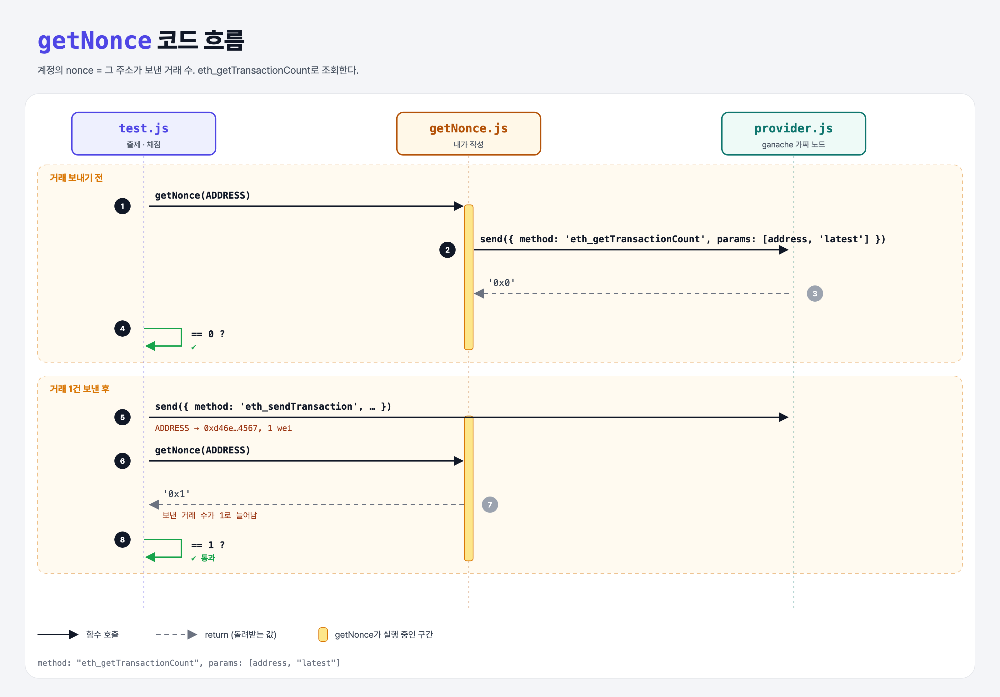

# Transaction Nonce (JSON-RPC Requests 3단계)

## 문제

`getNonce(address)`가 그 주소의 **nonce**(보낸 거래 수)를 돌려주게 하기. 어떤 메서드를 쓸지 직접 찾아야 한다 → `eth_getTransactionCount`.

## 한 줄 요약

nonce = 그 주소가 지금까지 보낸 거래 수. 거래를 보낼 때마다 1씩 늘어난다.



---

## 0. 이 과제가 말하려는 것

> **서명된 거래는 누구나 볼 수 있다. 누가 그걸 복사해 다시 보내도(재전송 공격) nonce가 이미 쓰였으면 네트워크가 거부한다.**

```
block-number → get-balance → [nonce] → 블록의 거래 수 → 묶음 요청
                              ★ 이 단계
```

- 1주차 ECDSA 프로젝트에서 "가로챈 서명을 다시 보내면?"이라는 질문의 답이 이것이다.
- 1주차 작업 증명의 nonce(해시를 바꾸려고 넣는 숫자)와는 **이름만 같고 다른 것**이다.

---

## 1. 파일 구성

| 파일 | 역할 |
|------|------|
| `getNonce.js` | **이번에 완성할 함수** |
| `provider.js`, `promisify.js` | get-balance와 같음 |
| `test.js` | 출제 · 채점 (테스트 2개) |

---

## 2. 정답 코드

```js
async function getNonce(address) {
    const response = await provider.send({
        jsonrpc: "2.0",
        id: 1,
        method: "eth_getTransactionCount",
        params: [address, "latest"],
    });

    return response.result;
}
```

---

## 3. test.js 한 줄씩

```js
assert.equal(await getNonce(ADDRESS), 0);     // 처음엔 0

provider.send({ method: "eth_sendTransaction",
    params: [{ from: ADDRESS, to: "0xd46e…4567", value: 0x1 }] });   // 1 wei 보내기

assert.equal(await getNonce(ADDRESS), 1);     // 보낸 거래 1건 → 1
```

- `eth_sendTransaction`은 노드가 그 계정의 개인키를 갖고 있을 때만 된다 (ganache 테스트 계정이라 가능). 실제로는 지갑이 서명해서 `eth_sendRawTransaction`으로 보낸다.

---

## 4. 일부러 틀려 보면

| 바꾼 것 | 결과 |
|---------|------|
| `eth_getBalance`를 씀 | 잔액(10 ETH)이 나와서 실패 |

---

## 5. 실행 방법

```bash
npx mocha week3/get-nonce/test.js --exit
```

## 로컬 실행 환경 메모

강의 사이트는 `ganache-core`(옛 이름)를 쓴다. 로컬에서는 같은 역할을 하는 최신 패키지 `ganache@7`을 설치했고, 사이트에서 숨겨져 있던 `promisify.js`는 같은 역할로 직접 만들었다. 새 ganache는 계정 잔액을 **16진수 문자열**로만 받아서, provider.js의 잔액 값만 같은 값의 16진수로 바꿨다. 정답 코드(내가 작성한 파일)는 사이트와 똑같다.

ganache가 백그라운드 연결을 열어 두기 때문에 테스트가 끝나도 프로세스가 안 끝날 수 있다. 그래서 `--exit`를 붙여 실행한다.

## 기억할 것

1. 계정 nonce = 보낸 거래 수 = `eth_getTransactionCount`.
2. nonce가 재전송 공격을 막는다.
