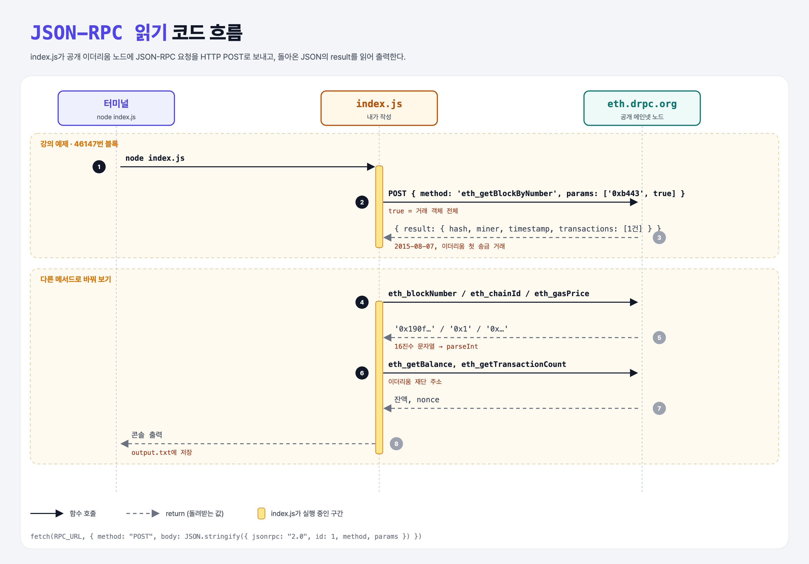

# Activity: JSON-RPC Read Requests (Activity: Query Ethereum)

## 활동 내용

진짜 이더리움 노드에 **JSON-RPC 읽기 요청**을 보내 보기.

1. 강의 예제: 메인넷 **46147번 블록**(`0xb443`)을 `eth_getBlockByNumber`로 가져온다.
2. 다른 JSON-RPC 메서드로 바꿔서 여러 가지 읽기 요청을 해 본다.

## 한 줄 요약

JSON-RPC = 노드에 `{ jsonrpc, id, method, params }`를 **HTTP POST**로 보내고 `result`를 받는 것. ganache 대신 진짜 메인넷에 해 봤다.



---

## 0. 이 활동이 말하려는 것

> **지금까지 ganache(가짜 노드)로 연습한 요청을 진짜 이더리움 메인넷에 그대로 보낼 수 있다. 읽기 요청은 돈도 키도 들지 않는다.**

- JSON = JavaScript Object Notation, RPC = Remote Procedure Call (원격 함수 호출).
- 강의는 Alchemy 계정을 만들어 받은 내 URL을 쓰라고 한다. 이 폴더는 **키가 필요 없는 공개 노드**(`https://eth.drpc.org`)를 썼다. 오래된 블록(46147)을 읽으려면 과거 기록을 다 가진 노드(archive)여야 해서, 여러 공개 노드 중 이것을 골랐다.

---

## 1. 파일 구성

| 파일 | 역할 |
|------|------|
| `index.js` | 요청을 보내고 결과를 출력하는 스크립트 |
| `output.txt` | 실제로 실행한 결과 (2026-10-26) |

---

## 2. 코드

```js
async function rpc(method, params = []) {
    const response = await fetch(RPC_URL, {
        method: "POST",
        headers: { "Content-Type": "application/json" },
        body: JSON.stringify({ jsonrpc: "2.0", id: 1, method, params }),
    });
    const data = await response.json();
    if (data.error) throw new Error(`${method}: ${data.error.message}`);
    return data.result;
}

const block = await rpc("eth_getBlockByNumber", ["0xb443", true]);
```

- 강의는 `axios.post(...)`를 쓰지만, Node 18부터 기본으로 있는 `fetch`로 같은 일을 했다 (설치 필요 없음).
- Python이라면 `requests.post(RPC_URL, json={...}).json()["result"]`.

| 사용한 메서드 | 얻는 것 |
|---------------|---------|
| `eth_getBlockByNumber` | 블록 정보 (두 번째 인자 `true`면 거래 객체 전체) |
| `eth_blockNumber` | 최신 블록 번호 |
| `eth_chainId` | 네트워크 번호 (1 = 메인넷, 11155111 = Sepolia) |
| `eth_gasPrice` | 현재 가스 가격 |
| `eth_getBalance` | 잔액 (wei) |
| `eth_getTransactionCount` | nonce (보낸 거래 수) |

---

## 3. 실제 결과 (output.txt)

```
block 46147
  hash:         0x4e3a3754410177e6937ef1f84bba68ea139e8d1a2258c5f85db9f1cd715a1bdd
  timestamp:    2015-08-07T03:30:33.000Z
  transactions: 1
  first tx:     from 0xa1e4…63b4 → to 0x5df9…e734 value 3.1337e-14 ETH
```

- 46147번 블록의 이 거래는 **이더리움 역사상 첫 번째 송금 거래**로 알려져 있다. 금액 31337 wei는 해커 은어 "eleet"를 숫자로 쓴 장난이다.
- 이더리움 재단 주소는 nonce가 0이다. 받기만 하고 직접 보낸 적은 없다는 뜻.

---

## 4. 실행 방법

```bash
node week3/json-rpc-read-activity/index.js
RPC_URL=https://eth-mainnet.g.alchemy.com/v2/내키 node week3/json-rpc-read-activity/index.js   # 내 Alchemy URL로
```

## 기억할 것

1. 읽기 요청은 무료, 키 없이도 공개 노드로 가능.
2. 오래된 블록은 archive 노드에서만 읽힌다 (많은 공개 노드가 `pruned history unavailable` 에러).
3. 값은 16진수 문자열 → `parseInt` 또는 `BigInt`.
