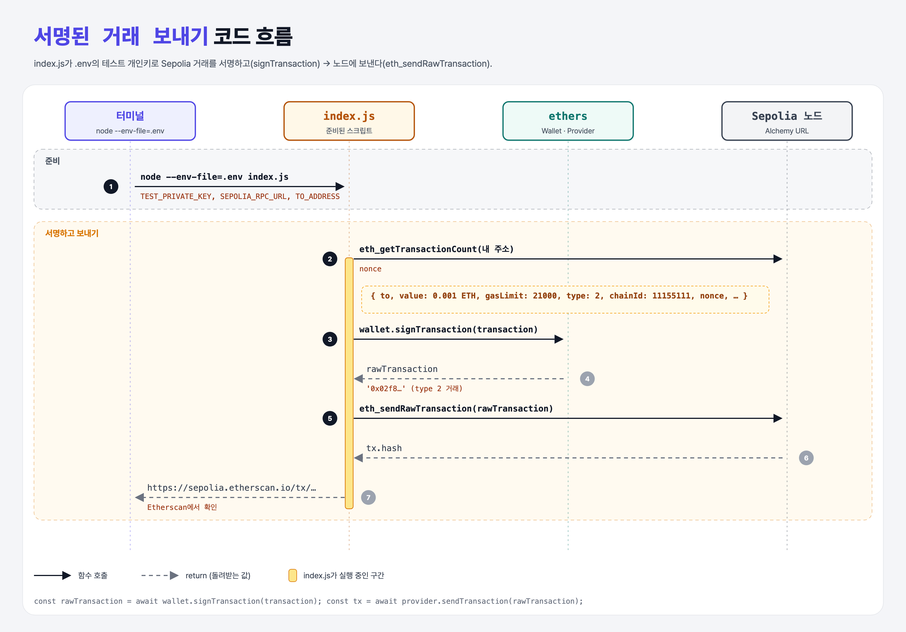

# Activity: Send a Signed Transaction on Sepolia (Code a Transaction)

> ⚠️ **직접 실행해야 하는 활동이다.** 테스트 지갑 개인키, Alchemy API 키, Sepolia 테스트 ETH가 필요해서 스크립트만 준비해 두었다.

## 활동 내용

내 컴퓨터의 스크립트에서 **서명한 거래를 Sepolia 테스트넷에 직접 보내기**. 성공하면 Etherscan에서 내 거래를 볼 수 있다.

## 한 줄 요약

ethers-sign(서명) + ethers-connect(전송)를 **진짜 테스트넷**에서 하는 것.



---

## 0. 이 활동이 말하려는 것

> **지금까지 ganache로 연습한 서명·전송을 실제 네트워크에서 한다. 내 터미널에서 실행한 스크립트가 전 세계 노드가 공유하는 장부에 기록된다.**

- 이 거래는 **Type 2(EIP-1559)** 거래다. ethers-sign의 Type 0(`gasPrice` 하나)과 달리 `maxPriorityFeePerGas`(팁)과 `maxFeePerGas`(최대치)를 나눠 적는다.
- `chainId: 11155111`은 Sepolia 번호. 서명에 체인 번호가 들어가서 다른 체인(메인넷)에서는 같은 서명을 재사용할 수 없다.

---

## 1. 파일 구성

| 파일 | 역할 |
|------|------|
| `index.js` | 서명하고 보내는 스크립트 (강의의 alchemy-sdk 대신 이미 설치된 ethers v5 사용) |
| `.env.example` | 채워야 할 값의 예시. `.env`로 복사해서 쓴다 |

`.env`는 루트 `.gitignore`에 넣어 두어서 GitHub에 올라가지 않는다.

---

## 2. 실행 방법

1. **테스트 전용 지갑**을 준비한다 (MetaMask 새 계정 등). 진짜 돈이 든 지갑은 쓰지 않는다.
2. [Sepolia faucet](https://www.alchemy.com/faucets/ethereum-sepolia)에서 테스트 ETH를 받는다.
3. [Alchemy](https://www.alchemy.com/) 대시보드에서 Sepolia 앱을 만들고 HTTPS URL을 복사한다.
4. `.env` 만들기:

   ```bash
   cp week3/sign-tx-activity/.env.example week3/sign-tx-activity/.env
   # .env를 열어 세 값을 채운다
   ```

5. 실행:

   ```bash
   node --env-file=week3/sign-tx-activity/.env week3/sign-tx-activity/index.js
   ```

6. 출력된 `https://sepolia.etherscan.io/tx/…` 링크에서 거래를 확인하고, 강의 페이지에서 **Mark Complete**를 누른다.

---

## 3. 코드

```js
const provider = new providers.JsonRpcProvider(SEPOLIA_RPC_URL);
const wallet = new Wallet(TEST_PRIVATE_KEY, provider);
const nonce = await provider.getTransactionCount(wallet.address, "latest");

const transaction = {
    to: TO_ADDRESS,
    value: utils.parseEther("0.001"),
    gasLimit: 21000,
    maxPriorityFeePerGas: utils.parseUnits("5", "gwei"),
    maxFeePerGas: utils.parseUnits("20", "gwei"),
    nonce,
    type: 2,
    chainId: 11155111,
};

const rawTransaction = await wallet.signTransaction(transaction);
const tx = await provider.sendTransaction(rawTransaction);
```

| 강의 (alchemy-sdk) | 이 폴더 (ethers v5) |
|---|---|
| `new Alchemy({ apiKey, network })` | `new providers.JsonRpcProvider(URL)` |
| `alchemy.core.getTransactionCount` | `provider.getTransactionCount` |
| `alchemy.core.sendTransaction` | `provider.sendTransaction` |
| `require('dotenv').config()` | `node --env-file=.env` (Node 20.6+ 기본 기능) |

## 기억할 것

1. 개인키는 `.env`에만, `.env`는 절대 git에 올리지 않는다.
2. Type 2 거래 = 팁 + 최대 수수료를 따로 적는다.
3. chainId가 서명에 들어가서 다른 체인에서 재사용할 수 없다.
