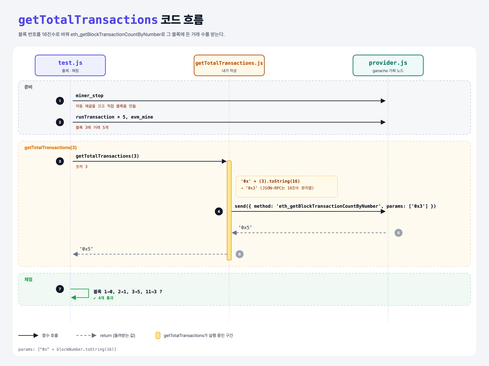

# Block Transactions (JSON-RPC Requests 4단계)

## 문제

`getTotalTransactions(blockNumber)`가 그 블록에 든 **거래 수**를 돌려주게 하기.

## 한 줄 요약

`eth_getBlockTransactionCountByNumber`에 블록 번호를 **16진수 문자열**로 넘긴다. (`3` → `"0x3"`)



---

## 0. 이 과제가 말하려는 것

> **블록에 들어가는 거래 수는 블록 가스 한도가 정한다. 단순 송금은 21,000 가스라서, 목표 1,500만 가스 블록에 약 714건이 들어간다.**

```
… → get-nonce → [블록의 거래 수] → 묶음 요청
                 ★ 이 단계
```

- **거래 가스 한도**(보내는 사람이 정하는 최대치)와 **블록 가스 한도**(블록 전체의 최대치)는 다르다.

---

## 1. 파일 구성

| 파일 | 역할 |
|------|------|
| `getTotalTransactions.js` | **이번에 완성할 함수** |
| `provider.js`, `promisify.js` | get-balance와 같음 |
| `test.js` | 출제 · 채점 (테스트 4개) |

---

## 2. 정답 코드

```js
async function getTotalTransactions(blockNumber) {
    const response = await provider.send({
        jsonrpc: "2.0",
        id: 1,
        method: "eth_getBlockTransactionCountByNumber",
        params: ["0x" + blockNumber.toString(16)],
    });

    return response.result;
}
```

- `(11).toString(16)` → `"b"`. Python의 `hex(11)` → `'0xb'`.
- 대신 `eth_getBlockByNumber`로 블록 전체를 받아 `result.transactions.length`를 세도 된다. 이번 방법은 개수만 받아서 더 가볍다.

---

## 3. test.js 한 줄씩

```js
provider.send({ method: "miner_stop" });     // ganache 자동 채굴 끄기 → 거래를 모았다가 한 번에 블록으로

// 블록 1: 거래 0건 / 블록 2: 1건 / 블록 3: 5건 / 블록 4~10: 빈 블록 / 블록 11: 3건
const length = await getTotalTransactions(3);
assert.equal(length, 5);                     // '0x5' == 5
```

---

## 4. 일부러 틀려 보면

| 바꾼 것 | 결과 |
|---------|------|
| `params: [blockNumber]` (숫자 그대로) | ganache는 숫자도 받아 줘서 통과한다. 하지만 규격은 16진수 문자열이라 실제 노드에서는 에러가 날 수 있다 |
| `blockNumber.toString()` (10진수 문자열) | `Cannot wrap string value "3" as a json-rpc type; strings must be prefixed with "0x"` 에러 |

---

## 5. 실행 방법

```bash
npx mocha week3/total-transactions/test.js --exit
```

## 로컬 실행 환경 메모

강의 사이트는 `ganache-core`(옛 이름)를 쓴다. 로컬에서는 같은 역할을 하는 최신 패키지 `ganache@7`을 설치했고, 사이트에서 숨겨져 있던 `promisify.js`는 같은 역할로 직접 만들었다. 새 ganache는 계정 잔액을 **16진수 문자열**로만 받아서, provider.js의 잔액 값만 같은 값의 16진수로 바꿨다. 정답 코드(내가 작성한 파일)는 사이트와 똑같다.

ganache가 백그라운드 연결을 열어 두기 때문에 테스트가 끝나도 프로세스가 안 끝날 수 있다. 그래서 `--exit`를 붙여 실행한다.

## 기억할 것

1. JSON-RPC의 숫자 인자는 `"0x…"` 16진수 문자열.
2. `n.toString(16)` = Python `hex(n)`에서 `0x`를 뺀 것.
