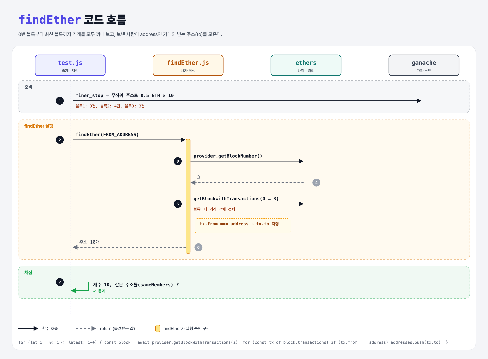

# Where is the Ether?

## 문제

`findEther(address)`: 그 주소가 ether를 보낸 **모든 받는 주소**를 배열로 돌려주기. 테스트는 블록 3개에 걸쳐 무작위 주소 10곳으로 보낸다.

## 한 줄 요약

0번 블록부터 최신 블록까지 `getBlockWithTransactions`로 거래를 다 꺼내서, `from`이 그 주소인 거래의 `to`를 모은다.



---

## 0. 이 과제가 말하려는 것

> **블록체인의 모든 거래는 공개되어 있다. 블록을 처음부터 훑으면 누가 누구에게 보냈는지 다 찾을 수 있다. 블록 탐색기(Etherscan)가 하는 일의 기본.**

---

## 1. 파일 구성

| 파일 | 역할 |
|------|------|
| `findEther.js` | **이번에 완성할 함수** |
| `config.js` | 10 ETH 테스트 계정이 있는 ganache |
| `test.js` | 출제 · 채점 (테스트 1개) |

---

## 2. 정답 코드

```js
async function findEther(address) {
    const addresses = [];
    const latest = await provider.getBlockNumber();
    for (let i = 0; i <= latest; i++) {
        const block = await provider.getBlockWithTransactions(i);
        for (const tx of block.transactions) {
            if (tx.from === address) {
                addresses.push(tx.to);
            }
        }
    }
    return addresses;
}
```

| 코드 | 설명 |
|------|------|
| `getBlock(i)` | 거래 **해시**만 들어 있음 |
| `getBlockWithTransactions(i)` | 거래 **객체 전체**(from, to, value…)가 들어 있음 |
| `tx.from === address` | ethers가 주소를 체크섬 형식으로 통일해 줘서 문자열 비교가 된다 |

---

## 3. test 한 줄씩

```js
stopMiner();                                        // 자동 채굴 끄기
for (; i < 3; i++) await sendEther(i);  await mineBlock();    // 블록 1: 3건
for (; i < 7; i++) await sendEther(i);  await mineBlock();    // 블록 2: 4건
for (; i < 10; i++) await sendEther(i); await mineBlock();    // 블록 3: 3건

const address = Wallet.createRandom().address;      // 매번 새로운 무작위 주소
assert.sameMembers(actual, expected);               // 순서 상관없이 같은 원소들인가
```

- 자동 채굴을 꺼서 거래 여러 건이 한 블록에 모이게 하고, `nonce: i`를 직접 넣는다.

---

## 4. 일부러 틀려 보면

| 바꾼 것 | 결과 |
|---------|------|
| `getBlock(i)` 사용 | `tx`가 해시 문자열이라 `tx.from`이 `undefined` → 0개 |
| `i < latest` | 마지막 블록을 빼먹어 3개 모자람 |

---

## 5. 실행 방법

```bash
npx mocha week3/where-is-the-ether/test.js --exit
```

## 로컬 실행 환경 메모

강의 사이트에서 숨겨져 있던 `config.js`는 같은 역할로 직접 만들었다. 테스트 계정(개인키 `0xf2f48ee1…257d`, 주소 `0x5409ED02…A631`)에 10 ETH를 넣은 ganache 가짜 노드를 만든다. 강의는 `ganache-core`, 로컬은 최신 `ganache@7`을 쓴다. 정답 코드는 사이트와 같다. ethers는 강의와 같은 **5.x**(`ethers@5.7.2`)를 설치했다 (6.x는 사용법이 달라서 이 코드가 동작하지 않는다).

## 기억할 것

1. 모든 거래는 공개 → 블록을 훑으면 추적 가능.
2. 거래 객체까지 필요하면 `getBlockWithTransactions`.
