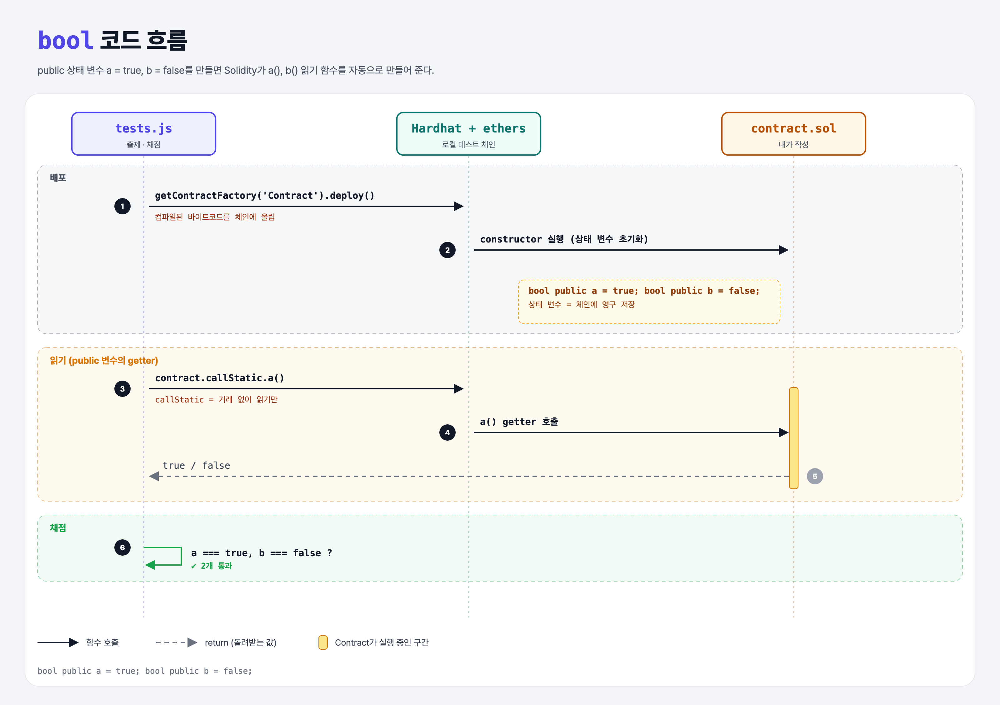

# Booleans (Data Types 1단계)

## 문제

컨트랙트에 **public bool 상태 변수** 두 개 만들기: `a` = `true`, `b` = `false`.

## 한 줄 요약

`bool public a = true;` — 상태 변수는 체인에 영구 저장되고, `public`을 붙이면 같은 이름의 읽기 함수가 자동으로 생긴다.



### 다이어그램 읽는 법

| 구간 | 일어나는 일 |
|------|-------------|
| 배포 | 테스트가 컨트랙트를 로컬 체인에 배포 → 상태 변수 초기화 |
| 읽기 | `callStatic.a()`로 자동 생성된 getter를 호출해 값을 읽음 |
| 채점 | a는 true, b는 false |

---

## 0. 이 과제가 말하려는 것

> **스마트 컨트랙트 = 체인 위에 사는 프로그램. 상태 변수는 그 프로그램의 영구 저장소다. 한 거래에서 바꾸면 이후 모든 사람이 바뀐 값을 읽는다.**

```
[bool] → uint → int → 문자열 → enum
 ★ 이 단계  unsigned-integers  signed-integers  string-literals  enum-type
```

- 4주차부터는 **Solidity**로 컨트랙트를 쓰고, JS 테스트로 채점한다.
- 기본값: 선언만 하면 bool은 `false`, 숫자는 `0`.
- **ABI Validations**: 사이트의 체크 표시는 컴파일 결과(ABI)에 `a()`, `b()` 함수가 생겼는지 확인한 것이다.

---

## 1. 파일 구성

| 파일 | 역할 |
|------|------|
| `contract.sol` | **이번에 완성할 컨트랙트** |
| `tests.js` | 출제 · 채점 (테스트 2개) |

---

## 2. 정답 코드

```solidity
// SPDX-License-Identifier: MIT
pragma solidity ^0.8.4;

contract Contract {
    bool public a = true;
    bool public b = false;
}
```

| 코드 | 설명 |
|------|------|
| `// SPDX-License-Identifier: MIT` | 라이선스 표시 (없으면 컴파일 경고) |
| `pragma solidity ^0.8.4;` | 0.8.4 이상 0.9 미만 컴파일러로 컴파일 |
| `contract Contract { }` | 클래스와 비슷한 컨트랙트 선언 |
| `bool public a = true;` | 타입 → 공개 여부 → 이름 → 초기값 순서. 문장 끝에 `;` 필수 |

Python과 비교하면 `a: bool = True`처럼 **타입을 반드시 먼저 적는** 언어다.

---

## 3. tests.js 한 줄씩

```js
const Contract = await ethers.getContractFactory("Contract");   // 컴파일된 컨트랙트 가져오기
contract = await Contract.deploy();                             // 로컬 체인에 배포 (거래)
await contract.deployed();                                      // 배포 완료 기다리기
const a = await contract.callStatic.a();                        // a() 호출 (읽기만, 거래 X)
assert.equal(a, true);
```

- `ethers`를 `require` 하지 않았는데 쓸 수 있는 건 Hardhat이 전역으로 넣어 주기 때문이다.

---

## 4. 일부러 틀려 보면

| 바꾼 것 | 결과 |
|---------|------|
| `public`을 빼먹음 | getter가 안 생겨서 `contract.callStatic.a is not a function` |
| `bool b;` (초기값 생략) | 기본값 false라서 그래도 통과 |

---

## 5. 실행 방법

```bash
sh tools/sol-test.sh week4/booleans
```

## 로컬 실행 환경 메모

강의 사이트는 브라우저 안에서 Hardhat으로 컴파일·테스트한다. 로컬에서도 똑같이 하려고 루트에 Hardhat(`hardhat@2.22`, `@nomiclabs/hardhat-ethers@2` = ethers v5)을 설치하고 `hardhat.config.js`를 만들었다. `STAGE` 환경 변수로 단계 폴더를 골라 그 폴더의 `.sol`만 컴파일한다. 테스트 파일의 전역 `ethers`는 Hardhat이 넣어 준다.

## 기억할 것

1. 상태 변수 = 체인에 영구 저장.
2. `public` → 자동 getter.
3. 기본값: bool false, 숫자 0.
